# KVMend: A Correctness Watchdog for the KV Cache in LLM Serving

*KVMend is a working name.*

## Abstract

**Problem.** An LLM server keeps the attention keys and values of every token, the KV cache, in GPU memory. If some of these bytes change silently, the model keeps answering, fluently but wrongly, and no error is raised.

This has happened in production. In 2026, a Cloudflare deployment of SGLang served 155 answers computed from the wrong KV, each with a normal HTTP 200 reply.

**Gap.** LLM servers already run watchdogs, but only for liveness: SGLang crashes the server when one step hangs for 300 s. Fault-tolerant systems such as GhostServe act only after a GPU fails and is reported.

Nothing watches whether the KV cache is still correct, so silent damage reaches users as wrong answers.

**Idea.** We propose KVMend, a correctness watchdog for the KV cache. Such damage is rare, so KVMend keeps its always-on part cheap and does real work only when a check fails.
- **Watch:** every small piece of the cache gets a 4-byte checksum, a tag, checked whenever its KV is reused, copied, or about to reach a user who asked for checked output.
- **Mend:** KVMend recomputes only the damaged pages and redoes only the tokens computed since they were last seen correct.
- **Guard, an option:** a request can ask that none of its tokens leave the server before a check covers what they read.
- **Parity, an option:** a compact backup in host memory rebuilds a damaged piece exactly, which pays off for bursts of damage.

**Evidence.** A proof of concept on SGLang catches three kinds of damage modelled on the incident; a fence modelled in the test drops the fourth.

On Llama-3.1-8B at TP=8 it repaired a 32K-token request in 0.5 to 1.3 s, where abort and retry took about 14 s.

A retry that keeps the undamaged part of the prompt is a stronger rival. For a late write early in the prompt, after a passing check, the repair was about 12 times faster: 1.00 s against 11.87 s.

A page never written early in the prompt cost about as much as that retry, 8.96 s against 11.19 s, because KVMend must also recompute the later prompt chunks that may have read it. Near the end of the prompt, both are cheap.

On one A100, keeping its tags cost 1.5% of Llama-3.1-8B's fault-free throughput, and 3.2% on decode-heavy work. Checking them inside decode attention cost at most 1.2% more, on 8 GPUs.

Such a check found a late write at the next decode step and repaired it in 89 ms on Llama-3.1-8B; with the check only logging, the text went wrong.

With the guard, a streaming client received none of the 78 wrong tokens that a server with no checks sent. With 64 requests arriving over time and four faults, 56 outputs were right, against 36 with no checks.

## 1 Introduction

### 1.1 Motivation: silent damage gives wrong answers with no error

When an LLM generates text, each new token attends to every earlier token. To avoid recomputing them, the server stores each earlier token's attention keys and values, the KV cache, in GPU memory.

A long request holds gigabytes of KV, and every new token reads all of it. So if a few KV bytes change silently, every later token is computed from wrong data.

The model does not crash. It keeps producing fluent text, and the server reports success. The user cannot tell that the answer is wrong.

This is not hypothetical. Between 27 August and 9 September 2026, a Cloudflare deployment on SGLang served 155 responses computed from KV pages that were never written for them [1].

The SGLang team wrote that "each occurrence was silent. The transfer reported success, and no component raised an exception or logged an error" [2]. Clients received normal HTTP 200 replies [1].

KV can go bad in several ways (§2.3). Memory errors can flip bits on GPUs without ECC (error-correcting memory). Copies between GPU memory and host memory, the CPU's RAM, can fail or land only in part.

Bugs can also let one request write into memory that was already given to another request.

Such damage is rare. The incident touched 155 responses in two weeks, all to prompts longer than 681,280 tokens [1]. On GPUs with ECC, memory errors are reported, not silent [3].

But when it happens it is silent, and every path that moves KV between GPUs, host memory and machines is one more place for it. So a watchdog for it must cost almost nothing while nothing is wrong.

### 1.2 The gap: what today's systems cannot do

Serving engines already run watchdogs, but they watch liveness, not correctness. SGLang crashes the server when one forward step takes longer than 300 s [4].

vLLM stops waiting for a step after 300 s when a model spans several GPUs [5], and orchestrators restart a server that fails its health check [6]. None of these looks at the values a server computes with.

Fault-tolerant serving systems protect the KV cache against GPUs and workers that fail [7, 8, 9]. They keep copies or checkpoints of the KV, and restore a failed GPU's share once the failure is reported.

GhostServe, the closest system, keeps parity, a compact backup, of each request's KV in host memory [10]. It even names "silent data corruptions" among the faults it targets.

Yet its recovery starts only after something else reports that a specific GPU failed. The paper, which we read in full, describes no check that would find or locate silent damage [10].

Some checks exist, but they are narrow. SGLang now checksums KV only while it moves between machines, and aborts the request on a mismatch [2]. Another design checks shared prefix blocks only when they are scheduled [11].

Cloudflare's own write-up asks for checks on "every read, including reads long after the transfer" [1]. None of the serving systems we reviewed (§3) offers this.

Together, today's systems leave three gaps:

1. **Nobody watches correctness.** No system we reviewed is described as checking KV continuously while it sits in GPU memory, so damage can stay silent for as long as the request runs.
2. **Nothing stops wrong tokens from leaving.** Every token computed after the damage read the bad KV, and servers send each token to the user as soon as it is computed.
3. **Recovery is all or nothing.** Except for prefix blocks checked at scheduling time, none of them names the damaged bytes, so they abort the request, recompute all of it, or rebuild a whole GPU.
   They also ignore what the damage reached: the KV of every later token, and finished requests' KV left in the prefix cache, where later requests reuse it.

### 1.3 Our idea: a correctness watchdog

**KVMend is a correctness watchdog for the KV cache: it watches every piece cheaply, mends only what the damage reached, and, for requests that ask, guards what leaves the server.**

An everyday analogy is a long report written by hand, with an editor who keeps checking its pages.

If one page gets a coffee stain, the editor rewrites that page and only what was written after it was last seen clean. For an important report, the editor also holds each page until it is checked.

The three jobs use a few terms, defined in Table 1 and in more detail in §2.

*Table 1. Terms used in the rest of this proposal.*

| Term            | Meaning                                                                                                                                            |
| --------------- | -------------------------------------------------------------------------------------------------------------------------------------------------- |
| page            | 16 consecutive tokens of a request; the engine stores KV page by page                                                                              |
| piece           | one page of one model layer on one GPU; 8 KiB in our setup                                                                                         |
| tag             | a 4-byte checksum of one piece, computed when the piece is written                                                                                 |
| parity          | an optional compact backup in host memory: with the same piece from the other GPUs, it rebuilds a lost piece exactly                               |
| scrub           | a background check that keeps re-reading the cache and comparing tags                                                                              |
| last good check | the most recent check that found a piece correct                                                                                                   |
| suspect tokens  | tokens computed after a piece's last good check; they may have read the damage                                                                     |
| prefill, decode | prefill computes the KV of all prompt tokens in one pass; decode then adds one token per step                                                      |
| re-prefill      | recompute the KV of tokens that already exist, in one pass                                                                                         |
| strict release  | for a request that asks: no token leaves the server before a check covers what it read; under fast release, the default, each token leaves at once |

KVMend has three jobs, one for each gap (Table 2):

1. **Watch.** Every piece gets a tag when it is written. Checks recompute the tag from the stored bytes when KV is reused, copied or released; a mismatch names the exact piece: page, layer and GPU.
2. **Guard, an option.** For a request that asks for it, no token reaches the user before a check covers every piece it read (§4.5). Other requests get each token at once, as today.
3. **Mend.** KVMend recomputes only the damaged page's 16 tokens, from the intact KV before them; with the optional parity, it rebuilds a damaged piece exactly instead (§4.4).
   Only the suspect tokens could have read the damage, so KVMend redoes just those tokens and drops cached KV computed after the last good check.

*Table 2. The three gaps and the watchdog job that closes each.*

| Gap                              | What happens today                                         | KVMend job                                                                                                                                 | Section    |
| -------------------------------- | ---------------------------------------------------------- | ------------------------------------------------------------------------------------------------------------------------------------------ | ---------- |
| 1. Nobody watches correctness    | wrong answers with HTTP 200                                | **watch**: a tag on every piece, checked before reuse, after risky events, before release and by a light scrub; a mismatch names the piece | §4.3       |
| 2. Wrong tokens leave the server | each token is sent as soon as it is computed               | **guard**, for requests that ask: release no token before a check covers what it read; redo the tokens held back                           | §4.5       |
| 3. Recovery is all or nothing    | abort, recompute the whole request, or rebuild a whole GPU | **mend**: recompute the page the tag named, or rebuild it from optional parity; redo only the suspect tokens; evict suspect cached KV      | §4.4, §4.5 |

Figure 1 shows the running example that we use throughout. Request R has a 32,768-token prompt and finishes its prefill at server step 9,000. Then the scrub finds page 64 (tokens 1,024–1,039) correct.

Some time later, page 64 is damaged in layer 12 on GPU 2. By step 9,040, R has decoded 40 more tokens, and the scrub finds the damage.

With no checks, R keeps answering from the bad data (Figure 1b). A system that only noticed the damage could not say where it is, so it would abort R or re-prefill all 32,808 tokens: the prompt plus 40 new tokens.

KVMend's watchdog catches the damaged piece by its tag; KVMend recomputes that one page's 16 tokens, and re-prefills only R's 40 suspect tokens (Figure 1c).

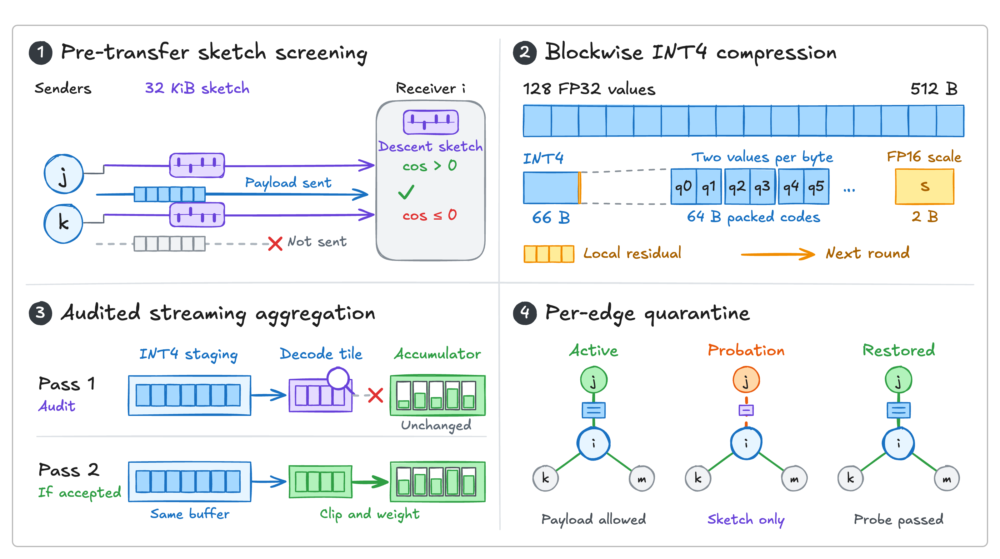

*Figure 1. The running example: request R and one damaged page of its KV cache on GPU 2, drawn for four GPUs.*

*(a) R's next token reads every page in every layer, and every piece matches its tag.*

*(b) One piece goes bad. Every new token reads it, its tag no longer matches, and R still answers with HTTP 200.*

*(c) KVMend (1) watches: the tag check names the piece; then it mends: (2) recomputes page 64 from the intact pages before it, and (3) redoes R's 40 suspect tokens.*

Almost all of the saving comes from redoing only the suspect tokens: KVMend recomputes 56 tokens instead of 32,808. Optional parity would save the page's own 16; it matters only when many pages are damaged at once (§4.4).

### 1.4 Contributions

This project makes four contributions:

1. **A cheap watchdog for correctness.** A tag on every piece, keyed by its tokens and computed from the values each writer stores, and checks at the moments KV is reused, copied or released.
2. **An optional guard on the output.** For requests that ask for it, a release rule that sends no token before a check covers every piece it read, and regenerates the tokens it held back.
3. **Mending only what the damage reached.** A recompute, in place, of just the damaged page's 16 tokens; then only the tokens computed since the last good check are redone, and cached KV from that window is evicted.
   Optional parity, across GPUs or within each GPU, rebuilds a damaged piece exactly, which pays off for bursts of damage.
4. **An evaluation plan.** Fault injection on 8 A100 GPUs that measures detection, repair work and overhead against today's responses and against KVMend with parts removed.

A proof of concept on our server catches three kinds of damage modelled on the incident, each by the part of the check built for it; a fence modelled in the test drops the fourth.

On one A100 its tags cost 1.5% to 3.2% of Llama-3.1-8B's throughput, and on 8 GPUs its checks inside decode attention added at most 1.2% (§7.3).

It repaired a 32K-token request in 0.5 to 1.3 s, where abort and retry took about 14 s. Against a retry that keeps the clean prefix, it was about 12 times faster for a late write at page 64, after a passing check.

A page never written in the first prompt chunk cost it nearly as much as that retry, because the later chunks are recomputed too (§7.5). Near the end of the prompt, both are cheap.

On both models, strict release sent none of the 78 wrong tokens that a server with no checks streamed. With requests arriving over time, it returned 56 of 64 right outputs, against 36 with no checks (§7.9).

Section 9 answers the question we expect most: why not a simpler fix, such as ECC, a checksum on transfers, or abort and retry.

## 2 Background

### 2.1 The KV cache in pages, pieces, slots and stripes

Each layer turns every token into a key vector and a value vector per attention head. Serving engines such as SGLang and vLLM store this KV cache in fixed-size pages [12, 13].

We use 16-token pages. With tensor parallelism (TP) over N GPUs, each GPU holds the KV of its own attention heads, so every page has one part per layer on every GPU (Figure 2).

We call one page of one layer on one GPU a **piece**. For Llama-3.1-8B and the 32B model, one token's KV in one layer is 4 KiB across all GPUs, so at TP=8 a piece is 8 KiB.

A **slot** is the place of one page in the KV pool. A request's token-to-slot table maps its tokens to slots, and one slot index serves every layer on every GPU.

A **stripe** is the same piece on every GPU, plus its parity in host memory: one piece for XOR, K pieces for Reed–Solomon (§2.2).

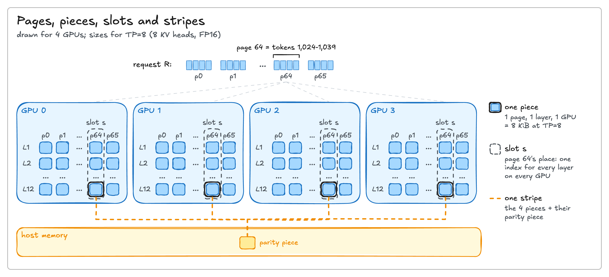

*Figure 2. The KV cache in pages, pieces, slots and stripes, drawn for four GPUs with sizes for TP=8.*

SGLang's radix cache keeps the pages of finished requests, so later requests with the same prefix can reuse them. Pages therefore change owners, are shared by many requests, and are evicted when memory runs short [12].

### 2.2 Parity, and how GhostServe uses it

Parity works as in RAID: XOR the same piece from every GPU into a parity piece, and any one lost piece can be rebuilt by XORing the others with the parity [14].

GhostServe splits each request into chunks of 2,048 tokens. After a chunk is computed, one GPU gathers every GPU's share and encodes K parity shards with XOR, RDP or Reed–Solomon codes [10, 15, 16].

The parity goes to host memory, so it costs K/N of the cache: 25% for an 8:2 code. Each request creates and updates its own parity [10].

When a GPU fails, GhostServe recomputes the first chunks and rebuilds the failed GPU's share of every remaining chunk. Its recovery starts from a failure that something else detected [10].

### 2.3 How KV bytes go bad

GPU memory can fail beyond what ECC corrects. On A100-class GPUs, uncorrectable errors are reported, and rows that keep failing are remapped [3, 17]. On GPUs without ECC, flipped bits stay silent [11].

Software bugs also damage KV. SGLang describes a race in which a dead request's in-flight writes landed in slots already given to another request [2]. An LMCache issue reports silent KV corruption with a packed vLLM layout [18].

Fuzzers now find such bugs: one reported that 7 of the 13 bugs in its table were cross-request KV corruption in vLLM and SGLang [19], and another tool targets KV corruption in vLLM, SGLang and LMCache [20].

Software faults dominate serving failures in general. About 60% of 156 high-severity inference incidents at Microsoft were engine failures [21], and crashes are the most common symptom among 929 inference-engine bugs [22].

### 2.4 Terms

**Detection coverage** is the share of injected faults that are found. **Detection latency** is the time from damage to discovery. Storage systems bound latency by **scrubbing**: reading data in the background and checking it [23, 24].

A piece's **last good check** is the most recent check that found it correct. The damage happened after that check, but we do not know exactly when.

**Tainted tokens** were computed from damaged data. **Suspect tokens** were computed between the last good check and the detection.

Suspect tokens include every tainted token. KVMend cannot tell the two apart, so it treats every suspect token as possibly wrong.

The **repair set** is everything the damage may have reached: the damaged piece and the KV of the suspect tokens.

## 3 Related Work

Table 3 compares related systems against the three gaps of §1.2. We read GhostServe, LUMEN and the SGLang and Cloudflare posts in full, and the main sections of AnchorTP and Dynamo.

The other rows rest on the design descriptions in the cited papers, read in less depth, so we scope each claim to what those descriptions say.

**Liveness watchdogs.** The watchdogs in serving engines catch hangs and crashes [4, 5], and orchestrators restart servers that fail a health check [6]. A server that answers wrongly passes all of them.

**Fail-stop recovery.** DéjàVu, FailSafe and LUMEN keep copies or checkpoints of KV, and restore or recompute it after a GPU or worker fails [7, 8, 9]. AnchorTP keeps KV alive in a separate process across engine crashes [25].

Dynamo keeps model weights alive and replays requests to rebuild KV. It notes that neither schedulability nor the absence of error codes guarantees that resident state is safe to reuse [3].

KVMend's checks give such a reuse test for KV that survives a crash.

**Erasure-coded KV.** GhostServe is the closest system [10]. KVMend adapts its parity to SGLang's shared, reused pages.

It adds what GhostServe lacks: a watchdog that finds silent damage, a guard on the output, and repair sized to what the damage reached.

**Detecting KV corruption.** SGLang's transfer checksum aborts the request on a mismatch, and its KV canary detects and logs possible corruption; both are off by default and do not yet cover every model [1, 2].

The transfer checksum does not check KV after the transfer, and neither post says what the canary checks. Yamamoto and Matsuura check shared prefix blocks at scheduling time and recompute a block on a mismatch [11].

**Storage integrity and repair.** RAID rebuilds lost disks from parity, and reading part of a stripe from the other disks is standard practice [14]. ZFS checks every block against a checksum and repairs bad blocks from redundancy [24].

The ZFS study also found ZFS far weaker against corruption in memory [24]. PPR speeds up the rebuild of a lost chunk by splitting it into partial operations across nodes [26].

KVMend's contribution is not rebuilding part of a stripe, which RAID and PPR already do. It is watching the correctness of KV in GPU memory, guarding what leaves the server, and mending exactly what the damage reached.

*Table 3. Related systems against the three gaps of §1.2.*

| System                                             | Protects against                  | 1. Watches correctness                                   | 2. Guards the output                                         | 3. Mends only what was reached           |
| -------------------------------------------------- | --------------------------------- | -------------------------------------------------------- | ------------------------------------------------------------ | ---------------------------------------- |
| SGLang and vLLM watchdogs, health checks [4, 5, 6] | hangs and crashes                 | no: liveness only                                        | no                                                           | no: they restart the server              |
| GhostServe [10]                                    | a failed GPU, once reported       | no check described                                       | no                                                           | no: rebuilds the GPU's whole share       |
| DéjàVu, FailSafe, LUMEN [7, 8, 9]                  | a failed GPU or worker            | no                                                       | no                                                           | no: restores or recomputes all of its KV |
| AnchorTP [25]                                      | process crashes                   | no                                                       | no                                                           | no: replays missing KV                   |
| SGLang transfer checksum [2]                       | damage during a transfer          | at transfer time only                                    | for transfers: checked before decoding                       | no: aborts the request                   |
| Yamamoto and Matsuura [11]                         | bit flips in shared prefix blocks | at scheduling time                                       | only when scheduled                                          | recomputes the block                     |
| ZFS [24]                                           | disk corruption                   | yes, every block read                                    | yes: a bad block is never returned                           | rebuilds the block from redundancy       |
| KVMend (ours)                                      | silent damage to KV in GPU memory | yes: on read, before reuse, by scrub, after risky events | yes, for requests that ask: no token released before a check | yes: the piece and the suspect tokens    |

## 4 KVMend Design

### 4.1 Overview and fault model

Figure 3 puts the running example on a timeline. Page 64 passes its last good check at step 9,000. The damage strikes at an unknown time, and the scrub finds it at step 9,040, after R has decoded 40 tokens.

KVMend then holds R, recomputes the damaged page, rolls R back by the 40 suspect tokens, re-prefills them in one pass, and resumes R.

In this example R uses fast release, so its 40 tokens were already sent and are re-prefilled as they were. For a strict request they would be held back and regenerated instead (§4.5).

Sections 4.3 to 4.5 explain the watchdog's three jobs: watch (§4.3), mend the piece (§4.4), and guard the output while mending what the damage reached (§4.5).

The example shows the slow case, in which only the background scrub finds the damage. With checks inside attention, R's next step would find it, and only that step's token would be suspect (§4.3).

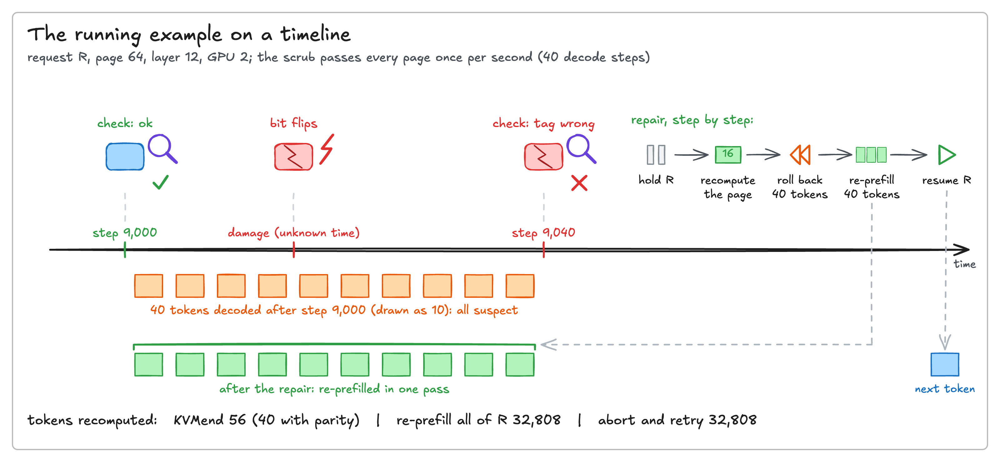

*Figure 3. The running example on a timeline: the last good check, the damage, the detection, and KVMend's repair steps. The 40 suspect tokens are drawn as 10.*

**System.** We assume single-node tensor-parallel serving on N GPUs with SGLang's paged KV cache and radix cache. Parity lives in host memory with ECC.

**Faults.** We target silent changes to KV after it was written. One source is KV moved per GPU between memory tiers, such as pages loaded from host memory, which can fail or land partially on some GPUs.

A second source is slot-lifetime bugs, such as late writes and reads after free, which hit the same slot on every GPU.

A third is memory errors, which stay silent on GPUs without ECC. On ECC GPUs they are reported, the GPU is reset, and its KV is lost [3]; the server restarts, as today, which KVMend does not replace.

We assume damage persists until it is repaired. We do not target wrong values from a faulty computation, because a tag computed from wrong values certifies them.

**Cost model.** Such damage is rare (§1.1), so KVMend keeps its always-on work small: tags at store time, and checks when KV is reused, copied or released. Mending runs only after a check fails.

The Cloudflare incident happened in prefill-to-decode disaggregation across machines. Our single-node analogues are pages loaded from host memory, skipped writes, and late writes into reused slots.

That incident affected every GPU's copy of the pages and was read from the first token, so it calls for the watch, the guard, and mending by recompute, which needs no parity.

### 4.2 What KVMend keeps: tags, and optional parity

Before anything goes wrong, KVMend keeps a tag for every piece, to find damage. Optionally, it also keeps a parity piece for every stripe, to rebuild a damaged piece exactly. Figure 4 shows both being made.

**Tags.** Each piece gets a 4-byte tag: each 32-bit word is scrambled by a fixed function that depends on its position, and the tag is the sum of the scrambled words, modulo 2³². Any change inside one word always changes the tag.

Random damage slips through with probability about 2⁻³². A CRC can also be built in parts, but each part must be adjusted for its position before the parts combine.

The parts of the sum simply add, in any order, so GPU threads that each read part of a piece can just add their results, as the check on read needs.

Tags are computed from the values each writer stores, never by re-reading memory later. While a page fills, each GPU updates a running tag per piece with every new token (Figure 4a).

When the 16th token arrives, the page is sealed and its tags are final (Figure 4b). Each GPU computes its own tags, so tagging adds no GPU-to-GPU traffic.

A tag is 0.05% of the piece it covers at TP=8. Updating running tags costs one small update per running request per layer per decode step.

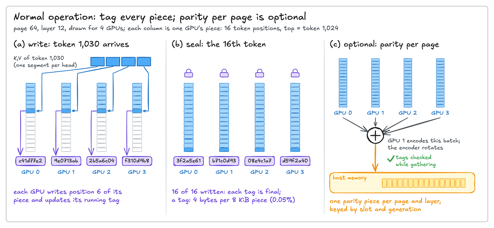

*Figure 4. Normal operation for page 64, layer 12, drawn for four GPUs; each column is one GPU's piece with its 16 token positions.*

*(a) Token 1,030 arrives: each GPU writes its heads' K and V into position 6 of its piece and updates that piece's running tag.*

*(b) The 16th token seals the page, and each tag is final.*

*(c) With the optional parity, a rotating encoder GPU gathers the sealed pieces, checks their tags, and sends each stripe's parity (one piece for XOR) to host memory.*

Tags are keyed by slot and a generation number that grows each time the slot is handed out. Freeing or evicting a page drops its tags, so stale data can never pass as fresh.

**Write fence.** Every write carries the writer's generation, and the store path drops and reports a write whose generation is stale.

Slots of an aborted request are handed out again only after its writes in flight have drained.

**Token key.** The tag key also mixes in a hash of the page's tokens and of every token before them, so the intact bytes of one page cannot pass as another page's.

**Parity, an option.** KVMend works without parity: it recomputes a damaged page (§4.4). Parity, kept as in GhostServe but per page, rebuilds one damaged piece exactly instead, without recomputing anything.

GhostServe keys parity by request, but in SGLang pages are shared, handed to other requests, and evicted. KVMend keys parity like the tags: one parity set per stripe, identified by slot and generation (Figure 4c).

As in GhostServe, sealed pages are encoded in batches. A rotating encoder GPU gathers the batch's pieces, checks their tags as it reads them, and encodes K parity pieces per stripe with XOR or Reed–Solomon codes.

Checking tags during the gather keeps damaged data out of the parity. A shared page has one parity, counted by references from the radix tree and freed when the page is freed or evicted.

Parity takes K/N of the cached KV in host memory: 12.5% for an 8:1 code and 25% for 8:2. Pages sealed but not yet encoded have tags but no parity, so damage there is fixed by recompute.

KVMend's per-page parity replaces GhostServe's per-request parity rather than adding to it. A page that still has a copy in host memory is repaired from that copy.

### 4.3 Watch: find the damage

A tag helps only if something checks it. A check reads a piece's bytes, recomputes the tag, and compares it with the stored tag. A bit flip changes the bytes but not the stored tag (Figure 5a), so the check reveals it.

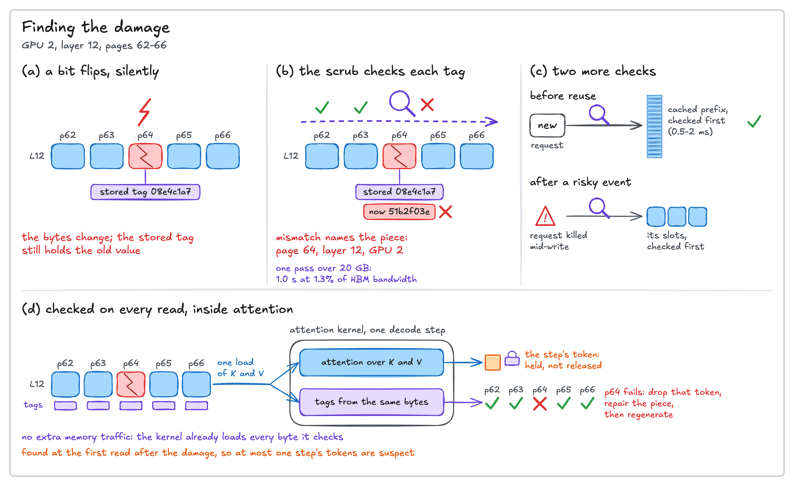

*Figure 5. Finding the damage on GPU 2, layer 12, pages 62–66.*

*(a) A bit flips in page 64, layer 12; the stored tag still holds the old value.*

*(b) The scrub walks the pieces, recomputes each tag, and names the piece whose tag no longer matches.*

*(c) Two more checks: before a cached prefix is reused, and on the slots of a request killed mid-write.*

*(d) The check on read: attention loads each piece once, recomputes its tag from the same bytes, and holds the step's token until its tags pass; when one fails, the token is dropped and regenerated.*

KVMend checks tags at four moments.

**On read.** Decode attention already loads every K and V byte of a request's pages, in every layer and every step.

KVMend's version of SGLang's Triton attention kernel recomputes each piece's tag from the bytes it loads, and compares it with the stored tag (Figure 5d). This adds integer work but no memory traffic.

In the proof of concept, this check in decode attention ran within 1.2% of the throughput of tags alone, on Llama-3.1-8B at TP=8 (§7.3).

Damage is found at the first read after it strikes. A strict request's tokens of that step are held back (§4.5), so at most one step of tokens is suspect.

Where the kernel cannot be changed, a targeted check of a request's pieces runs before each batch of its tokens is released. It costs as much as the check before reuse below: 0.5–2 ms for 32K tokens, in one kernel launch.

**Background scrub.** A rate-limited pass recomputes the tags of a fixed number of allocated pieces per step and compares them with the stored tags (Figure 5b). A low-priority stream alone would not cap its share of bandwidth.

At 1.3% of the A100's 1,555 GB/s, one pass over 20 GB of KV takes 1.0 s, if the checker runs near full memory bandwidth. With checks on read, the scrub only needs to cover pages that no running request reads.

The scrub visits memory in a staggered order rather than one request at a time, so a failing region shows up early [23].

Our fused checker scans 710–784 GB/s per GPU, about half of full bandwidth, where the first, unfused one read about 18 GB/s (§7.3).

**Before reuse.** Pieces read after a pause are checked first: a prefix-cache hit, a swapped-in request, or a page loaded from host memory (Figure 5c).

A 32K-token prefix takes between 0.5 ms (8B at TP=8) and 2 ms (32B at TP=4) to check at 1 TB/s. Our check of every layer in one kernel launch took 0.52 ms and 1.74 ms (§7.3).

**After a risky event.** After an engine exception, an aborted transfer, or a request killed with writes in flight, KVMend checks the affected slots first (Figure 5c).

A match records the step of the check, which becomes the piece's last good check. A mismatch names the damaged piece by page, layer and GPU, and adds it to the repair list.

**Stale access.** Some bad reads involve intact bytes that belong to the wrong owner. Figure 6 follows one slot through two owners and shows how each such access fails a check.

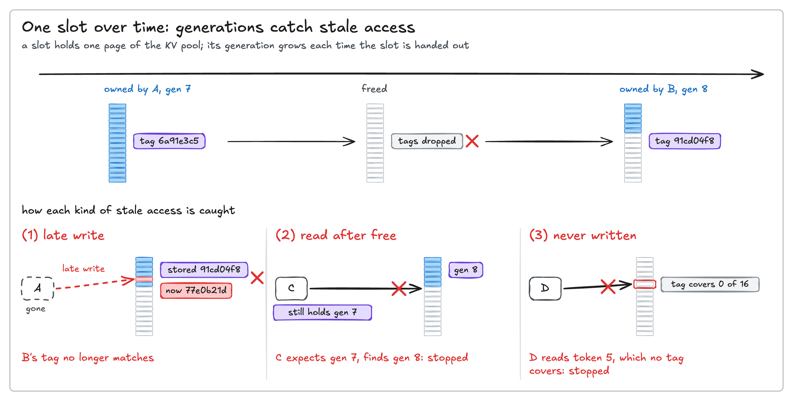

*Figure 6. One slot over time: owned by request A in generation 7, freed with its tags dropped, then owned by B in generation 8. Below, three stale accesses and the check that stops each.*

A late write from A into the reused slot carries generation 7, so the store path drops it; a write that bypasses the store path, such as a network transfer, breaks B's tag instead (case 1).

Each request records the generation of every page it uses, so a request that still expects generation 7 is stopped in generation 8 (case 2).

A page that was never written has no tag for the tokens being read. Every read checks that the page's tag covers the tokens it reads, so a skipped write is caught before its data is used (case 3).

A token table that points at another live page is caught too: that page's tags were keyed by other tokens, so its check fails for this reader.

Other writers keep tags current: pages loaded from host memory bring the tag they left with, and recomputed pieces get new tags.

### 4.4 Mend: recompute the damaged page, or rebuild it from parity

By default, KVMend recomputes the damaged page: a short prefill of its 16 tokens that attends to the intact KV before them and writes new K and V over the damaged ones, in every layer.

In the design, only the page's readers wait while it is recomputed; the rest of the batch keeps running. The proof of concept still runs the recompute inside a scheduler step, so the whole batch waits for it.

The recompute works however many GPUs are damaged, and needs no backup.

Recomputed KV may not match the original bit for bit, so KVMend refreshes the page's tags. In the running example, the page's 16 tokens and the 40 suspect tokens make 56 recomputed tokens (Figure 7, lower left).

**Parity, an option.** XOR and Reed–Solomon parity work symbol by symbol: symbol i of a parity piece depends only on symbol i of each GPU's piece in the same stripe [16].

We leave out RDP, whose diagonal parity mixes positions within a stripe [15].

So with parity, KVMend can rebuild one piece exactly, without touching the rest of the request. Figure 7 shows one symbol of the running example.

A flipped exponent bit turns GPU 2's value 0x2B77 (0.058) into 0x6B77 (3,822). XORing the parity 0x58C8 with the three good values gives back 0x2B77.

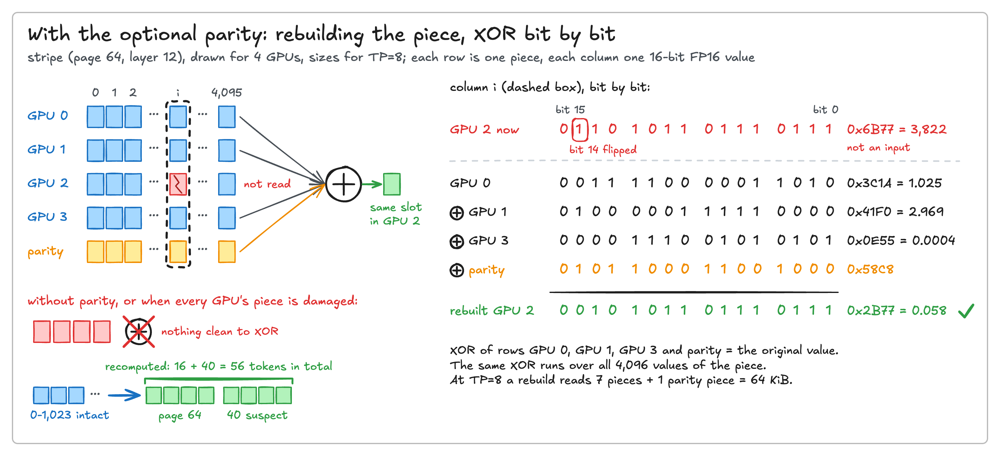

*Figure 7. With the optional parity: rebuilding GPU 2's piece of stripe (page 64, layer 12) from the other GPUs and the parity, drawn for four GPUs. The bits are those of one symbol, column i.*

*Lower left: KVMend's default, and the way when parity cannot help: recompute the page's 16 tokens and the 40 suspect tokens, 56 in all.*

The same XOR repeats for all 4,096 symbols of the piece. At TP=8, KVMend reads the other 7 pieces and 1 parity piece, which is 64 KiB at any TP size, and writes the result back into the same slot.

The piece must stay in its slot, because one slot index serves every layer and every GPU, so a single piece cannot move alone.

Up to K damaged GPUs means a parity rebuild; an RS code with K = 2 rebuilds two damaged GPUs exactly, using arithmetic in GF(2¹⁶) instead of plain XOR.

When more than K GPUs are damaged, as when a lifetime bug writes the same slot on all of them, or when the page has no parity yet, KVMend recomputes the page. It also recomputes when a rebuilt piece still fails its tag.

**Stripes within one GPU.** Parity across GPUs needs a model split over several GPUs. For a model served on one GPU, KVMend can instead stripe pages of the same GPU, 8 in the proof of concept, and keep their XOR in host memory.

Such a stripe rebuilds one damaged page per layer, even when a lifetime bug damaged that page on every GPU, since each GPU rebuilds its own piece. It cannot rebuild a GPU that fails outright.

**When parity pays.** For one damaged page, parity saves only the page's 16 tokens; most of the saving comes from redoing only the suspect tokens (§4.5). Parity matters for bursts that damage many pages at once.

A GPU that fails outright usually ends today's servers, which restart; rebuilding its KV from parity, as GhostServe does, saves only the re-prefill of the requests it held. Section 7.7 measures when a rebuild pays.

### 4.5 Guard and mend: what the damage reached

A token's KV in layer 13 comes from attending over layer-12 KV, including page 64; here layers are counted from 1.

Every token that R computed after the damage therefore carries the damage into its layers 13–32, and its tags certify that bad KV (Figure 8).

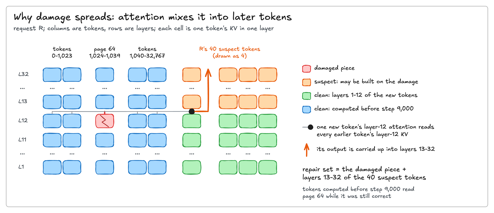

*Figure 8. Which KV in request R is damaged, suspect, or clean when page 64 is damaged in layer 12. The 40 suspect tokens are drawn as 4.*

Tokens computed before the damage read page 64 while it was correct, so they are clean. The damage time is unknown, but it lies after page 64's last good check, which bounds the repair set.

The repair set is the damaged piece plus the KV above layer 12 of every suspect token: every token that a reader of page 64 computed since that check. In the running example, these are R's 40 newest tokens and the cached KV of S (Figure 9).

S is a finished request that read page 64; its KV stays in the prefix cache for reuse.

Figure 9 shows the repair. KVMend holds R and recomputes the page, rolls R back to the last good check, which drops the 40 suspect tokens' KV, and re-prefills them from their token ids in one pass.

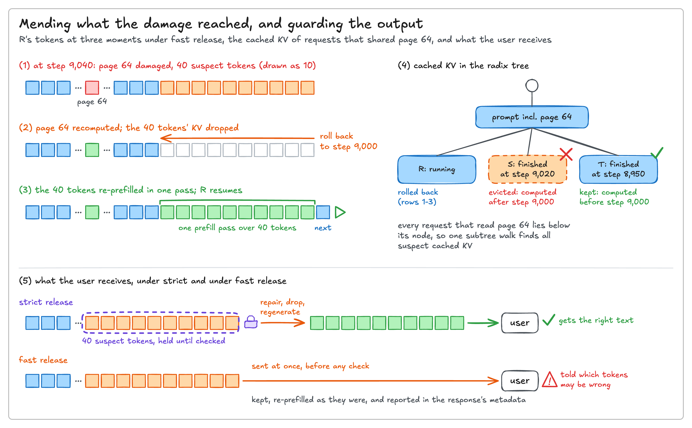

*Figure 9. Mending what the damage reached, and guarding the output. Rows 1–3: R under fast release, at detection, after the rollback and after the re-prefill. Part 4: cached KV of readers of page 64. Part 5: what the user receives.*

**Guard, an option: what the user receives.** A token computed from damaged KV may be wrong. A request can therefore ask KVMend to release a token only after a check has covered every piece it read (Figure 9, part 5).

With checks on read, that check is part of the same step.

Without them, a strict request waits for a targeted check before each batch of its tokens is released (§4.3). Other requests get each token at once, as today, and are told later if any of them may be wrong.

After a rollback, tokens not yet released are regenerated, so the final text is what a healthy server would produce. Tokens already released are kept, re-prefilled as they were, and reported in the response's metadata.

Readers that finished inside the window left their KV in the radix cache, where a later request could reuse it. KVMend stamps each radix node with the step at which its KV was computed.

It walks the subtree under page 64 and evicts nodes computed after the last good check. In Figure 9, S finished at step 9,020, so its cached KV is evicted.

T finished at step 8,950, before the last good check, so it read page 64 while it was correct and its KV is kept.

S used fast release, so its response was already returned before the detection; KVMend reports it as possibly affected.

The repair set is empty when a check catches the damage before any reader uses it. With checks on read, it holds at most one step of tokens per reader: one token when decoding, one prefill chunk when prefilling.

With the scrub alone, it holds up to one scrub pass of tokens per reader, so the scrub rate trades overhead against repair work.

A pass is about 40 tokens for a decoding reader at 40 tokens/s, but thousands for a reader that prefills during the window.

Damage that strikes during a long prefill may taint the rest of the prompt before the next check. KVMend then falls back to re-prefilling from the damaged page onward.

A long prompt is computed in chunks, and each later chunk reads the earlier chunks' KV, the damaged page included, from the pool. The proof of concept therefore mends the page and re-prefills every later chunk (§7.11).

### 4.6 When to repair, and what to watch

Each damaged piece joins a repair list together with the requests that read it (Figure 10). A piece that a running request reads in the next step is repaired at once, and only its readers are held back.

A piece that will be read later, for example by a swapped-out request or an idle cached prefix, waits. KVMend repairs it before its next read or when the GPU is idle.

A piece whose owner finished, and that nobody shares, is freed or evicted without repair.

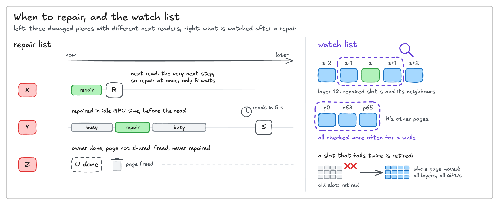

*Figure 10. Left: damaged pieces X, Y and Z with different next readers are repaired now, in idle time, or never. Right: the watch list around a repaired piece, and a slot retired after failing twice.*

After a repair, the watch list checks the piece, its neighbouring slots and the owner's other pages more often for a while. A slot that fails twice is retired, as the GPU itself remaps memory rows that keep failing [17].

Retiring a slot moves the whole page, all layers on all GPUs, to a new slot through the scheduler, which updates every GPU's token-to-slot table at once.

### 4.7 Changes to SGLang

Table 4 maps each mechanism to the part of SGLang 0.5.1 it changes. Rolling a request back reuses SGLang's retract path, which already returns requests to the waiting queue and re-prefills them from their token ids [12].

*Table 4. Where each KVMend mechanism hooks into SGLang 0.5.1.*

| Mechanism                  | SGLang component                                                         | Change                                                                                                                                                                |
| -------------------------- | ------------------------------------------------------------------------ | --------------------------------------------------------------------------------------------------------------------------------------------------------------------- |
| Running tags               | the KV pool's store path, and HiCache's `load_back`                      | update a per-piece tag from the values being stored, keyed by slot, generation and tokens; drop writes with a stale generation; tags travel with pages to host memory |
| Page generations           | the KV slot allocator, radix-cache `evict`, and each request's page list | bump the generation on allocation; drop tags and parity on free or evict; readers record the generations they use                                                     |
| Checks on read             | SGLang's Triton decode and extend attention kernels                      | recompute each piece's tag from the KV the kernel loads; flag a mismatch before the step's tokens are released                                                        |
| Parity per page (optional) | a new background encoder stream                                          | gather sealed pieces, check tags, encode, copy to host memory                                                                                                         |
| Readers of a page          | `req_to_token` tables, radix-tree lock counts, and radix nodes           | find running readers; walk the subtree under the damaged page and evict cached nodes computed after the last good check                                               |
| Roll back and re-prefill   | the scheduler's `retract_decode` path                                    | a partial retract that keeps KV up to the last good check                                                                                                             |
| Release rule               | the scheduler's output path                                              | hold a request's new tokens until a check covers what they read; regenerate unreleased suspect tokens after a rollback                                                |
| Recompute a page           | an extend batch over the page's 16 tokens                                | prefix = earlier tokens; write back the damaged pieces in place                                                                                                       |

### 4.8 Costs

Table 5 compares the work to fix one damaged page in the running example, and Table 6 lists the other costs. The numbers are estimates from the model shapes and the A100's memory bandwidth, except those marked measured (§7).

*Table 5. Work to fix damage in the running example (Llama-3.1-8B at TP=8; R has a 32,768-token prompt and decoded 40 tokens since page 64's last good check; the burst rows damage 100 of R's pieces on GPU 2, all in one layer).*

| Approach                                                                  | Tokens recomputed | Parity read | Requests lost |
| ------------------------------------------------------------------------- | ----------------- | ----------- | ------------- |
| Abort R, no retry                                                         | none              | none        | 1             |
| Abort and retry R, cache flushed (today's practice, §5.3)                 | 32,808            | none        | 0             |
| Re-prefill all of R                                                       | 32,808            | none        | 0             |
| Retry that keeps the clean prefix: R from page 64, found by KVMend's tags | 31,784            | none        | 0             |
| KVMend: recompute page 64, redo the suspect tokens                        | 56                | none        | 0             |
| KVMend with checks on read                                                | 17                | none        | 0             |
| KVMend, damage caught before reuse                                        | 16                | none        | 0             |
| KVMend with parity, damage on one GPU                                     | 40                | 64 KiB      | 0             |
| KVMend with parity, burst over 100 pieces of R on one GPU                 | 40                | 6.25 MiB    | 0             |
| KVMend without parity, same burst                                         | 1,640             | none        | 0             |

*Table 6. Other expected costs (estimates from model shapes and the A100's 1,555 GB/s memory bandwidth).*

| Cost                                           | Estimate                                                                                                                                                                                                                                                                                                                                     | Basis                                                                                                        |
| ---------------------------------------------- | -------------------------------------------------------------------------------------------------------------------------------------------------------------------------------------------------------------------------------------------------------------------------------------------------------------------------------------------- | ------------------------------------------------------------------------------------------------------------ |
| Tag memory                                     | 0.05% of the KV cache at TP=8                                                                                                                                                                                                                                                                                                                | 4 B per 8 KiB piece                                                                                          |
| Running-tag updates and checks before encoding | measured (§7.3): tags alone, fused, on 8B on one A100: 1.5% of throughput, and 3.2% on a decode-heavy run; on 8B at TP=8, 0.3%, and less than plain SGLang varies between runs when the two took turns; 1.6% on TinyLlama at TP=2; with parity, within 0.2% of parity alone on 8B's mostly prefill run and 1.8% slower on a decode-heavy run | one small update per stored token per layer                                                                  |
| Parity in host memory (optional)               | 12.5% (8:1) or 25% (8:2) of the cached KV                                                                                                                                                                                                                                                                                                    | K/N                                                                                                          |
| One scrub pass over 20 GB per GPU              | 1.0 s at 1.3% of bandwidth; 0.64 s at 2%                                                                                                                                                                                                                                                                                                     | 20 GB divided by the scrub rate, with a checker near full bandwidth (our fused one scans 710–784 GB/s, §7.3) |
| Checks on read in attention                    | extra integer work per KV word and no extra memory traffic; measured (§7.3) on 8B at TP=8, decode-heavy: +0.4% of throughput against tags alone when reusing attention's tiles, −1.2% when loading the words again                                                                                                                           | the decode kernel already loads every KV byte                                                                |
| Check before reusing a 32K-token prefix        | 0.5 ms (8B, TP=8) to 2 ms (32B, TP=4)                                                                                                                                                                                                                                                                                                        | 512 MiB to 2 GiB per GPU at 1 TB/s; measured with one launch over all layers: 0.52 and 1.74 ms (§7.3)        |
| Suspect tokens per reader                      | one step's tokens with checks on read; up to 40 with a 1 s scrub pass                                                                                                                                                                                                                                                                        | 40 tokens/s while decoding; a prefilling reader computes thousands per second                                |

## 5 Evaluation Methodology

### 5.1 Research questions

The first three questions test the three gaps; the last two test timing and cost.

- **RQ1 (watch).** Where can damage hide: the open page, pages not yet encoded, freed pages, partial loads? How fast do the four checks find it, and with how many false alarms?
- **RQ2 (mend).** How much work does recomputing only the damaged page and the suspect tokens save, compared with abort and retry, and with re-prefill? With the optional parity, at what burst size does a rebuild pay?
- **RQ3 (guard and mend).** How large is the repair set, how does it change with the scrub rate, and is all suspect cached KV evicted? How many unchecked tokens reach the user, and what does holding them back cost?
- **RQ4 (timing).** Which repair timing (now, before the next read, or never) gives the best goodput, and what does the watch list catch?
- **RQ5 (cost).** What does protection cost in fault-free serving?

### 5.2 Experimental setup

Table 7 lists the setup. We reuse GhostServe's software versions so that the comparison with its design stays close [10, 12].

*Table 7. Experimental setup.*

| Item         | Choice                                                                                                                                                                       |
| ------------ | ---------------------------------------------------------------------------------------------------------------------------------------------------------------------------- |
| Server       | 8× A100-PCIE-40GB, PCIe only, no NVLink; 2× EPYC 7742; 512 GB host memory                                                                                                    |
| Software     | SGLang 0.5.1 with 16-token pages and its Triton attention backend, which KVMend extends for checks on read; FlashInfer 0.3.1, as in GhostServe, for a plain-SGLang reference |
| Main setup   | Llama-3.1-8B [27] at TP=8 with an FP16 KV cache, as in GhostServe's eight-GPU runs; without parity, and with XOR (8:1) or Reed–Solomon (8:2) parity                          |
| Second setup | DeepSeek-R1-Distill-Qwen-32B [28] at TP=4, for overhead and repair time                                                                                                      |
| Workloads    | GhostServe's mix of long-input and long-output requests; a shared-prefix workload; 16K and 32K contexts                                                                      |
| Jobs         | Slurm jobs of at most one hour each                                                                                                                                          |

An 8B model fits on one A100, but parity spans the tensor-parallel group, so we follow GhostServe in running it at TP=8 to get eight pieces per stripe.

GhostServe's released code does not run on A100, so we implement per-page parity in SGLang ourselves. The tag update must run inside SGLang's decode CUDA graphs; the proof of concept shows that it can (§7).

### 5.3 Baselines

- **Abort and retry, today's practice:** our checks find the damage, the readers are aborted, as SGLang does when its transfer checksum fails [2], their cached KV is dropped, and the client resubmits.
  Today's systems respond this way when a check fails; without per-page tags they cannot tell which cached pages are bad. This returns the right text at the cost of recomputing the whole request.
- **No checks:** parity alone, as in GhostServe; damage stays silent.
- **NaN check:** SGLang's optional check for NaN in the logits. It logs the NaN and masks it, so it notices such faults but cannot locate or repair them, and the text stays wrong.
- **Retry that keeps the clean prefix:** the same abort, but only the damaged page and what follows it are dropped, so the resubmitted request recomputes from that page on.
  It needs our tags to find the page, and is the strongest baseline (§7.5).
- **KVMend with parity:** the default plus per-page parity, which rebuilds a damaged piece instead of recomputing its page; this shows what parity is worth, and the burst size at which it beats recompute.
- **KVMend without the redo:** the page is repaired, but the suspect tokens are kept; this shows what the redo is worth.
- **Parity without tags:** an RS 8:2 code checks stripes and corrects one bad piece on its own; this shows what tags are worth.

We also run an ablation that rebuilds a whole 2,048-token range from parity instead of one piece, to measure the effect of repair size.

**Fairness rules.** Every response is held to one bar: its final text must equal the fault-free run's, up to the variation that fault-free control replays show (§5.4), or the wrong tokens it released are counted.

Detection is measured, not scheduled. Costs are measured on requests that arrive over time, and plain SGLang runs in its best configuration as the reference.

### 5.4 Fault injection

We inject faults in software, because the A100's ECC reports most memory errors instead of hiding them. Table 8 lists the fault classes, their real counterparts, and the repair we expect.

*Table 8. Fault classes for injection.*

| Fault class             | How we inject it                                                                                                                  | Real counterpart                               | Expected repair                                                                  |
| ----------------------- | --------------------------------------------------------------------------------------------------------------------------------- | ---------------------------------------------- | -------------------------------------------------------------------------------- |
| Bit flips on one GPU    | flip one bit at swept positions (sign, exponent, mantissa) of K or V, in a sealed piece, the open page, or a page not yet encoded | memory errors without ECC [11]                 | recompute of the page; with parity, a rebuild                                    |
| Partial load            | a page loaded from host memory lands on only some GPUs                                                                            | a failed per-GPU transfer                      | re-copy from the host copy                                                       |
| Late write on every GPU | write another request's data into a reused slot on all GPUs, through the store path or around it                                  | a dead request's late write [2]                | write dropped by its stale generation, or recompute of the page                  |
| Read after free         | let a request keep reading a slot after it is freed and reused                                                                    | a slot-lifetime bug                            | changed generation, then recompute                                               |
| Misplaced page          | point one token-table entry at another live page                                                                                  | a slot-mapping bug                             | the tag's token key fails, then recompute                                        |
| Never-written page      | skip the writes of a page                                                                                                         | a rejected request that passed the handoff [1] | tag does not cover the read, then recompute                                      |
| Damaged parity or tag   | flip bits in host parity or in a tag                                                                                              | host memory error or bug                       | rebuilt piece fails its tag, then recompute of the page (§4.4, measured in §7.7) |
| Burst over many pages   | damage a range of slots on one GPU                                                                                                | a failing memory region                        | many parity rebuilds, then slot retirement                                       |

Flips of the top exponent bit make NaN or huge values; a NaN check notices only the NaN cases. In §7.4, NaNs gave garbage, huge values changed nothing or, once, gave fluent but wrong text, and flips of lower bits changed nothing.

We classify each outcome as unchanged, fluent but wrong, or garbage, and report which outcomes the NaN check catches.

Each run injects many faults into one serving session and compares the repaired KV with a saved fault-free copy: bit for bit after a parity rebuild, and within a tolerance after recompute. One campaign fits in a one-hour job.

For effects on output, we replay about 100 fixed batches on the main setup. SGLang 0.5.1 has no deterministic mode, so fault-free control replays measure how much outputs differ without any fault.

### 5.5 Metrics

- **Detection:** coverage per fault class and per hiding place of RQ1, detection latency (at the first read or later), false alarms.
- **Repair:** exact repairs, tokens recomputed, parity read, how long readers wait, requests aborted.
- **Damage reach:** tainted tokens per fault, known from the injection time; suspect tokens re-prefilled; and outputs that differ beyond the control replays.
- **What the user receives:** tainted tokens released, final text equal to the fault-free run, fluent but wrong outputs, and the delay that holding tokens back adds.
- **Cost:** fault-free throughput, time to first token, and time per output token on a decode-heavy workload, with and without SGLang's overlap scheduler; tag and parity memory; goodput under a fault rate.

## 6 Hypotheses and Expected Results

Figure 11 plots the expected work per repair and the expected scrub trade-off, and Table 9 states each hypothesis with its basis. The expected results are estimates from §4.8; the proof-of-concept results are measured (§7).

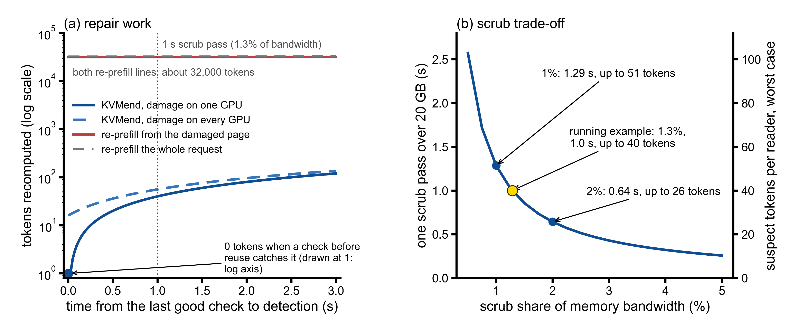

*Figure 11. Expected results (estimates for the running example).*

*(a) Tokens recomputed to fix page 64 against the time from its last good check to detection, on a log scale; KVMend's work grows with that time, while re-prefilling stays above 31,000 tokens.*

*(b) The scrub's share of memory bandwidth against the time for one full pass over 20 GB per GPU, and the suspect tokens per reader at 40 tokens/s.*

*Table 9. Hypotheses and expected results.*

| #  | Part                 | Hypothesis                                         | Expected result and basis                                                                                                                                                                                                                                                                                                                                                                                                                                                                                                                                                                                                                                                                                               |
| -- | -------------------- | -------------------------------------------------- | ----------------------------------------------------------------------------------------------------------------------------------------------------------------------------------------------------------------------------------------------------------------------------------------------------------------------------------------------------------------------------------------------------------------------------------------------------------------------------------------------------------------------------------------------------------------------------------------------------------------------------------------------------------------------------------------------------------------------- |
| H1 | watch                | The checks find every injected change              | damage to pieces that running requests read found at the next read; idle pieces within one scrub pass or before reuse; stale writes, reads after free, misplaced and never-written pages caught before use; proof of concept: three of the incident's four kinds found, and the fourth dropped by a fence modelled in the test, where the scrub alone found one (§7.5); checks on read in decode attention found a probe's bit flip at the next step (§7.3); a load from host memory that missed one GPU found on arrival (§7.10); with requests arriving over time, every unfenced fault found (§7.9)                                                                                                                  |
| H2 | mend (parity option) | With parity, a rebuild is exact                    | every single-GPU fault rebuilt bit for bit against the fault-free copy, reading 64 KiB; proof of concept: bit for bit across GPUs, reading 64 KiB (§7.2), from a stripe within one GPU (§7.5), and for every burst of §7.7                                                                                                                                                                                                                                                                                                                                                                                                                                                                                              |
| H3 | mend                 | KVMend recomputes far fewer tokens than re-prefill | 56 tokens instead of 32,808 in the running example (40 with parity), and 16 when caught before reuse; the last-good-check bound gives most of the saving; proof of concept: 41 instead of 32,809, with the window set by the test (§7.2); with a late write at page 64 on every GPU, 16 recomputed and 40 regenerated, about 12 times faster than a retry that keeps the clean prefix; a page never written in the first prompt chunk cost nearly as much as that retry, since the later chunks are recomputed too (§7.5)                                                                                                                                                                                               |
| H4 | mend                 | Damage on every GPU needs no abort                 | the page's 16 tokens and the suspect tokens are recomputed: 56 in the example; proof of concept: four pages damaged on every GPU repaired with no abort, and the right text (§7.5)                                                                                                                                                                                                                                                                                                                                                                                                                                                                                                                                      |
| H5 | mend                 | The repair set follows detection latency           | one step of tokens per reader with checks on read; with the scrub alone, in proportion to the pass time (Figure 11b); proof of concept: checks on read found a probe's bit flip at the next decode step, but do not yet start the repair (§7.3)                                                                                                                                                                                                                                                                                                                                                                                                                                                                         |
| H6 | timing               | Lazy repair saves work                             | pieces whose owners finish before their next read are never repaired; the share is measured per workload                                                                                                                                                                                                                                                                                                                                                                                                                                                                                                                                                                                                                |
| H7 | cost                 | Protection is cheap                                | targets: tags within 3% of plain SGLang's fault-free throughput, and KVMend with parity within 3% of parity alone; proof of concept on 8B: fused tags alone cost 1.5% on one A100, and 3.2% on a decode-heavy workload, just above the target; at TP=8, 0.3%, and less than plain SGLang varies between runs when the two took turns; checks on read within 1.2% of tags alone; KVMend with parity +0.2% against parity alone on the mixed workload, −1.8% on a decode-heavy one (§7.3)                                                                                                                                                                                                                                 |
| H8 | mend (parity option) | Parity pays off for bursts                         | 100 damaged pieces rebuilt by reading 6.25 MiB, instead of recomputing their pages' 1,600 tokens (1,640 with the suspect tokens, Table 5); proof of concept: on 8B at TP=8 a rebuild beat recompute at every size tried, 1 to 1,024 pieces, by 8 to 110 times; on TinyLlama it lost at 512 pieces (§7.7)                                                                                                                                                                                                                                                                                                                                                                                                                |
| H9 | guard                | No unchecked token reaches a strict request's user | with strict release, no unchecked token is released; with checks on read, holding tokens back adds less than one step, and a failed check withholds that step's token and generates it again (§7.12); proof of concept on both models: strict release sent none of the 78 wrong tokens that a server with no checks streamed; a check costs 0.4–1.1 ms, and checking before every token lengthened 8B's gap between tokens by 12% (§7.6); with 64 requests arriving over time and four faults on 8B, no strict request with a stable text released a wrong token after the damage struck, and 56 of 64 outputs were right, against 36 with no checks; without faults, strict release cost about 7% of throughput (§7.9) |

## 7 Preliminary Results

Before building the full system, we tested its core on our server. A proof of concept patches SGLang 0.5.1 as it loads, the way GhostServe loads its own hook, so SGLang itself is not edited [10, 12].

Sections 7.2 and 7.4, and the earlier rows of §7.3, used an earlier version, with one bit flip in one request. Section 7.4 applies the first fairness rule of §5.3, that every response must return the right text.

The current rows of §7.3, and §7.5 to §7.8, test the current version: cost, the incident's kinds of damage, a streamed request, bursts and a loaded server.

Sections 7.9 to 7.11 test its newest parts: requests arriving over time, loads from host memory that land on only some GPUs, and a store skipped during the prefill.

In §7.6, §7.8, §7.9 and §7.11 the release rule's own checks find the damage, and in §7.10 the check on arrival does. Elsewhere, the test chose when to check.

### 7.1 What the proof of concept builds

It builds the core of the design:

- **Watch:** a running tag per piece, keyed by each token's id and position and updated as SGLang stores K and V, also inside its decode CUDA graphs, by fused Triton kernels.
- **Checks:** a scrub, and the reader's check of one request's pages: the tag must cover its tokens there, match them with its token keys, and keep the generation it had. Every layer is checked in one kernel launch.
- **Stale writes:** slot generations. The write fence is modelled in the fault injector, which drops its own stale write; SGLang's store path does not yet carry a writer's generation.
- **Mend:** a damaged page is recomputed in place by a short side prefill over the intact KV before it. With parity, a damaged piece is rebuilt instead, from the other GPUs or from a stripe within its own GPU.
- **Mend what it reached:** SGLang's retract path rolls a request back; every strict reader of a mended page then regenerates its unchecked tokens, and cached KV written after the reader's last good check is evicted.
- **Guard:** the release rule, with one batched check per step for every strict request that is due.
- **Checks on read:** copies of SGLang's Triton decode attention kernels also add up the tag of every piece they read, and after each decode step the sums are compared with the stored tags. Prefill attention is not checked.
- **Loads from host memory:** SGLang's hierarchical cache copies KV to host memory and loads it back. The tags travel with the host copy, each loaded layer is checked on arrival, and a piece that fails is copied again from the host copy.
- **The check right after the prefill:** a setting checks every request once, right after its prefill, not only strict ones. A pass becomes the request's last good check.
- **The chunk rule:** a long prompt is computed in chunks, and each later chunk reads the earlier chunks' KV from the pool. So after a failed check right after the prefill, KVMend also recomputes every later chunk.
- **Abort and retry, as a baseline:** an option makes a failed check abort the request, and every other reader of the damaged pages, instead of mending. The damaged pages leave the prefix cache, and the client resubmits.

It does not yet build a fence in the store path, checks for fast-release requests beyond the one right after the prefill, checks before a cached prefix is reused or after risky events, or Reed–Solomon parity.

Nor does it build slot retirement or the repair and watch lists, and its scrub has not yet run at its design rate.

With the repair setting on, a failed check on read withholds that step's token from every reader of the damaged page, mends the page, and the readers generate the token again (§7.12).

These checks compare the bytes and their coverage, so another sequence's KV with matching tags is left to the reader's check.

Only strict requests are checked as they run. With the setting on, a fast-release request is checked once, right after its prefill; a failure mends its pages and reports that its first token, already sent, may be wrong.

A fast-release request gets no later check, rollback or report yet, so the fast-release runs of §7.6, §7.8 and §7.9 have no checks at all.

The reader's check runs between steps, over one request's pages. Checks on read run inside decode attention, as it reads the KV.

It also re-implements GhostServe's parity and rebuild, because GhostServe's released code does not run on A100 (§5.2).

The runs of §7.2 to §7.4 used an earlier version that had only the tags, the scrub, parity across GPUs and the rollback. The runs of §7.5 to §7.8 use the current version.

Most of them ran before every layer was checked in one launch: they checked layer by layer, or, in §7.5, with PyTorch operations. Section 7.3, §7.6 and the repeat in §7.8 use the one-launch check.

The last five parts of the list above were added after most of those runs. The newest runs, in §7.3, §7.5 and §7.9 to §7.11, test them.

Of these, §7.9 uses the one-launch check, while the newest runs of §7.5, §7.10 and §7.11 still check with PyTorch operations.

Some parts are simplified. The token key mixes each token's id and position, not the hash of its whole prefix, so a page with the same tokens at the same positions after another prefix would pass.

Generations are kept in each request's record rather than mixed into the tag.

The release rule checks a strict request's pages in a separate pass, right after its prefill and then every few tokens, so its tokens leave one step later than with a check inside attention.

A check that fails at a request's last token aborts it instead of regenerating.

The tags are computed by re-reading the stored bytes right after each store, so a store that writes wrong bytes into its own slot would be certified.

The rollback returns R to its cached prompt. Under fast release it re-prefills the tokens decoded since then (§7.2); under strict release it keeps the first output token, re-prefills it and regenerates the rest (§7.4).

The design rolls back to the last good check. In §7.2 to §7.5 that is the check right after the prefill, where the rollback returns R; the release rule of §7.6 rolls back to its own last passing check.

The KV cache is BF16, the models' own type, rather than Table 7's FP16. Every run, the plain-SGLang reference included, uses the Triton attention backend; Table 7's FlashInfer reference is not run yet.

Every run also turns off SGLang's overlap scheduler, so that the hook acts between steps, and its custom all-reduce. Plain SGLang in its best configuration (§5.3) is not measured yet.

### 7.2 One bit flip, five responses

We injected one fault into request R, as in the running example. R has a 32,768-token prompt on Llama-3.1-8B at TP=8, decodes 80 tokens greedily, and passes a scrub right after its prefill: its last good check.

At output 10, bit 14 of one stored key value of token 1,030 (page 64) flips in layer 12 on GPU 2 and turns −1.22 into NaN.

Here layers count from 0, as in SGLang, so this is layer 13 in the count from 1 of §4.5 and the figures.

At output 41, 40 tokens after the last good check, each response acts (Table 10, Figure 12a):

- **No checks**, which is GhostServe as published: parity is kept, but nothing is checked.
- **GhostServe-style, told the GPU:** an oracle names GPU 2, which GhostServe cannot find by itself, and the rebuild restores GPU 2's share of every page in every layer.
- **GhostServe-style, told the GPU and the chunk:** the same rebuild, only for the 2,048-token chunk that holds the damage.
- **Detect, then re-prefill:** our scrub finds the damage, and R's whole KV is recomputed from its first token, keeping the tokens already produced. A real abort and retry would instead regenerate all of R's output.
- **KVMend:** the scrub names the piece, parity rebuilds it, and R's suspect tokens are re-prefilled.

*Table 10. One bit flip under five responses (Llama-3.1-8B at TP=8, 32,768-token prompt; one run of each).*

| Response                                     | Notices the damage                     | Data read to repair | Tokens recomputed | Recovery time  | Next tokens match a healthy server | Final text correct |
| -------------------------------------------- | -------------------------------------- | ------------------- | ----------------- | -------------- | ---------------------------------- | ------------------ |
| No checks (GhostServe as published)          | no                                     | none                | 0                 | never recovers | no                                 | no                 |
| GhostServe-style, told the GPU               | no; told by an oracle                  | 4 GiB               | 0                 | 0.46 s         | no                                 | no                 |
| GhostServe-style, told the GPU and the chunk | no; told by an oracle                  | 256 MiB             | 0                 | 0.06 s         | no                                 | no                 |
| Detect, then re-prefill all of R             | yes                                    | none                | 32,809            | 13.1 s         | yes                                | no                 |
| KVMend                                       | yes: GPU 2, layer 12 (from 0), page 64 | 64 KiB              | 41                | 0.20 s         | yes                                | no                 |

The next tokens match a healthy server when, after recovery, they equal those of a fault-free server given the same text on the same compute path. The final text is correct when it equals the fault-free run's text.

Recovery time runs from the first recovery action to the first token after it.

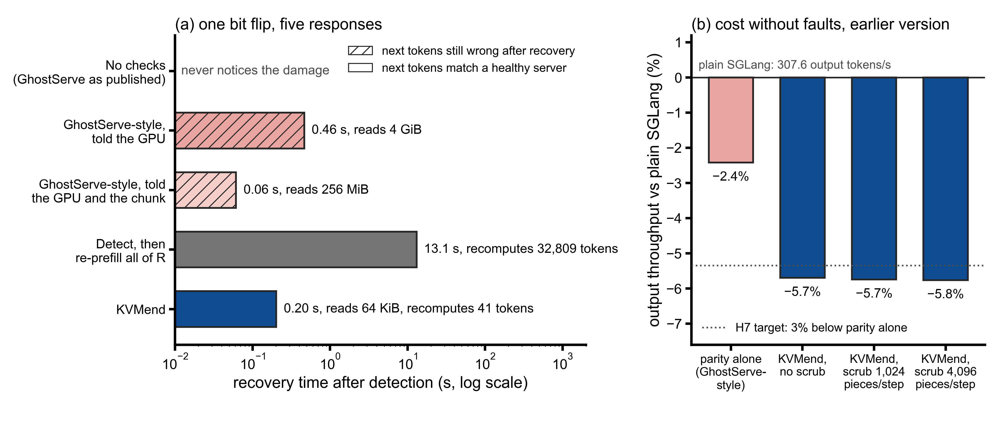

*Figure 12. Measured results of the proof of concept (Llama-3.1-8B at TP=8 on our 8 A100 GPUs).*

*(a) Recovery time after one bit flip, on a log scale, with the data read and the tokens recomputed; hatched bars mark responses whose next tokens are still wrong after recovery.*

*(b) Fault-free output throughput of the earlier version against plain SGLang, median of 3 runs (Table 11); the dotted line is H7's target for KVMend with parity, 3% below parity alone.*

Only KVMend both notices the damage and repairs the KV cache cheaply: it recomputes 800 times fewer tokens and recovers 65 times faster than the full re-prefill.

The GhostServe-style rows make two points that do not depend on numbers: GhostServe never notices the damage, and even when told where it is, a rebuild alone leaves wrong output.

Their data volumes and times depend on how much the oracle told them, so we do not compare those numbers.

Rebuilding the damaged bytes is not enough. The GhostServe-style rebuild restores all 65,536 pieces bit for bit, yet its output differs from the first token after the rebuild.

The 31 tokens generated after the flip were computed from the NaN, and their KV differs in every layer above the damaged one, as Figure 8 predicts. Recomputing their KV, as KVMend does, makes the next tokens match a healthy server again.

**No response fixes the text already produced.** The flip made a NaN, so the 31 tokens produced between the flip and the detection are garbage, and every response here keeps them.

Returning the right text needs the guard of §4.5: hold tokens back until a check covers them, and regenerate the held tokens after a rollback. The earlier version built only the second half, for requests that are not streamed (§7.4).

The current version builds both (§7.6).

Two controls rule out other causes. The GhostServe-style rebuild gives the same 80 tokens as KVMend without the redo (§5.3), and rolling back a request with no fault leaves its output unchanged.

KVMend recomputes 41 tokens: the 40 suspect tokens and the first output token, whose KV was also computed after the last good check. The full re-prefill likewise recomputes 32,809 tokens, one more than in Table 5.

KVMend's 0.20 s is mostly the re-prefill: about 0.19 s to recompute 41 tokens against the 32K-token cache. The repair step takes 14 ms and the rollback 1 ms.

Of the 14 ms, rebuilding the piece takes 0.5 ms; the rest is waiting for the GPUs to line up and checking the result.

The GhostServe-style rebuilds recompute nothing, which is why their next tokens stay wrong.

Two things make this test easier than real use. It schedules the detecting scrub at output 41; at the scrub rates we tested, a background pass takes minutes (§7.3), so a scrub-only window would hold far more than 40 tokens.

And the flipped bit is the top exponent bit, which turns the value into a NaN and the text into garbage. SGLang's optional NaN check would notice that, though not locate it; a fluent but wrong flip appeared only on TinyLlama (§7.4).

### 7.3 Cost without faults

Table 11 compares fault-free throughput for the earlier version, also drawn in Figure 12b, and for the current one. Each mode ran in its own engine on 64 requests of 1,024 prompt and 256 output tokens, sent at once.

Parity alone encodes sealed pages every 16 batch steps, as KVMend with parity does.

*Table 11. Fault-free output throughput (Llama-3.1-8B at TP=8): the earlier version, median of 3 runs, and the current one, median of 2 runs in a later job.*

| Version | Mode                                                       | Output tokens/s | vs plain SGLang | vs parity alone |
| ------- | ---------------------------------------------------------- | --------------- | --------------- | --------------- |
| earlier | Plain SGLang                                               | 307.6           |                 |                 |
| earlier | Parity alone (GhostServe-style)                            | 300.2           | −2.4%           |                 |
| earlier | KVMend, no background scrub                                | 290.1           | −5.7%           | −3.4%           |
| earlier | KVMend, scrub of 1,024 pieces per step (0.04 GB/s per GPU) | 290.0           | −5.7%           | −3.4%           |
| earlier | KVMend, scrub of 4,096 pieces per step (0.12 GB/s per GPU) | 289.9           | −5.8%           | −3.4%           |
| current | Plain SGLang                                               | 311.5           |                 |                 |
| current | Parity alone (GhostServe-style)                            | 298.0           | −4.3%           |                 |
| current | Tags alone, fused                                          | 310.5           | −0.3%           |                 |
| current | KVMend: fused tags and parity                              | 298.6           | −4.1%           | +0.2%           |

In the earlier version KVMend cost 3.4% over parity alone, just above H7's target of 3% for KVMend with parity. On TinyLlama-1.1B [29] at TP=4 it cost 13–16%: a small model does little work per layer next to the tag work.

Two parts caused the cost: the tag update was a series of separate PyTorch operations in every layer, and checking tags before encoding waited for the GPU once per layer.

On Llama-3.1-8B the scrub cost nothing measurable at these rates, which are 160–480 times below the design rate; on TinyLlama it cost up to 3.5%. It raised no false alarm over about 0.8 million pieces per run on each GPU.

The checker of that version read only about 12–18 GB/s per GPU, about 1% of memory bandwidth, too slow for the 1.0 s pass over 20 GB of §4.3 and Table 6.

The current version fuses this work into Triton kernels: two launches per layer at store time, inside the decode CUDA graphs.

Tags alone then cost 0.3% on Llama-3.1-8B at TP=8 (310.5 against 311.5 output tokens/s), within H7's target. One GPU, measured later, gives a cleaner figure (Table 12).

With parity, KVMend ran as fast as parity alone (+0.2%, within the range of the two runs); parity itself cost 4.3%. On TinyLlama at TP=2, tags alone cost 1.6%, but KVMend with parity 24.5%.

Parity is thus the costly part, above all on a small model, whose layers leave little time to hide the copies. This is one reason parity is an option (§4.4).

On one A100, with synthetic KV of each model's shape, the fused checker scans 710 GB/s for Llama-3.1-8B at TP=8 and 784 GB/s for the 32B model at TP=4, about half of 1,555 GB/s; PyTorch operations read 20 GB/s.

A reader's check of a 32K-token prefix in every layer, in one kernel launch, takes 0.52 ms (8B) and 1.74 ms (32B): 1.0 and 1.2 TB/s, the estimate of §4.3. Launched layer by layer it took 5.1 and 10.1 ms.

On our server, tensor parallelism over PCIe limits throughput: prefill runs at about 2,000 tokens/s at TP=8. Relative costs will differ on NVLink servers.

Prefill also takes more than half of each run above (estimated from its rate), so a decode-heavy workload measures time per output token: 32 requests of 128 prompt and 512 output tokens.

There each output step took 58.1 ms in plain SGLang, 58.9 ms with parity alone and 60.0 ms with KVMend and parity: 3.2% slower than plain and 1.8% slower than parity alone (median of 2 runs; tags alone not run in that job).

**Tags on one GPU, and checks on read.** Later jobs measured the tags alone on one A100, and the checks on read at TP=8 on the decode-heavy workload (Table 12). No parity or scrub ran in these modes.

*Table 12. Fault-free output throughput of Llama-3.1-8B in later jobs: on one A100 (card 61:00.0), median of 2 runs; at TP=8, median of 3 runs.*

| GPUs | Workload                                                      | Mode                                               | Output tokens/s | vs plain SGLang | vs tags alone |
| ---- | ------------------------------------------------------------- | -------------------------------------------------- | --------------- | --------------- | ------------- |
| 1    | 64 requests of 1,024 prompt and 256 output tokens             | Plain SGLang                                       | 1,105           |                 |               |
| 1    | 64 requests of 1,024 prompt and 256 output tokens             | Tags alone, fused                                  | 1,089           | −1.5%           |               |
| 1    | decode-heavy: 32 requests of 128 prompt and 512 output tokens | Plain SGLang                                       | 1,911           |                 |               |
| 1    | decode-heavy: 32 requests of 128 prompt and 512 output tokens | Tags alone, fused                                  | 1,849           | −3.2%           |               |
| 8    | decode-heavy                                                  | Tags alone, fused                                  | 546             |                 |               |
| 8    | decode-heavy                                                  | Tags and checks on read, reusing attention's tiles | 548             |                 | +0.4%         |
| 8    | decode-heavy                                                  | Tags and checks on read, loading the words again   | 539             |                 | −1.2%         |

On one A100 a decode-heavy step takes 16.7 ms, against about 58 ms at TP=8 over PCIe, so the tag work weighs more there. We take these runs as our cleanest measurement of what the tags cost.

There, tags alone cost 1.5% on the workload of Table 11 and 3.2% on the decode-heavy one, where they add 0.6 ms to each step. The second is just above H7's target of 3%.

On 8 GPUs, tags alone and plain SGLang took turns in one job, three runs each, twice. Tags alone ran at 550–553 output tokens/s and plain SGLang at 542–551, so at TP=8 the tags cost less than plain SGLang varies between runs.

In the job of Table 12's 8-GPU rows, the plain-SGLang engine ran twice as fast as every other engine we started on 8 GPUs. We cannot explain it, so we do not use it as the baseline.

The checks on read run in copies of SGLang's Triton decode kernels, and kernel tests found the attention output unchanged, bit for bit.

Against tags alone, the checks on read changed throughput by +0.4% when they reused attention's tiles, and by −1.2% when they loaded the words again.

They read 25,057 pieces per GPU and step, and raised no false alarm. A bit flip that the test injected as a probe was found at the next decode step, in the exact piece it struck.

### 7.4 Returning the right text: strict release against abort and retry

Here both repairing responses must return the fault-free text, as §5.3 requires (Table 13). The fault is the NaN of §7.2, found at output 41.

KVMend uses strict release: R's 40 suspect tokens were never sent, so after the rebuild it drops them and generates them again. Abort and retry, today's practice (§5.3), stops R, flushes the whole cache and resubmits R.

A retry that drops only the damaged KV, which needs KVMend's tags to locate it, would keep the first 1,024 prompt tokens cached, about 3% of the prompt. §7.5 measures such a retry.

*Table 13. The two repairing responses must return the fault-free text (Llama-3.1-8B at TP=8, 32,768-token prompt; one run each). Extra time is over 17.0 s, the median of nine runs that inject a fault and take no action.*

| Response               | Final text right          | Recomputed                       | Data read | Extra time |
| ---------------------- | ------------------------- | -------------------------------- | --------- | ---------- |
| No checks              | no: garbage from token 10 | 0                                | none      | none       |
| Abort and retry        | yes                       | 32,768 prompt + 80 output tokens | none      | +15.86 s   |
| KVMend, strict release | yes                       | 1 re-prefilled + 40 regenerated  | 64 KiB    | +0.93 s    |

Both repairing responses return exactly the fault-free text. KVMend adds 0.93 s, and abort and retry adds 15.86 s, 17 times as much, because it recomputes the whole 32K-token prompt and all 80 output tokens.

Most of KVMend's 0.93 s is regenerating the 40 suspect tokens: the same rollback with no fault costs 0.74 s. The rebuild itself reads 64 KiB in 0.6 ms.

Recomputing the damaged page instead, which is KVMend's default without parity, took 50 ms for its 16 tokens. For one page, parity mainly buys an exact repair, as §4.4 says.

The nine reference runs form a sweep of single-bit faults: bits 14, 10 and 6 of three key values of token 1,030, in the NaN's layer and GPU, with nothing checking.

Taking no action, they do the same work as a fault-free run; their times vary by 0.13 s. The first fault-free run took 19.6 s, mostly because its parity encode, the first in the job, paid one-time setup.

On Llama-3.1-8B, eight of the nine changed nothing, even the two that made a value about 10³⁸ in size; only the NaN changed the text.

On TinyLlama-1.1B (TP=4, 1,536-token prompt), one of nine gave fluent but wrong text: "…and on GPU 0." became "…and on GPU 0, 1, 2, and 3." Strict release again returned the right text, and so did abort and retry.

Single-bit flips are thus a weak test: they mostly do nothing or break the text. Damage that replaces whole pages, as in the incident of §1.1, is tested next.

### 7.5 The incident's kinds of damage

The incident of §1.1 replaced whole pages instead of flipping bits. We injected its four kinds of damage into R's last four prompt pages, in every layer and on every GPU, so parity across GPUs cannot rebuild them:

- **Never written:** the pages' KV is never stored, as for the incident's rejected requests.
- **Late write around the store path:** another request's KV lands in the pages without updating their tags.
- **Late write through the store path:** the same write goes through the store path, carrying the slots' old generation.
- **Another sequence's KV:** the pages hold other tokens' KV, stored with tags that match those bytes, as a misplaced page would.

We ran TinyLlama-1.1B at TP=2 with a 1,536-token prompt, and our main setup, Llama-3.1-8B at TP=8, with a 32,768-token prompt (Table 14).

The pages never written are found by a check right after the prefill, before any decode step reads them. The late writes strike at output 10 and a check at output 41 looks for them; after a mend, R redoes its 40 suspect tokens.

*Table 14. The incident's kinds of damage (one run each). Extra time is over the median of three runs that take no repair action: 0.51 s on TinyLlama-1.1B at TP=2 and 15.10 s on Llama-3.1-8B at TP=8.*

| Damage                            | Without checks (TinyLlama / 8B)     | Scrub finds it | Reader's check finds it by                       | KVMend's repair                           | KVMend extra time (TinyLlama / 8B) | Abort and retry extra time (TinyLlama / 8B) |
| --------------------------------- | ----------------------------------- | -------------- | ------------------------------------------------ | ----------------------------------------- | ---------------------------------- | ------------------------------------------- |
| Never written                     | fluent but wrong / fluent but wrong | no             | coverage                                         | recompute the pages                       | +0.08 s / +0.47 s                  | +0.30 s / +14.20 s                          |
| Late write around the store path  | fluent but wrong / unchanged        | yes            | tag                                              | recompute the pages; regenerate 40 tokens | +0.35 s / +1.32 s                  | +0.68 s / +14.75 s                          |
| Late write through the store path | fluent but wrong / unchanged        | no             | not needed: the modelled fence dropped the write | none                                      | +0.04 s / +0.23 s                  | not run                                     |
| Another sequence's KV             | fluent but wrong / unchanged        | no             | tag, keyed by R's own tokens                     | recompute the pages; regenerate 40 tokens | +0.34 s / +1.32 s                  | not run                                     |

Without checks, TinyLlama's text went fluent but wrong, with no error, as in the incident: for pages never written, and for a late write that lands (one run stands for the three late kinds).

On Llama-3.1-8B only the pages never written changed the text; four late-written pages among 2,048 did not.

The scrub, which compares stored bytes with stored tags, found only the late write around the store path. In the other three cases the bytes match their tags.

The reader's check found all three kinds that changed KV, each by a different part: coverage for the pages never written, the tag for the late write, the token key for another sequence's KV.

The fence, modelled in the fault injector, dropped the stale write.

KVMend's text equals the fault-free text in seven of eight cases. The eighth, TinyLlama's never-written pages, matches a fault-free run that recomputes the same pages: recompute is not bit for bit, and output 73 is a near-tie.

Abort and retry, with the same checks, also returned the fault-free text, but it flushed the cache and recomputed R's whole prompt. On the 32K-token prompt KVMend's repairs cost 11 to 30 times less time than that.

A retry that keeps the clean prefix is stronger: it drops only the damaged pages and what follows them, which KVMend's tags locate, and keeps the prompt before them cached.

We ran it on Llama-3.1-8B with the damage at the end of the prompt and at page 64 (Table 15, Figure 13a). In each run a check had passed right after the prefill, placed by the test (§7.1).

*Table 15. KVMend against two retries, by where the damage sits (Llama-3.1-8B at TP=8, 32,768-token prompt; extra time over 15.0 s; one run each; every text right).*

| Damage                         | KVMend  | Retry that keeps the clean prefix | Abort and retry, cache flushed |
| ------------------------------ | ------- | --------------------------------- | ------------------------------ |
| Never written, last four pages | +0.48 s | +0.45 s                           | +13.29 s                       |
| Late write, last four pages    | +1.32 s | +1.17 s                           | +14.04 s                       |
| Never written, page 64         | +0.34 s | +12.78 s                          | +13.37 s                       |
| Late write, page 64            | +1.15 s | +13.49 s                          | +14.43 s                       |

With the damage at the end, this retry recomputes 64 tokens and costs as much as KVMend's repair, or a little less.

With the damage at page 64, it recomputes 31,744 tokens. KVMend recomputes 16, and regenerates 40 after the late write, so it is 12 to 38 times faster here; the 38 is optimistic, as shown below.

Fixed costs, such as the 40 decode steps, keep this ratio far below the token ratio of Table 5. At page 64 no damage changed 8B's text, even with no checks, so these rows price the repair, not a wrong answer avoided.

Most of KVMend's +1.32 s on 8B is the rollback and the 40 regenerated tokens. Recomputing the four pages took 0.22 s; the checks, still built from PyTorch operations, and parity encoding add 0.23 s even when nothing needs repair.

**The optimistic case, and the chunk rule.** In Table 15 the page never written was injected after the prefill, so no later prompt chunk had read it, and KVMend mended the page alone. Its +0.34 s at page 64 is the optimistic case.

A failed check right after the prefill cannot tell when the damage struck. If the page was never written during the prefill, every later chunk read it from the pool (§7.11).

So KVMend now recomputes those chunks too, by the chunk rule of §7.1.

Table 16 repeats page 64 with that rule. R's last good check is now KVMend's own check right after every prefill. The prompt is computed in chunks of up to 8,192 tokens, and page 64 lies in the first.

As in Table 15, the page is left unwritten after the prefill, so no later chunk read it. The rule recomputes those chunks anyway, since it cannot know that, so this row prices the rule.

*Table 16. Page 64 again, with the chunk rule, and KVMend's own check right after every prefill as R's last good check (Llama-3.1-8B at TP=8, 32,768-token prompt; extra time over 13.74 s; one run each; every text right).*

| Damage                                       | KVMend  | KVMend recomputes                                      | Retry that keeps the clean prefix | Abort and retry, cache flushed |
| -------------------------------------------- | ------- | ------------------------------------------------------ | --------------------------------- | ------------------------------ |
| Never written, found right after the prefill | +8.96 s | 24,608 tokens: the page, and all after the first chunk | +11.19 s                          | +11.59 s                       |
| Late write, after that check passed          | +1.00 s | 16 tokens, and 40 regenerated                          | +11.87 s                          | +13.00 s                       |

A late write after the passing check still costs KVMend 1.00 s, against 11.87 s for the retry: about 12 times less. A page never written now costs 8.96 s, against 11.19 s, because the rule recomputes three quarters of the prompt.

So against this retry, KVMend is about 12 times faster when the damage comes after a passing check, and about as costly when a page is never written in an early chunk.

Near the end of the prompt, both are cheap (Table 15): the rule recomputes only tokens after the damage, and few follow it there.

The other kinds behaved as before: the fence dropped the stale write (+0.06 s), another sequence's KV was recomputed (+0.97 s), and a damaged tag or parity piece fell back to recompute (+0.99 and +0.98 s).

Every text was right, and so was a fault-free control on each repair path.

On one GPU, Llama-3.1-8B with one damaged page shows what a stripe within the GPU does. It rebuilt the late write bit for bit, 32 pieces in 12 ms; KVMend added +0.8 to +2.1 s, and abort and retry, recomputing the prompt, +7.1 to +8.2 s.

On one GPU the same request takes 8.7 s, not 15 s, so the gap to abort and retry is 4 to 9 times, not 11 to 30.

The stripe could not rebuild another sequence's KV, for a reason given in §7.7.

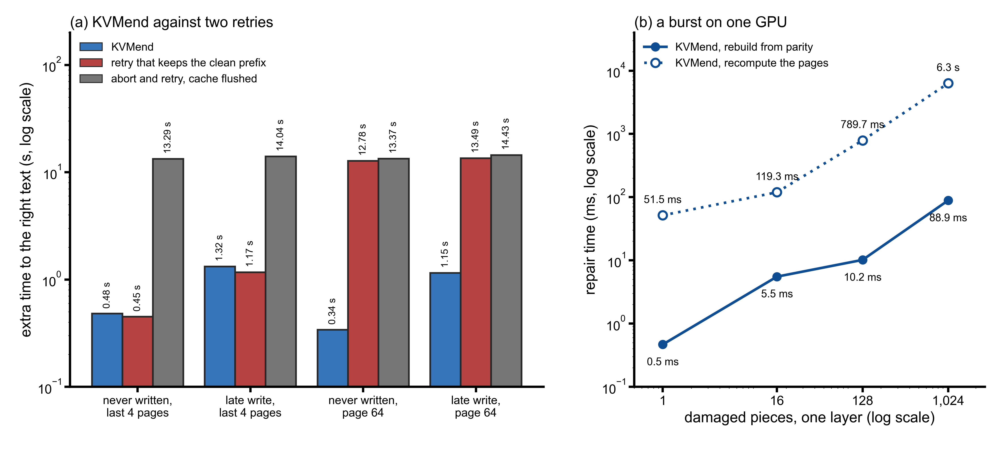

*Figure 13. Repairs on the main setup (Llama-3.1-8B at TP=8 on our 8 A100 GPUs; one run each).*

*(a) Extra time to the right text, by where the damage sits, on a log scale: KVMend, a retry that keeps the clean prefix and recomputes from the damaged page, and an abort and retry that flushes the cache (Table 15).*

*(b) Repair time of a burst on one GPU against the damaged pieces in one layer, on a log scale: rebuilt from parity, or recomputed. The burst over 8 layers is in Table 18.*

### 7.6 The release rule on a streamed request

Section 7.4 returned the right text only for a request that was not streamed. Here R streams its 80 tokens, and from output 2 its last four prompt pages hold KV never written for it, on every GPU.

That is the incident's kind of damage, but here it strikes after the check that follows the prefill has passed.

Under strict release, the release rule's own checks must find the damage. It checks right after the prefill, then before every token or every 8 tokens, each time over all layers in one kernel launch (Table 17).

*Table 17. The release rule on a streamed request (80 output tokens; pages never written from output 2; one run each): TinyLlama-1.1B at TP=2 with a 1,536-token prompt, and Llama-3.1-8B at TP=8 with a 32,768-token prompt.*

| Release                          | Damage              | Wrong tokens the client received (TinyLlama / 8B) | Final text right (TinyLlama / 8B) | Median gap between chunks (TinyLlama / 8B) | Checks: count, median time (TinyLlama / 8B) | Damage found at output | Tokens regenerated |
| -------------------------------- | ------------------- | ------------------------------------------------- | --------------------------------- | ------------------------------------------ | ------------------------------------------- | ---------------------- | ------------------ |
| Fast                             | none                | 0 / 0                                             | yes / yes                         | 3.6 / 15.1 ms                              | none                                        |                        |                    |
| Strict, check before every token | none                | 0 / 0                                             | yes / yes                         | 4.6 / 16.9 ms                              | 80: 0.4 / 1.0 ms                            |                        |                    |
| Fast                             | pages never written | 78 of 80 / 78 of 80                               | no / no                           | 3.6 / 15.1 ms                              | none                                        |                        |                    |
| Strict, check every 8 tokens     | pages never written | 0 / 0                                             | yes / yes                         | 29.6 / 123.1 ms (chunks of 8)              | 12: 0.4 / 1.0 ms                            | 8                      | 7                  |
| Strict, check before every token | pages never written | 0 / 0                                             | yes / yes                         | 4.6 / 17.0 ms                              | 81: 0.4 / 1.1 ms                            | 2                      | 1                  |

On both models fast release, which had no checks in these runs (§7.1), streamed 78 wrong tokens of 80, with no error. Strict release sent none: a check found the damage before any token that read it left.

KVMend then recomputed the four pages, kept the first token, which the check after the prefill had covered, and regenerated only the tokens after it.

Both strict texts equal the clean text, and a fault-free control that takes the same repair path.

The check is now cheap: 0.4 ms on TinyLlama and about 1.0 ms on Llama-3.1-8B. There, checking before every token lengthened the median gap between tokens from 15.1 to 16.9 ms, 12%; checking every 8 tokens sends tokens in bursts of 8.

Earlier runs checked layer by layer, with a late write at output 10. Their checks took 6 ms on TinyLlama and 9 ms on Llama-3.1-8B, and checking before every token made the gap 2.2 and 1.6 times as long.

On TinyLlama that late write sent 70 wrong tokens under fast release and none under strict release. On Llama-3.1-8B it did not change the text, which is why Table 17 uses pages never written.

The check after the prefill fixes a flaw an earlier run found. When damage struck before a request's first check, all its cached KV counted as suspect, and its whole prompt was recomputed.

In the runs of Table 17, nothing was evicted.

### 7.7 When parity pays: bursts

Recompute is KVMend's default, and parity an option for bursts (§4.4). We damaged 1 to 1,024 of a request's pieces on one GPU and repaired them both ways, with parity across the GPUs (Table 18, Figure 13b).

*Table 18. Rebuild from parity against recompute in place, for a burst on one GPU (one run each; both gave the right text every time): TinyLlama-1.1B at TP=2 with a 1,536-token prompt, Llama-3.1-8B at TP=8 with 20,480.*

| Model        | Burst (pages × layers) | Pieces | Rebuild reads | Rebuild time | Recompute     | Recompute time |
| ------------ | ---------------------- | ------ | ------------- | ------------ | ------------- | -------------- |
| TinyLlama    | 1 × 1                  | 1      | 16 KiB        | 5.1 ms       | 16 tokens     | 32.3 ms        |
| TinyLlama    | 8 × 1                  | 8      | 128 KiB       | 0.8 ms       | 128 tokens    | 32.0 ms        |
| TinyLlama    | 64 × 1                 | 64     | 1 MiB         | 4.9 ms       | 1,024 tokens  | 32.9 ms        |
| TinyLlama    | 64 × 8                 | 512    | 8 MiB         | 40.0 ms      | 1,024 tokens  | 32.7 ms        |
| Llama-3.1-8B | 1 × 1                  | 1      | 64 KiB        | 0.5 ms       | 16 tokens     | 51.5 ms        |
| Llama-3.1-8B | 16 × 1                 | 16     | 1 MiB         | 5.5 ms       | 256 tokens    | 119.3 ms       |
| Llama-3.1-8B | 128 × 1                | 128    | 8 MiB         | 10.2 ms      | 2,048 tokens  | 789.7 ms       |
| Llama-3.1-8B | 1,024 × 1              | 1,024  | 64 MiB        | 88.9 ms      | 16,384 tokens | 6,321.8 ms     |
| Llama-3.1-8B | 128 × 8                | 1,024  | 64 MiB        | 94.0 ms      | 2,048 tokens  | 790.8 ms       |

On TinyLlama a recompute of up to 1,024 tokens takes a flat 33 ms. So a rebuild wins up to 64 pieces and loses at 512, where gathering 8 MiB over PCIe takes 40 ms. The first rebuild includes the first exchange between the GPUs.

On Llama-3.1-8B a rebuild won at every size we tried, by 8 to 110 times: 0.5 ms against 51.5 ms for one page, and 89 ms against 6.3 s for 1,024 pages. Recompute grows with the tokens; a rebuild reads 64 KiB per piece.

Parity also makes a repair exact. Recompute is not: on Llama-3.1-8B it left only about 20% of the pages' K and V values bit-identical (largest difference 1.05), though the text still matched.

A stripe within one GPU has limits. It rebuilds one page per stripe and layer, so in an earlier run, with four damaged pages in one stripe of eight, KVMend fell back to recompute.

And a write through the store path marks its page as not yet encoded, so the old parity no longer covers it. This is why another sequence's KV in §7.5 was recomputed, not rebuilt.

Damage to what KVMend keeps falls back the same way. With a stored tag or the parity damaged on one GPU, the rebuilt piece failed its tag, and KVMend recomputed the page: +1.2 to +1.3 s on Llama-3.1-8B, with the right text.

### 7.8 Under load

So far one request ran alone. Here 24 requests run at once: four groups of six, each group sharing a prefix in SGLang's prefix cache (1,024 tokens on TinyLlama, 8,192 on Llama-3.1-8B), each request generating 64 tokens.

Four faults strike in one run, and the release rule's own checks, every 4 tokens, must find them:

- a late write into group 0's shared prefix, which all six of its requests read;
- another sequence's KV in one request's own page;
- a burst over 8 pages in 2 layers on one GPU;
- a late write that carries an old generation.

On both models each fault that changed KV was found by the next check of a request that read it. One reader's check found the shared late write at output 12; its five other readers then regenerated the tokens they were holding.

The burst was rebuilt from parity, bit for bit, in a repair step of 9 ms on TinyLlama and 12 ms on Llama-3.1-8B (1.6 ms of rebuilding on 8B). Another sequence's KV was recomputed, 16 tokens, and the modelled fence dropped the stale write.

On TinyLlama all 24 strict outputs were right, while fast release, with no checks, gave 11 of 24 wrong outputs under the same faults, with no error. An output counts as right when it equals one of three fault-free runs (§5.4).

On Llama-3.1-8B, 11 of 24 requests already vary among the three fault-free runs, so that rule no longer tells damage from batching. On the 13 that do not vary, strict release returned their fault-free text for all 13.

Fast release, with no checks, returned it for 12 of the 13: one went wrong right after the burst struck its group. Two strict outputs match no fault-free run; both belong to requests that vary anyway, and one read no damaged page.

The guard cost the most here: one batched check of all due requests, launched layer by layer, took 8.1 ms on TinyLlama and 36 ms on Llama-3.1-8B, every 4 steps.

Run times in that job varied up to threefold between identical runs, so we price the guard by its checks.

A repeat on Llama-3.1-8B with five fault-free runs and the one-launch check passed: 11 requests gave the same text in all five, and strict release returned it for all 11.

Fast release, with no checks, also returned all 11 this time, so this run shows that strict release stays right, not that it avoided harm.

Its batched check took 5.0 ms per step instead of 36 ms. Run times were steady this time, and strict release took about 10% longer than fast release with no checks.

### 7.9 Requests arriving over time

So far, the requests of a run were sent at once. Here 64 requests arrive over time, 8 per second on average, on Llama-3.1-8B at TP=8. They form four groups that each share an 8,192-token prefix, and each generates 64 tokens.

The four faults of §7.8 strike while they run: a late write into one group's shared prefix, another sequence's KV in one request's own page, a burst on one GPU, and a late write that carries an old generation.

Three responses run in one engine, each once without the faults and once with them (Table 19). Strict release checks every 4 tokens.

Abort and retry makes the same checks, but a failed check aborts every reader of the damaged pages, and the client resubmits them. Fast release keeps the tags and parity, but has no checks and no fence.

A request is stable when five fault-free runs give it the same text; 41 of 64 are. A miss is a stable request that released a wrong token after the damage struck and before the repair.

A wrong token released before the damage struck was computed from intact KV. It is batch variation, which SGLang shows between identical runs at TP=8, so it is reported but not counted as a miss.

*Table 19. Requests arriving over time (Llama-3.1-8B at TP=8; 64 requests at 8 per second, in four groups with 8,192-token shared prefixes; 64 output tokens each; one run each; times are medians over the run's requests).*

| Response                | Faults | Right outputs | Right requests per second | Misses | Output tokens/s | Time to first token | End to end |
| ----------------------- | ------ | ------------- | ------------------------- | ------ | --------------- | ------------------- | ---------- |
| Fast release, no checks | none   | 64 of 64      | 5.04                      | 0      | 322             | 91 ms               | 5.17 s     |
| Fast release, no checks | four   | 36 of 64      | 2.85                      | 17     | 324             | 92 ms               | 5.14 s     |
| Strict release          | none   | 64 of 64      | 4.67                      | 0      | 299             | 199 ms              | 6.67 s     |
| Strict release          | four   | 56 of 64      | 4.01                      | 0      | 294             | 202 ms              | 7.49 s     |
| Abort and retry         | none   | 64 of 64      | 4.71                      | 0      | 302             | 182 ms              | 6.25 s     |
| Abort and retry         | four   | 57 of 64      | not timed                 | 0      | not timed       | not timed           | not timed  |

With the faults, strict release returned 56 of 64 right outputs, 4.01 right requests per second; with no checks, 36 of 64 were right, 2.85 per second. Strict release had no miss, and no checks had 17.

Of strict release's eight wrong outputs, two belong to stable requests that read no damaged page and passed every check. The other six belong to requests whose text varies between fault-free runs anyway.

Abort and retry also had no miss, and returned 57 of 64 right outputs, but it aborted 21 times. Its run with faults stalled for 3.9 s, so its timing is not reported.

Every fault that was not fenced was found, under strict release and under abort and retry, and the modelled fence dropped the fourth.

Without faults, strict release cost about 7% of throughput against fast release in the same engine: 299 against 322 output tokens/s.

It also added about 110 ms to the median time to first token (199 against 91 ms), and 1.5 s to the median end-to-end time (6.67 against 5.17 s).

TinyLlama at TP=2 passed the same checks in two jobs. We refined the rule for misses after an earlier run of this test, whose two strict misses were tokens sent before the damage struck.

### 7.10 Loads from host memory that land on only some GPUs

SGLang's hierarchical cache keeps copies of cached KV in host memory, and loads them back when a request reuses them. Each GPU loads its own share, so a load can fail on one GPU alone.

Here R loads the first 32,752 tokens of its 32,768-token prompt from host memory, on Llama-3.1-8B at TP=8. Four of the pages do not land on GPU 1, which keeps zeros there, in all 32 layers (Table 20).

*Table 20. A load from host memory that misses one GPU (Llama-3.1-8B at TP=8; 32,752 of 32,768 prompt tokens loaded; four pages left as zeros on GPU 1 in every layer; one run each; extra time over 1.62 s, a fault-free load).*

| Response                     | Found by                                  | Repair                                               | Text right     | Extra time |
| ---------------------------- | ----------------------------------------- | ---------------------------------------------------- | -------------- | ---------- |
| No checks                    | nothing                                   | none                                                 | yes: unchanged | +0.01 s    |
| KVMend                       | the check on arrival: 128 pieces on GPU 1 | copy them again from host memory                     | yes            | +0.03 s    |
| KVMend, check on arrival off | the reader's check after the prefill      | copy them again; regenerate the first token          | yes            | +0.33 s    |
| KVMend, check on arrival off | the reader's check after the prefill      | recompute the four pages; regenerate the first token | yes            | +0.40 s    |
| Abort and retry              | the reader's check after the prefill      | abort, flush the cache, recompute the prompt         | yes            | +13.33 s   |

The tags travelled with the host copy and raised no false alarm after a load. The check on arrival found the damage before any forward read it, copied the 128 pieces again, and added 0.03 s.

With the check on arrival turned off, a reader's check that the test placed right after the prefill found the damage instead. The repair then added 0.33 or 0.40 s; abort and retry added 13.33 s.

On Llama-3.1-8B the zeros did not change the text, even with no checks. On TinyLlama at TP=2 the same kind of fault did change it, and the check on arrival found it and gave back the right text.

The check on arrival, still built from PyTorch operations, took 0.16 to 0.17 s per load on the slowest GPU. Every load ran it, the reference included, so its cost to a request is not yet priced.

The TinyLlama run also found a bug. After a failed reader's check, the rollback had reused a prompt page that the prefill computed on top of the damaged load, so the text stayed wrong.

The fixed rollback undoes the whole prefill, and the rerun gave the right text.

### 7.11 A store skipped during the prefill

A long prompt is computed in chunks, and each chunk reads the earlier chunks' KV from the pool. If the store of one page is skipped while the prefill runs, every later chunk reads wrong KV there.

We skipped the store of the page at position 1,024, on every GPU. On both models, the release rule's check right after the prefill found it by its coverage, and the chunk rule recomputed the page and every later chunk (Table 21).

*Table 21. A store skipped during the prefill: KVMend's chunk rule against mending the page alone (one run each; every text right).*

| Model                  | Prompt                           | Chunk rule: tokens recomputed | Chunk rule: extra time | Same repair, no fault | Page alone: tokens recomputed | Page alone: extra time |
| ---------------------- | -------------------------------- | ----------------------------- | ---------------------- | --------------------- | ----------------------------- | ---------------------- |
| TinyLlama-1.1B at TP=2 | 1,536 tokens in chunks of 256    | 288                           | +0.32 s                | +0.40 s               | 16                            | +0.03 s                |
| Llama-3.1-8B at TP=8   | 32,768 tokens in chunks of 8,192 | 24,608                        | +10.58 s               | +10.62 s              | 16                            | +0.15 s                |

On Llama-3.1-8B the page lies in the first chunk, so the rule recomputes three quarters of the prompt, for 10.58 s; mending the page alone took 0.15 s. A fault-free run on the same repair path cost about as much as the rule.

No text changed on either model, even when only the page was mended and the later chunks kept KV computed from the wrong page. So these runs price the rule, but do not show the harm it prevents.

Nor does the KV tell the two repairs apart: after either one, the later chunks' KV differs from the fault-free KV, because it read the wrong page or because a recompute is not bit for bit.

The proof of concept runs this recompute inside a scheduler step, so any other request in the batch would wait as long (§4.4).

### 7.12 Checks on read that repair

A check on read finds damage while attention reads it. With the repair setting on, a failure withholds that step's token from every reader of the damaged page, mends the page, and the readers generate the token again.

We tested two kinds of damage on a 1,536-token prompt: one flipped bit on one GPU, and a late write into four pages on every GPU (Table 22). Each repaired text equals a fault-free run on the same repair path.

*Table 22. Checks on read that repair (1,536-token prompt, 80 output tokens; one run each).*

| Model                  | Damage                | Found                   | Repair                                        | Repair time | With the check only logging              |
| ---------------------- | --------------------- | ----------------------- | --------------------------------------------- | ----------- | ---------------------------------------- |
| TinyLlama-1.1B at TP=2 | one bit, one GPU      | at the next decode step | rebuilt from parity                           | 22 ms       |                                          |
| TinyLlama-1.1B at TP=2 | late write, every GPU | at the next decode step | recomputed 64 tokens; 1 token generated again | 24 ms       | fluent but different text from output 10 |
| Llama-3.1-8B at TP=8   | one bit, one GPU      | at the next decode step | rebuilt from parity                           | 206 ms      |                                          |
| Llama-3.1-8B at TP=8   | late write, every GPU | at the next decode step | recomputed 64 tokens; 1 token generated again | 89 ms       | fluent but different text from output 10 |

On both models the late write turned the text wrong from output 10 when the check only logged. With the repair on, the text equalled its fault-free run on the same path.

Every GPU must agree on a finding before the step's tokens are processed, which adds one collective per decode step. Its cost is not yet measured.

### 7.13 What the results mean for the plan

The current version supports H1 for the incident's kinds of damage: the checks found three, each by the part built for it, and the modelled fence dropped the fourth. The scrub alone found one of four.

It also found a load from host memory that missed one GPU, on arrival, and a probe's bit flip at the next decode step, by checks on read inside attention.

With the repair on, a late write that a check on read found was mended at the next decode step, and the text stayed right (§7.12).

It supports H3 and H4 for whole pages damaged on every GPU, with no abort.

Against a retry that keeps the clean prefix, KVMend was about 12 times faster for damage at page 64 that came after a passing check.

A page never written in the first chunk cost nearly as much as that retry, because the chunk rule recomputes the later chunks. Near the end of the prompt, both were cheap.

It supports H9 on both models: strict release sent none of the 78 wrong tokens that a server with no checks streamed. In one launch a check costs 0.4–1.1 ms; checking before every token lengthened 8B's gap between tokens by 12%.

With requests arriving over time, strict release had no miss and returned 56 of 64 right outputs, against 36 with no checks. Without faults, it cost about 7% of throughput and 110 ms of median time to first token.

Under load on Llama-3.1-8B, a check every 4 tokens cost strict release about 10%.

On one A100, fused tags alone cost 1.5% of Llama-3.1-8B's throughput, and 3.2% on a decode-heavy workload, just above H7's target. On TinyLlama at TP=2 they cost 1.6%.

On 8 GPUs, the tags cost less than plain SGLang varies between runs, and checks on read stayed within 1.2% of tags alone.

Parity costs 4.3% on 8B, far more on TinyLlama, but on 8B it repairs a burst 8 to 110 times faster than recompute (H8).

So keeping tags is cheap in this setup, though close to H7's target for decode-heavy work on one GPU, and parity is worth its cost where bursts are expected and recompute is slow.

Still to measure: the scrub at its design rate, checks before a cached prefix is reused, the cost of the check on arrival, checks on read on one GPU, and the tags on the 32B setup.

The results also bound what mending can promise. Without the guard, it repairs the KV but not text already sent (§7.2); and since recompute is not bit for bit, a repaired text can differ where tokens are near-tied (§7.5).

The chunk rule is costly as well: a page never written early in a 32K-token prompt makes KVMend recompute three quarters of it, and no run has yet shown the wrong text that this prevents (§7.11).

Still open: checks on read in prefill attention; host copies in the cleanup paths of the release rule and the abort rule (§8); and a second engine.

## 8 Risks and Threats to Validity

Table 23 lists the main risks and how we handle them.

*Table 23. Risks and mitigations.*

| Risk                                                                                                        | Effect                                                                                                                     | Mitigation                                                                                                                                                                                                                                                                |
| ----------------------------------------------------------------------------------------------------------- | -------------------------------------------------------------------------------------------------------------------------- | ------------------------------------------------------------------------------------------------------------------------------------------------------------------------------------------------------------------------------------------------------------------------- |
| Per-page parity takes longer to build than planned                                                          | less time for experiments                                                                                                  | parity is an option; XOR parity across GPUs and within one GPU already works (§7.5, §7.7); Reed–Solomon only if time allows                                                                                                                                               |
| Tag work costs more than the 3% target                                                                      | lower fault-free throughput                                                                                                | fused Triton kernels inside SGLang's decode CUDA graphs: on one A100, tags alone cost 1.5% on 8B, and 3.2% on a decode-heavy workload, just above the target; 1.6% on TinyLlama at TP=2 (§7.3); the 32B setup is next                                                     |
| The guard's checks take a large share of a decode step                                                      | strict requests stream more slowly                                                                                         | one launch over all layers (0.4–1.1 ms per check, §7.6), a check every few tokens, checks on read inside attention; the guard stays a per-request option; with requests arriving over time it cost about 7% of throughput and 110 ms of median time to first token (§7.9) |
| Checks inside the attention kernel slow decode                                                              | higher time per output token                                                                                               | measured on 8B at TP=8: +0.4% and −1.2% of throughput against tags alone (§7.3); still to measure on one GPU, where steps are shorter; fall back to targeted checks before release and a rate-limited scrub                                                               |
| Damage during a long prefill taints the rest of the prompt                                                  | the repair grows to every later prompt chunk, and the proof of concept stalls the batch while it runs                      | built: after a failed check right after the prefill, KVMend re-prefills the later chunks; for page 64 of a 32K-token prompt, 24,608 tokens and +10.58 s (§7.11); the design repairs beside the batch (§4.4); report how often this happens                                |
| Recompute is not bit for bit                                                                                | a repaired request can give another text where tokens are near-tied                                                        | compare with a fault-free run on the same recompute path; parity where an exact repair matters (§7.5)                                                                                                                                                                     |
| Most real corruption hits every GPU                                                                         | parity rebuild is rarely used                                                                                              | recompute is the default and covers that case; we report the split between the two paths                                                                                                                                                                                  |
| ECC corrects or reports memory errors on our A100s                                                          | silent hardware faults are rare here                                                                                       | software injection of the incident's kinds of damage, and results for GPUs without ECC [11]                                                                                                                                                                               |
| One server, without RDMA                                                                                    | we cannot reproduce the incident's transfers between machines                                                              | inject their effects, such as pages never written or misplaced, directly into the KV (§5.4, §7.5)                                                                                                                                                                         |
| Run times vary between identical runs, on a shared server and even alone on it                              | noisy costs; one plain-SGLang engine on 8 GPUs ran twice as fast as all others (§7.3)                                      | report the median of repeated runs, let the modes take turns in one job, and price the guard by its checks rather than run times (§7.3, §7.8)                                                                                                                             |
| Every run turned off SGLang's overlap scheduler                                                             | checks and rollbacks between steps may not fit an engine that launches the next step early                                 | move the checks into the step's own stream, and measure with the overlap scheduler on                                                                                                                                                                                     |
| A damaged page under a popular shared prefix                                                                | all its readers hold back or regenerate at once: a repair storm                                                            | repair the page once, regenerate its readers in one batch, and measure under arriving requests, as begun in §7.9                                                                                                                                                          |
| The cleanup paths of the release rule and the abort rule do not yet handle entries of the host-memory cache | after a repair or an abort, a host copy of suspect KV could stay cached and be loaded later, or its host memory could leak | extend both cleanups to host copies, as the rollback after a failed load already does (§7.10), and test them with loads from host memory                                                                                                                                  |
| One engine: every result is on SGLang 0.5.1                                                                 | the results may not carry over to other engines                                                                            | state it as a limit; a port to vLLM would need tag updates where vLLM writes KV, checks over a request's pages, and changes to its prefix cache and chunked prefill                                                                                                       |
| A tag certifies wrong values if the computation itself was wrong                                            | compute errors are missed                                                                                                  | stated as out of scope in §4.1                                                                                                                                                                                                                                            |
| Scrubbing slows serving                                                                                     | lower throughput                                                                                                           | a rate limit and a staggered order [23]; we measure the trade-off                                                                                                                                                                                                         |
| PCIe-only server                                                                                            | absolute repair times differ from NVLink servers                                                                           | we report tokens recomputed and data read as well as time                                                                                                                                                                                                                 |

## 9 Why not something simpler?

Simpler tools come to mind for silent KV damage. Table 24 sets each against KVMend, and says where the simpler tool is the better choice.

*Table 24. Simpler alternatives: what each misses, and where it is the better choice.*

| Alternative                                                        | What it does well                                                              | What it misses                                                                                                                                                                          | Where it is the better choice                                                                                             |
| ------------------------------------------------------------------ | ------------------------------------------------------------------------------ | --------------------------------------------------------------------------------------------------------------------------------------------------------------------------------------- | ------------------------------------------------------------------------------------------------------------------------- |
| ECC on GPU memory                                                  | corrects or reports memory errors                                              | damage from software: pages never written, late writes, misplaced pages, as in the incident                                                                                             | memory errors on GPUs with ECC                                                                                            |
| A checksum on each KV transfer, as SGLang added [2]                | catches damage in transit, then aborts                                         | damage after the transfer: late writes into reused slots, reuse from the prefix cache, loads from host memory                                                                           | a server whose only risk is the transfer                                                                                  |
| Fixing and fuzzing the engine                                      | removes known bugs; a write fence in the store path would be one               | the next unknown bug: 7 of the 13 bugs in one fuzzer's table were cross-request KV corruption [19]                                                                                      | always, next to KVMend                                                                                                    |
| Abort and retry                                                    | right text, with no repair code                                                | finding the damage, which it needs first; it recomputes the request from the first page it cannot trust, and aborts every reader of that page                                           | damage near the end of a prompt, or a short prompt; nearly as good for a page never written early in a long prompt (§7.5) |
| Restarting the engine when a check fails                           | simple, and clears every bad state                                             | every request in flight is recomputed, not one page; the bug can strike again after the restart                                                                                         | damage to the engine's own state, which tags do not cover                                                                 |
| A NaN check or another monitor of the output                       | cheap, and independent of the engine                                           | fluent but wrong text, which damage of the incident's kinds gave in §7.5; it cannot name or repair the damage                                                                           | bit flips that make a NaN (§7.4)                                                                                          |
| SGLang's KV canary [1, 2]                                          | flags possible corruption                                                      | it only logs: it names no page and repairs nothing, and the posts do not say what it checks                                                                                             | a first alarm where KVMend is not deployed                                                                                |
| A range check on stored K and V                                    | catches bit flips that make huge values                                        | damage that stays in range: the incident's kinds put real KV of other tokens in place                                                                                                   | a cheap filter for memory errors                                                                                          |
| Filling freed slots with NaN                                       | a read after free or a page never written turns into NaN, which a monitor sees | a write per freed page; late writes and misplaced pages, which hold real values                                                                                                         | a debugging mode                                                                                                          |
| Parity alone, as in GhostServe [10]                                | rebuilds damage on one GPU exactly                                             | finding the damage; pages never written or misplaced; damage on every GPU                                                                                                               | none: parity is KVMend's option for bursts                                                                                |
| A full copy of the KV in host memory                               | exact repair, even of damage on every GPU                                      | a second copy of all cached KV in host memory, against 12.5% for XOR parity and 0.05% for tags, plus the copy traffic                                                                   | a server with spare host memory; KVMend can repair from such a copy                                                       |
| Running each request twice, or a sample of requests, and comparing | also catches wrong computation                                                 | twice the compute for each request compared; in SGLang 0.5.1, 11 of 24 fault-free requests already differ between runs on Llama-3.1-8B (§7.8), so comparing needs deterministic kernels | faults in computation, which KVMend leaves out (§4.1)                                                                     |
| Checksums carried through the attention math                       | catches wrong computation                                                      | KV that was wrong before the math: the checksums are computed from the stored KV, so they agree with it                                                                                 | faults in computation, outside KVMend's scope (§4.1)                                                                      |
| Turning off the prefix cache                                       | damaged shared KV no longer spreads                                            | the cache's savings; damage to a request's own KV                                                                                                                                       | none                                                                                                                      |
| A standard hash such as CRC32C                                     | stronger guarantees for some patterns of damage                                | parts that add in any order: a CRC part must be shifted for its position first (§4.2)                                                                                                   | blocks checked whole, as in storage                                                                                       |

**Is the damage common enough to care?** No, and the design follows from that. Only the tags and a slow scrub run all the time.

On one A100 the tags cost 1.5% to 3.2% of Llama-3.1-8B's throughput; the scrub is not measured at its design rate yet.

Checks run when KV is reused or released; the rest, after a check fails.

What earns even that cost is how this failure looks: wrong answers with HTTP 200, and in the incident, KV from other requests [1]. Fuzzers keep finding this class of bug in vLLM and SGLang [19, 20].

**Why hash the bytes, if metadata catches most of it?** Three of the four kinds in §7.5 could be caught from metadata alone: which slots were written, their generation, and the token each slot was written for.

A write around the store path changes only the bytes, and that is the incident's own path: a network transfer that writes straight into the KV pool. Memory errors change only the bytes too.

So does a load from host memory that misses one GPU: the page's records say it was loaded, but its bytes are wrong (§7.10).

Mixing the token key into the byte tag lets one check cover all of these.

**What do the tags really cost?** Our cleanest measurement is on one A100, where a decode step is short, so tag work weighs more: tags alone cost 1.5% of Llama-3.1-8B's throughput, and 3.2% on a decode-heavy workload (§7.3).

The 3.2% is just above H7's target of 3%. The 0.3% of Table 11 was measured where a step is slow next to tag work: over PCIe at TP=8, on a mostly prefill workload. On TinyLlama at TP=2, tags alone cost 1.6%.

Every run had SGLang's overlap scheduler off. Faster servers, the overlap scheduler and the 32B setup are still to measure (§8).

**When is a plain retry enough?** When the damage is near the end of the prompt, or the prompt is short, a retry that keeps the clean prefix recomputes little, and costs about as much as KVMend's repair (§7.5).

KVMend's repair pays off when damage early in a long prompt comes after a passing check: a late write at page 64 of a 32K-token prompt cost it 1.00 s, and the retry 11.87 s (Table 16).

When the check right after the prefill fails instead, KVMend cannot tell whether the later prompt chunks read the damage, so it recomputes them. A page never written at page 64 then cost 8.96 s, near the retry's 11.19 s.

So the retry is nearly as good for a page never written early in a long prompt. KVMend still keeps the request running, with no abort for the client to handle.

KVMend now makes the check right after the prefill itself, for every request when a setting is on (§7.1). Without a passing check, it counts the whole cached prompt as suspect and recomputes it.

With requests arriving over time, abort and retry also had no miss, but it aborted 21 times (§7.9).

**What does deploying it take?** A patch on every path that writes or frees KV: the store path, loads from host memory, eviction, rollback, and transfers, so that tags travel with KV between machines.

In SGLang, the copies to and from host memory bypass the store path. So the proof of concept patches them on their own: the tags travel with the host copy, and each loaded layer is checked on arrival (§7.10).

Checks on read also need a change to each attention kernel. The proof of concept changes copies of SGLang's Triton decode kernels (§7.3); prefill attention and the other attention backends still need theirs.

A writer that skips its tags causes false alarms, so each new write path needs a test.

The proof of concept hit two false alarms, both fixed: stale token keys in CUDA graphs, and a rollback misread as a read after free, which looped until the time limit.

It also hit a repair that left the text wrong, now fixed: after a failed load from host memory, the rollback reused a prompt page computed on the damaged load (§7.10).

Each cleanup path must also handle every kind of cache entry; those of the release rule and the abort rule do not yet handle host copies (§8).

A first deployment can run the tags and checks alone, and add repair, the guard and parity later. Operators also need an alert for each detection and a limit on repeated repairs of one slot (§4.6), not built yet.

Every result so far is on one engine, SGLang 0.5.1. A port to vLLM would need tag updates where vLLM writes KV, checks over a request's pages, and changes to its prefix cache and chunked prefill (§8).

## 10 Timeline

Table 25 gives an eight-week plan, to be adjusted to the course deadline.

The proof of concept of §7 already covers much of weeks 1–5: fused tags with generations and token keys; a fence modelled in the test; XOR parity; recompute and rebuild in place; the release rule with a one-launch check.

It also covers checks on read in decode attention, checks of loads from host memory, the check right after every prefill with the chunk rule, and abort and retry as a baseline. A first test with requests arriving over time ran too.

What remains in those weeks: checks on read in prefill attention; checks before a cached prefix is reused and after risky events; a fence in the store path.

Also: later checks for fast-release requests, Reed–Solomon parity, host copies in the cleanup paths, the scrub at its design rate, and the 32B setup. Weeks 6–8 are still ahead.

*Table 25. Eight-week plan.*

| Week | Work                                                                                                                                                       | Output                                        |
| ---- | ---------------------------------------------------------------------------------------------------------------------------------------------------------- | --------------------------------------------- |
| 1    | SGLang 0.5.1 at TP=8 on A100; fault injector with a bit-position sweep; fault-free KV snapshots                                                            | baseline throughput; working injector         |
| 2    | Running tags with slot generations, write fences and token keys; checks on read in the Triton attention kernel; checks before reuse and after risky events | detection working; tag and check overhead     |
| 3    | Recompute of a damaged page in place; holding readers; rate-limited scrub                                                                                  | repair of damage on any number of GPUs        |
| 4    | Optional per-page parity with batched encoding (XOR; RS if time allows) and reference counts; rebuild in place                                             | exact repair of damage on one GPU, for bursts |
| 5    | Repair set: partial retract, then regenerate or re-prefill suspect tokens; release rule; eviction of cached suspect KV; refresh tags and parity            | complete repairs; no unchecked token released |
| 6    | Repair list and watch list; slot retirement if time allows                                                                                                 | scheduling policies working                   |
| 7    | Experiments for RQ1–RQ5                                                                                                                                    | results                                       |
| 8    | Analysis and write-up                                                                                                                                      | final report                                  |

## References

1. Cloudflare. Cross-request KV cache exposure in the GLM-5.3 Workers AI model, and our remediation with SGLang. Cloudflare blog, 26 October 2026. https://blog.cloudflare.com/kv-cache-exposure-remediation/
2. SGLang Team. SGLang security update: improving request isolation. LMSYS blog, 26 October 2026. https://www.lmsys.org/blog/2026-10-26-cf-security/
3. S. Saereesitthipitak, M. Abdulwahhab, H. Zhang, D. Feigin, N. Shah, M. Khadkevich, I. Neeman, V. S. Mailthody, W. W. Hwu. Fast Recovery for LLM Serving via Decoupled Device Memory Lifetime in Dynamo. arXiv:2609.25451, 2026. https://arxiv.org/abs/2609.25451
4. SGLang v0.5.1 source. Server argument --watchdog-timeout, default 300 s: "If a forward batch takes longer than this, the server will crash to prevent hanging." python/sglang/srt/server_args.py. https://github.com/sgl-project/sglang/blob/v0.5.1/python/sglang/srt/server_args.py
5. vLLM v0.11.0 source. Environment variable VLLM_EXECUTE_MODEL_TIMEOUT_SECONDS, default 300 s: "Timeout in seconds for execute_model RPC calls in multiprocessing executor (only applies when TP > 1)." vllm/envs.py. https://github.com/vllm-project/vllm/blob/v0.11.0/vllm/envs.py
6. Kubernetes documentation. Configure Liveness, Readiness and Startup Probes. https://kubernetes.io/docs/tasks/configure-pod-container/configure-liveness-readiness-startup-probes/
7. F. Strati, S. McAllister, A. Phanishayee, J. Tarnawski, A. Klimovic. DéjàVu: KV-cache Streaming for Fast, Fault-tolerant Generative LLM Serving. ICML 2024, PMLR 235:46745–46771. https://arxiv.org/abs/2403.01876
8. Z. Xu, Z. Xie, S. Gandhi, C. Kozyrakis. FailSafe: High-performance Resilient Serving. arXiv:2511.14116, 2025. https://arxiv.org/abs/2511.14116
9. Z. Cao, S. Han, J. Zhang, Y. Ren, Y. Li, P. P. C. Lee. LUMEN: Coordinated Failure Recovery for Distributed LLM Serving. arXiv:2606.17787, 2026. https://arxiv.org/abs/2606.17787
10. S. Jayakody, Y. Zhao, C. Nehate, J. Wang. GhostServe: A Lightweight Checkpointing System in the Shadow for Fault-Tolerant LLM Serving. MLSys 2026. https://arxiv.org/abs/2605.00831. Code: https://github.com/kennethzhao24/GhostServe-MLSys26
11. Yamamoto, Matsuura. Bit-Flip Vulnerability of Shared KV-Cache Blocks in LLM Serving Systems. SECRYPT 2026; arXiv:2604.17249. https://arxiv.org/abs/2604.17249
12. L. Zheng, L. Yin, Z. Xie, C. Sun, J. Huang, C. H. Yu, S. Cao, C. Kozyrakis, I. Stoica, J. E. Gonzalez, C. Barrett, Y. Sheng. SGLang: Efficient Execution of Structured Language Model Programs. NeurIPS 2024. https://arxiv.org/abs/2312.07104. Code: https://github.com/sgl-project/sglang/tree/v0.5.1
13. W. Kwon, Z. Li, S. Zhuang, Y. Sheng, L. Zheng, C. H. Yu, J. E. Gonzalez, H. Zhang, I. Stoica. Efficient Memory Management for Large Language Model Serving with PagedAttention. SOSP 2023. https://doi.org/10.1145/3600006.3613165
14. D. A. Patterson, G. Gibson, R. H. Katz. A Case for Redundant Arrays of Inexpensive Disks (RAID). SIGMOD 1988, pp. 109–116. https://doi.org/10.1145/50202.50214
15. P. Corbett, B. English, A. Goel, T. Grcanac, S. Kleiman, J. Leong, S. Sankar. Row-Diagonal Parity for Double Disk Failure Correction. USENIX FAST 2004.
16. I. S. Reed, G. Solomon. Polynomial Codes Over Certain Finite Fields. Journal of the SIAM 8(2):300–304, 1960. https://doi.org/10.1137/0108018
17. NVIDIA. NVIDIA GPU Memory Error Management: Row Remapping. NVIDIA documentation. https://docs.nvidia.com/deploy/a100-gpu-mem-error-mgmt/row-remapping.html
18. LMCache issue #4463. [Bug][GPU Connector] Silent KV cache corruption on vLLM 0.26 fused/packed KV layout. GitHub, 2026. https://github.com/LMCache/LMCache/issues/4463
19. Y. Zhao, Y. Zhao, Y. Zhang, Z. Liu, M. L. Mazurek. Continuous Discovery of Vulnerabilities in LLM Serving Systems with Fuzzing. arXiv:2605.11202, 2026. https://arxiv.org/abs/2605.11202
20. phantom-kv: Deterministic simulation testing for LLM-serving KV caches. GitHub repository. https://github.com/sameer-sde/phantom-kv
21. B. Ranganathan, M. Zhang, K. Wu. Enhancing Reliability in AI Inference Services: An Empirical Study on Real Production Incidents. arXiv:2511.07424, 2025. https://arxiv.org/abs/2511.07424
22. M. Liu, S. Zhong, W. Bi, Y. Zhang, Z. Chen, Z. Chen, X. Liu. A First Look at Bugs in LLM Inference Engines. arXiv:2506.09713, 2025 (v2, 2026). https://arxiv.org/abs/2506.09713
23. A. Oprea, A. Juels. A Clean-Slate Look at Disk Scrubbing. USENIX FAST 2010. https://www.usenix.org/conference/fast-10/clean-slate-look-disk-scrubbing
24. Y. Zhang, A. Rajimwale, A. C. Arpaci-Dusseau, R. H. Arpaci-Dusseau. End-to-end Data Integrity for File Systems: A ZFS Case Study. USENIX FAST 2010, pp. 29–42. https://www.usenix.org/conference/fast-10/end-end-data-integrity-file-systems-zfs-case-study
25. W. Xu, C. Chen, H. Xiao, K. Li, J. Xiong, C. Zhang, W. Zhou, C. Tao, Y. Bai, B. Yu, N. Wong. AnchorTP: Resilient LLM Inference with State-Preserving Elastic Tensor Parallelism. arXiv:2511.11617, 2025. https://arxiv.org/abs/2511.11617
26. S. Mitra, R. Panta, M.-R. Ra, S. Bagchi. Partial-Parallel-Repair (PPR): A Distributed Technique for Repairing Erasure Coded Storage. EuroSys 2016. https://doi.org/10.1145/2901318.2901328
27. Llama Team, AI @ Meta. The Llama 3 Herd of Models. arXiv:2407.21783, 2024. https://arxiv.org/abs/2407.21783
28. DeepSeek-AI (D. Guo et al.). DeepSeek-R1: Incentivizing Reasoning Capability in LLMs via Reinforcement Learning. arXiv:2501.12948, 2025. https://arxiv.org/abs/2501.12948
29. P. Zhang, G. Zeng, T. Wang, W. Lu. TinyLlama: An Open-Source Small Language Model. arXiv:2401.02385, 2024. https://arxiv.org/abs/2401.02385
