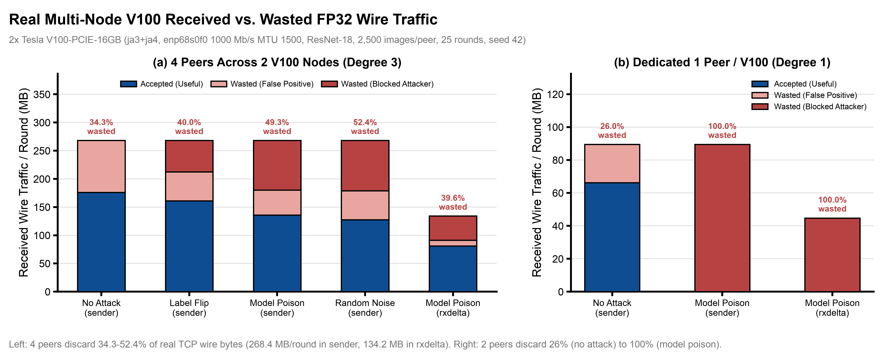

# PeerSieve motivation

This report measures the network and round-time costs of running TrustGraph-DFL on CIFAR-10 with ResNet-18. Accuracy and defense results are in [reproduce_report.md](reproduce_report.md). Here we measure two communication bottlenecks directly in multi-node V100 distributed training over `1 Gb/s` Ethernet, with no simulated timings or link-speed extrapolations.

---

## Hardware and measurement setup

We ran separate `PeerNode` processes ([src/distributed.py](../../src/distributed.py)) across two cluster servers (`ja3` and `ja4`). Each server has one `Tesla V100-PCIE-16GB` GPU and connects over `1 Gb/s` Ethernet (`enp68s0f0`, MTU `1500`). Each ResNet-18 model has `11,181,642` 32-bit floating-point (FP32) weights, which equals `44.73 MB` (decimal megabytes, used for network rates) or `42.65 MiB` (binary mebibytes, used for RAM and GPU memory).

| Component | Configuration |
|---|---|
| Cluster nodes | `ja3` (`172.23.15.13`) and `ja4` (`172.23.15.14`) |
| GPUs | 2x NVIDIA Tesla V100-PCIE-16GB (`01:00.0`, PCIe Gen3 x16, 1 GPU per node) |
| Driver and CUDA runtime | NVIDIA driver `525.116.04`, CUDA `11.8` runtime |
| Software stack | Python `3.12.13`, PyTorch `2.7.1+cu118`, `torchvision 0.22.1+cu118`, `networkx 3.7` |
| Ethernet NIC | `enp68s0f0`, `1000 Mb/s` (`1 Gb/s`), MTU `1500` |
| Training workload | Pretrained ResNet-18, CIFAR-10 (`2,500` images per peer, `val=iid`), `25` rounds, seed `42` |
| Runs measured | 8 multi-node TCP runs (`3` at 2 peers, `5` at 4 peers, `0` `NaN` runs) |
| Committed dataset | [phase1_v100_distributed_2node.json](../data/phase1_v100_distributed_2node.json) |

Three measurement details explain how we record these numbers:

- **Synchronized GPU timers.** GPUs run asynchronously from the CPU, so we call `torch.cuda.synchronize()` before and after local training, validation gradient computation, host copies, and TrustGraph aggregation. We then report the median across all `25` rounds.
- **Ethernet framing and MTU `1500`.** Ethernet splits large transfers into `1500`-byte packets with headers and TCP acknowledgments. During full-duplex training exchanges, usable payload throughput (goodput) sits at `930` to `935 Mb/s`, below the `1000 Mb/s` line rate.
- **Wire size in `sender` and `rxdelta` modes.** Under receiver-anchored scoring (`rxdelta`), a peer sends one FP32 vector (`44.73 MB`, its new weights $\theta_j^{t+1/2}$) and the receiver subtracts its own old weights $\theta_i^t$ locally. Under strict `sender` scoring, the receiver does not know neighbor $j$'s old weights $\theta_j^t$, so the sender must transmit two FP32 vectors (`89.45 MB` per neighbor): $\theta_j^{t+1/2}$ for averaging and $\Delta_j^t = \theta_j^{t+1/2} - \theta_j^t$ for cosine scoring.

---

## Metrics we measure

To quantify the two network bottlenecks of TrustGraph-DFL, we track three system metrics.

### Wasted bandwidth share

The share of downloaded neighbor bytes that a benign peer discards after scoring.

$$\text{Wasted share} = \frac{\text{false-positive bytes} + \text{blocked-attacker bytes}}{\text{total received bytes}}$$

Each round, a benign peer either keeps a downloaded update (positive trust weight) or discards it (zero weight, from a benign false positive or a blocked attacker). Divide all discarded wire bytes by all received wire bytes. Lower means less network waste; higher means more bandwidth spent downloading updates that never enter the model.

### Per-peer round time

The total wall-clock time one benign peer spends on GPU compute and neighbor transfers in a single round.

$$\text{Round time} = \underbrace{t_{\text{train}} + t_{\text{val}} + t_{\text{agg}}}_{\text{GPU compute}} + \underbrace{t_{\text{D2H}} + t_{\text{TCP}} + t_{\text{H2D}}}_{\text{transport}}$$

Add median per-peer GPU compute times (local SGD training, validation gradient, and TrustGraph aggregation) to transport times (GPU-to-CPU copy `D2H`, Ethernet `TCP` exchange, and CPU-to-GPU copy `H2D`). Lower means faster rounds; higher means compute or communication slows down training.

### Communication share

The fraction of a peer's round time spent moving model updates instead of training on the GPU.

$$\text{Communication share} = \frac{t_{\text{transport}}}{\text{Round time}}$$

Divide per-peer transport time by total per-peer round time. Lower means the GPU spends more time training; higher means the network link limits round speed.

---

## 1. Wasted bandwidth on discarded updates (Gap 1, Figure 5)

TrustGraph-DFL scores a neighbor only after downloading its full uncompressed FP32 payload over TCP (`89.45 MB` per neighbor in `sender` mode, or `44.73 MB` in `rxdelta` mode). If the cosine score falls at or below $\tau = 0.003$, ReLU sets the weight to zero and discards the model. A peer discards two kinds of updates: malicious updates caught by the filter (blocked-attacker waste) and benign updates pushed below $\tau$ by local non-IID drift (false-positive waste).

Figure 5 splits the FP32 megabytes received per benign peer per round on `ja3` and `ja4` into accepted traffic (blue), false-positive waste (pink), and blocked-attacker waste (dark red).

In the `4`-peer runs (`2` peers on `ja3` and `2` on `ja4`), peers form a complete graph of degree `3` (`4 - 1 = 3` neighbors each). Benign peers reach `90.47%` to `91.17%` per-peer accuracy (`90.87%` to `92.13%` consensus) while discarding `34.3%` to `52.4%` of downloaded bytes. Over `25` rounds, that totals `8.05` to `10.56 GB` of wasted wire traffic in `sender` mode and `3.98 GB` in `rxdelta` mode. In the `2`-peer runs (`1` dedicated V100 per peer, degree `1`), benign peers discard `26.0%` under no attack and `100.0%` under model poisoning, where every attacker update crosses the wire before rejection (`0.0%` Byzantine acceptance).

| Real V100 Ethernet run (`ja3` + `ja4`, 25 rounds) | Peers / degree | Wire / neighbor (MB) | Received (MB/peer/round) | Useful (MB/peer/round) | False-positive waste (MB/peer/round) | Blocked-attacker waste (MB/peer/round) | Wasted share (%) | Total wasted (GB, 25 rounds) |
|---|---:|---:|---:|---:|---:|---:|---:|---:|
| 4p No attack (`0%` Byz, `sender`) | 4 / 3 | 89.45 | 268.4 | 176.2 | 92.1 | 0.0 | 34.33 | 9.21 |
| 4p Label flip (`25%` Byz, $E_b=2$, `sender`) | 4 / 3 | 89.45 | 268.4 | 161.0 | 51.3 | 56.1 | 40.00 | 8.05 |
| 4p Model poison (`25%` Byz, $\lambda=10$, `sender`) | 4 / 3 | 89.45 | 268.4 | 136.0 | 44.1 | 88.3 | 49.33 | 9.93 |
| 4p Random noise (`25%` Byz, $\sigma=0.5$, `sender`) | 4 / 3 | 89.45 | 268.4 | 127.6 | 51.3 | 89.5 | 52.44 | 10.56 |
| 4p Model poison (`25%` Byz, $\lambda=10$, `rxdelta`) | 4 / 3 | 44.73 | 134.2 | 81.1 | 10.1 | 42.9 | 39.56 | 3.98 |
| 2p No attack (`0%` Byz, `sender`) | 2 / 1 | 89.45 | 89.5 | 66.2 | 23.3 | 0.0 | 26.00 | 1.16 |
| 2p Model poison (`50%` Byz, $\lambda=10$, `sender`) | 2 / 1 | 89.45 | 89.5 | 0.0 | 0.0 | 89.5 | 100.00 | 2.24 |
| 2p Model poison (`50%` Byz, $\lambda=10$, `rxdelta`) | 2 / 1 | 44.73 | 44.7 | 0.0 | 0.0 | 44.7 | 100.00 | 1.12 |

---

## 2. Transfer time versus GPU compute on 1 Gb/s Ethernet (Gap 2, Figure 6)

Figure 6 splits measured per-peer round time across all `8` multi-node V100 runs into GPU compute (gray), useful `1 Gb/s` transfer time (blue), and wasted `1 Gb/s` transfer time (red).

### 2.1 Dedicated 1 peer per V100 (`2` peers, `ja3` and `ja4`, Figure 6a)

First, we ran `1` peer on `ja3` and `1` peer on `ja4` so each peer owns an unshared `Tesla V100-PCIE-16GB` GPU (`1.67` to `1.71 GiB` peak allocated VRAM) and an unshared `1 Gb/s` NIC. Each round, a peer trains locally, copies outgoing FP32 weights from VRAM to pinned host RAM (`D2H`), exchanges payloads over `enp68s0f0` (`TCP`), copies received payloads back to VRAM (`H2D`), and runs TrustGraph aggregation.

| Real 2-peer V100 run (`ja3` <-> `ja4`, degree `1`, 25 rounds) | Wire / neighbor (MB) | Per-peer accuracy (%) | Consensus accuracy (%) | Wasted share (%) | V100 compute (s) | D2H + H2D copy (s) | Real 1 Gb/s TCP (s) | Total round time (s) | Communication share (%) | Wall time (s) |
|---|---:|---:|---:|---:|---:|---:|---:|---:|---:|---:|
| No attack (`0%` Byz, `sender`) | 89.45 | 89.72 | 90.40 | 26.00 | 0.941 | 0.015 | 0.766 | 1.722 | 45.4 | 71.3 |
| Model poison (`50%` Byz, `sender`) | 89.45 | 81.89 | 81.89 | 100.00 | 0.935 | 0.014 | 0.766 | 1.715 | 45.5 | 56.1 |
| Model poison (`50%` Byz, `rxdelta`) | 44.73 | 81.58 | 81.58 | 100.00 | 0.940 | 0.008 | 0.385 | 1.333 | 29.4 | 46.6 |

With one neighbor per peer, `1 Gb/s` Ethernet takes `0.766 s` per round in `sender` mode (`45.4%` to `45.5%` of the round) and `0.385 s` in `rxdelta` mode (`29.4%`). Dedicated V100 compute takes `0.935` to `0.941 s` (`0.843` to `0.848 s` for training, `0.091 s` for the validation gradient, and `0.001` to `0.002 s` for aggregation). PCIe copies (`D2H + H2D`) take `0.008` to `0.015 s` (under `1%` of the round), so the Ethernet link is the bottleneck.

### 2.2 Four-peer Ethernet training (`4` peers across `ja3` and `ja4`, Figure 6b)

Next, we ran `4` peers (`2` on `ja3` and `2` on `ja4`, `1.75` to `1.88 GiB` peak allocated VRAM per peer) on a complete graph of degree `3`. For each peer, `2` neighbors sit on the remote server across `1 Gb/s` Ethernet and `1` sits on the same server.

| Real 4-peer V100 run (`ja3` + `ja4`, degree `3`, 25 rounds) | Wire / neighbor (MB) | Per-peer accuracy (%) | Consensus accuracy (%) | Wasted share (%) | V100 compute (s) | D2H + H2D copy (s) | Real 1 Gb/s TCP (s) | Total round time (s) | Communication share (%) | Wall time (s) |
|---|---:|---:|---:|---:|---:|---:|---:|---:|---:|---:|
| No attack (`0%` Byz, `sender`) | 89.45 | 91.17 | 92.13 | 34.33 | 2.099 | 0.050 | 3.082 | 5.231 | 59.9 | 148.2 |
| Label flip (`25%` Byz, `sender`) | 89.45 | 90.59 | 91.52 | 40.00 | 2.087 | 0.050 | 3.083 | 5.220 | 60.0 | 164.4 |
| Model poison (`25%` Byz, `sender`) | 89.45 | 90.56 | 90.96 | 49.33 | 2.058 | 0.048 | 3.082 | 5.188 | 60.3 | 147.8 |
| Random noise (`25%` Byz, `sender`) | 89.45 | 90.47 | 91.23 | 52.44 | 2.063 | 0.051 | 3.082 | 5.196 | 60.3 | 148.0 |
| Model poison (`25%` Byz, `rxdelta`) | 44.73 | 90.52 | 90.87 | 39.56 | 2.062 | 0.025 | 1.541 | 3.628 | 43.2 | 108.8 |

Three hardware measurements show why PeerSieve needs both screening and compression:

1. **Ethernet dominates even with shared V100 GPUs.** Placing `2` peers on each V100 raises per-peer compute from `0.94 s` to `2.06` to `2.10 s`. Even so, `1 Gb/s` TCP takes `3.082 s` (`59.9%` to `60.3%` of round time) because `4` cross-node `89.45 MB` streams (`357.8 MB` each way) share `enp68s0f0` every round at `929 Mb/s` aggregate goodput.
2. **Smaller payloads cut wall time proportionally.** Switching `model_poison` from `sender` (`89.45 MB`) to `rxdelta` (`44.73 MB`) halves TCP time from `3.082 s` to `1.541 s`. Round time falls by `30.1%` (`5.19 s` to `3.63 s`), and 25-round wall time drops from `147.8 s` to `108.8 s` at the same `90.5%` accuracy.
3. **Screening wasted traffic alone is not enough.** In `rxdelta` (`1.541 s` total TCP), the useful share alone takes `0.93 s` (`1.56` to `2.02 s` in `sender`), which still matches or exceeds a dedicated V100's `0.94 s` compute time. Accepted updates also need compression.

---

## 3. Measurement limits

1. **V100 partition access (`2` nodes, `10`-minute cap).** Our cluster account has access to `2` V100 nodes (`ja3` and `ja4`) on partition `open` (`10`-minute wall limit); partitions covering all `4` V100 nodes (`ja1` to `ja4`) require `priority`, `public`, or `ci` accounts. The `4`-peer runs place `2` peers per V100 (`2/3` of neighbor edges cross Ethernet and `1/3` stay on the same node), while the `2`-peer runs isolate unshared 1-V100-per-peer timings.
2. **One random seed.** All `8` multi-node V100 runs used seed `42` over `25` rounds (`0` `NaN` runs).

---

## 4. Summary of gaps and how PeerSieve addresses them

| Gap | Problem in TrustGraph-DFL | Measured V100 Ethernet cost | PeerSieve fix |
|---|---|---|---|
| 1. Wasted downloads | Downloads full models before scoring | `34.3%` to `52.4%` discarded at 4 peers (`26.0%` to `100.0%` at 2 peers) | Pre-transfer screening |
| 2. Slow model transfers | Sends uncompressed 32-bit weights even for kept peers | `3.08 s` TCP (`60.3%` of round) in `sender`; `1.54 s` (`43.2%`) in `rxdelta` | 4-bit block compression |

### Pre-transfer screening (fixes Gap 1)

In TrustGraph-DFL, a peer downloads a full `44.73 MB` model before checking whether it is useful. In PeerSieve, each peer first sends a small summary of its update (a few hundred kilobytes, built by folding the weights into a fixed-size table called a CountSketch). The receiver folds its own validation direction the same way and estimates the cosine score from those two tables.

The receiver requests the full update only from neighbors that pass this check, so rejected peers send nothing further. When an accepted update arrives, the receiver checks its exact cosine score against the earlier summary, so an attacker cannot send a benign summary followed by a poisoned model.

### 4-bit block compression (fixes Gap 2)

Even useful updates are slow when sent as 32-bit floats (`44.73 MB` each). In PeerSieve, each sender splits its update into small blocks of weights, stores one shared scale per block, and quantizes each weight from 32 bits to 4 bits. Giving each block its own scale keeps small weights from rounding to zero and shrinks each transfer by about `7x` (from `44.73 MB` to about `6 MB`).

To keep quantization error from hurting accuracy, each sender saves the residual between its exact update and the 4-bit version and adds that residual to the next round's update (error feedback).

For exact reproduction and summary export commands, see [experiments/phase1/REPRODUCE.md](../../experiments/phase1/REPRODUCE.md).
