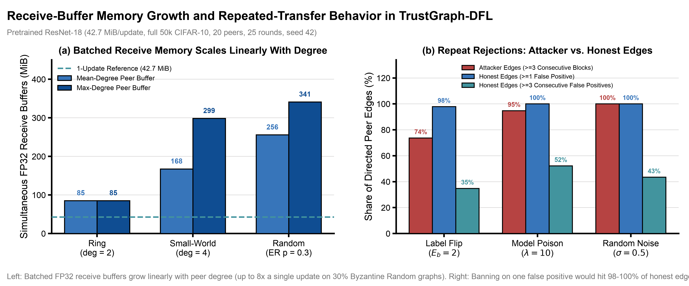

# TrustGraph-DFL system cost and Phase 2 motivation

This report measures the system cost of batched FP32 TrustGraph-DFL on our Phase 1 CIFAR-10 ResNet-18 setup. Accuracy and defense results are in [reproduce_report.md](reproduce_report.md). Here we measure four system bottlenecks that Phase 2 will fix directly.

---

## Hardware and measurement setup

We ran all 14 `paper_resnet18_50k` settings (seed 42, 20 peers, 25 rounds, 0 `NaN` runs) on `octave` with synchronized GPU timers (`src/simulator.py`), and verified multi-process TCP execution across all 8 A100 GPUs (`src/distributed.py`). Each ResNet-18 model has `11,181,642` FP32 parameters (`44.73 MB` or `42.65 MiB`).

| Component | Configuration |
|---|---|
| Training node | `octave` |
| GPUs | 8x NVIDIA A100-PCIE-40GB (`01:00.0` to `E1:00.0`, PCIe Gen4 x16 `SYS`) |
| NVIDIA driver and CUDA | Driver `610.57.04`, CUDA `13.2` |
| Software stack | Python `3.12.13`, PyTorch `2.15.0+cu132`, `torchvision 0.29.2`, `networkx 3.7` |
| Training run wall time (14 runs) | Median `446.0 s` (range `255.5` to `503.7 s`, 14 runs, 0 `NaN` runs) |
| Inter-node TCP benchmark | `ja4` (`172.23.15.14`) to `ja3` (`172.23.15.13`), CPU-only (`0` GPUs) |
| Measured Ethernet NIC | `enp68s0f0`, `1000 Mb/s` (`1 Gb/s`), MTU `1500`, achieved TCP goodput `941.2 Mb/s` |
| Committed dataset | [report/data/phase1_system_metrics_50k.json](../data/phase1_system_metrics_50k.json) |

For round time, we pair two direct measurements with two reference link speeds:

- **Measured GPU compute (`octave` A100).** Per-peer time per round for local training, validation gradient, and TrustGraph aggregation.
- **Measured `1 Gb/s` cluster TCP (`ja4` to `ja3`).** Real node-to-node TCP transfers over `enp68s0f0` (`1000 Mb/s` Ethernet, MTU `1500`), run CPU-only to time real TCP framing without V100 GPUs.
- **Reference link speeds (`10 Gb/s` and `100 Mb/s`).** Simple wire-time estimates ($\text{bytes} \times 8 / \text{bandwidth}$) representing a fast datacenter link and a slow edge link.

---

## Metrics

### Wasted bandwidth share

The share of downloaded neighbor bytes that a benign peer throws away after scoring.

$$\text{Wasted share} = \frac{\text{false-positive bytes} + \text{blocked-attacker bytes}}{\text{total received bytes}}$$

Split all downloaded updates into useful bytes (positive trust weight) and wasted bytes (zero weight, from benign false positives or blocked attackers). Lower means less network waste; higher means more bandwidth spent on discarded models.

### Per-peer round time

The wall-clock time one benign peer spends on compute plus network transfer in a single round.

$$\text{Round time} = t_{\text{train}} + t_{\text{val}} + t_{\text{agg}} + t_{\text{comm}}$$

Add median GPU compute time (`train`, `val`, `agg`) to network transfer time (`comm`). Lower means faster training rounds; higher means communication or compute is slowing the round down.

### Simultaneous receive buffer

The memory a peer needs to hold all incoming neighbor models in memory at the same time before averaging.

$$\text{Receive buffer} = \text{peer degree} \times \text{single model size}$$

Multiply a peer's neighbor count by the size of one FP32 model. Lower means less memory pressure per peer; higher means memory grows linearly with graph degree and model size.

### Repeat downloads and rejection streaks

How often a peer keeps downloading from an attacker it already blocked, and how many rounds in a row an edge gets rejected.

- **Repeat downloads after first block.** Count every full download from a Byzantine neighbor after that edge was blocked once. Lower means less repeated waste.
- **Consecutive rejection streak.** The longest run of back-to-back rounds where an edge gets zero weight. Long streaks separate chronic attackers from brief benign false positives.

---

## Overview of the four measured gaps

| System gap | What Phase 1 TrustGraph-DFL does | Measured cost on 50k ResNet-18 |
|---|---|---|
| 1. Bandwidth wasted on discarded updates | Downloads every full FP32 model before scoring and throwing away zero-weight updates | `42.5%` to `67.6%` discarded (`127.2` to `181.3 MB`/peer/round; `46.8` to `63.6 GB` over 25 rounds) |
| 2. Transfer cost of uncompressed FP32 | Sends full uncompressed FP32 models even for accepted neighbors | `2.28 s` measured on `1 Gb/s` TCP vs. `0.66 s` A100 compute (`77.5%` communication; `97.0%` est. at `100 Mb/s`) |
| 3. Receive memory grows with degree | Stores all $d$ incoming neighbor models in memory at once | `85.3 MiB` (`2.0x`) on Ring to `341.2 MiB` (`8.0x`) and up to `469.2 MiB` (`11.0x`) on Random |
| 4. Repeated downloads from blocked attackers | Keeps no edge history, so peers re-download from the same attackers every round | Attackers blocked `15.6` to `25.0` of 25 rounds (`24.9` to `40.8 GB` repeat waste); `97.8%` to `100%` of benign edges hit at least one false positive |

---

## 1. Communication waste and round-time bottleneck (Figure 5)

Figure 5 connects wasted bytes to wall-clock round time. Panel (a) breaks down received FP32 traffic per peer into useful traffic (blue), false-positive waste (pink), and blocked-attacker waste (dark red). Panel (b) turns the `Model Poison` bar (`268.4 MB`) into round time across three network speeds.

### 1.1 Bandwidth wasted on discarded updates (Gap 1, Figure 5a)

TrustGraph-DFL downloads every neighbor's full `44.73 MB` model before checking whether its cosine score passes $\tau = 0.003$. Whenever a score is too low, the peer gives it zero weight and throws those bytes away. Across the four settings on Random ER ($p=0.3$), peers discard `42.5%` to `67.6%` of all received bytes.

| Regime on Random ER ($p=0.3$) | Mean / max degree | Received (MB/peer/round) | Useful (MB/peer/round) | False-positive waste (MB/peer/round) | Blocked-attacker waste (MB/peer/round) | Wasted share (%) | Total wasted (GB, 25 rounds) |
|---|---:|---:|---:|---:|---:|---:|---:|
| No attack (0% Byzantine) | 6.7 / 11 | 299.7 | 172.5 | 127.2 | 0.0 | 42.45 | 63.60 |
| Label flip (30%, $E_b=2$) | 6.0 / 8 | 268.4 | 134.6 | 57.9 | 75.9 | 49.86 | 46.83 |
| Model poison (30%, $\lambda=10$) | 6.0 / 8 | 268.4 | 119.1 | 64.4 | 84.8 | 55.62 | 52.24 |
| Random noise (30%, $\sigma=0.5$) | 6.0 / 8 | 268.4 | 87.0 | 59.9 | 121.4 | 67.57 | 63.47 |

The same waste shows up across topologies (`35.3%` to `49.9%`) and attacker shares (`43.0%` to `49.9%`). In the `euclidean` and `no_relu` ablations, waste drops to `0.0%` only because every attacker is accepted.

| Sweep slice (label flip, $E_b=2$) | Mean / max degree | Received (MB/peer/round) | Useful (MB/peer/round) | False-positive waste (MB/peer/round) | Blocked-attacker waste (MB/peer/round) | Wasted share (%) | Total wasted (GB, 25 rounds) |
|---|---:|---:|---:|---:|---:|---:|---:|
| Ring, 30% Byzantine | 2.0 / 2 | 89.5 | 57.9 | 21.6 | 10.0 | 35.29 | 11.05 |
| Small-World, 30% Byzantine | 3.9 / 7 | 175.7 | 113.0 | 36.0 | 26.7 | 35.71 | 21.96 |
| Random, 10% Byzantine | 6.8 / 11 | 303.1 | 172.8 | 114.9 | 15.4 | 42.98 | 58.64 |
| Random, 20% Byzantine | 6.6 / 11 | 296.3 | 162.1 | 91.5 | 42.7 | 45.28 | 53.67 |
| Random, 40% Byzantine | 6.2 / 11 | 275.8 | 142.2 | 59.5 | 74.1 | 48.43 | 40.08 |
| Random, 50% Byzantine | 6.8 / 11 | 304.1 | 162.1 | 52.8 | 89.3 | 46.71 | 35.51 |

### 1.2 Converting FP32 bytes to round time (Gap 2, Figure 5b)

On `octave` A100, one peer's local compute takes a median of `0.660 s` per round under model poisoning (`0.602 s` training, `0.055 s` validation gradient, `0.0032 s` aggregation; `0.647 s` to `0.668 s` across all 14 runs). On our cluster's `1 Gb/s` Ethernet (`enp68s0f0`, `ja4` to `ja3`), real TCP framing caps goodput at `941.2 Mb/s` one-way and `935.1 Mb/s` full-duplex.

| Measured TCP workload (`ja4` to `ja3`, `enp68s0f0` 1 Gb/s) | Payload (MB) | Repeats | Median (s) | Min to max (s) | Goodput (Mb/s) |
|---|---:|---:|---:|---:|---:|
| Single ResNet-18 FP32 update (one-way) | 44.73 | 25 | 0.3804 | 0.3803 to 0.3805 | 940.7 |
| Model poison useful share (Panel b blue) | 119.10 | 10 | 1.0123 | 1.0123 to 1.0124 | 941.2 |
| Model poison wasted share (Panel b red) | 149.26 | 10 | 1.2686 | 1.2686 to 1.2728 | 941.2 |
| Full 6-neighbor round burst (one-way) | 268.36 | 10 | 2.2807 | 2.2805 to 2.2807 | 941.3 |
| Simultaneous full-duplex exchange (`ja3` and `ja4`) | 268.36 | 5 | 2.2959 | 2.2940 to 2.2991 | 935.1 |

We kept `ja3` and `ja4` CPU-only because their NVIDIA driver (`525.116.04`, CUDA `12.0`) does not support our `PyTorch 2.15.0+cu132` runtime (a GPU test fell back to CPU and hit the 5-minute timeout, not OOM). Pairing A100 compute with measured `1 Gb/s` TCP and the two reference link tiers gives Figure 5b.

| Link bandwidth (Model Poison, `268.4 MB` from Fig. 5a) | Source | Measured A100 compute (s) | Useful transfer, `119.1 MB` (s) | Wasted transfer, `149.3 MB` (s) | Total round time (s) | Communication share (%) |
|---|---|---:|---:|---:|---:|---:|
| `10 Gb/s` datacenter | Reference estimate | 0.660 | 0.095 | 0.119 | 0.875 | 24.5 |
| `1 Gb/s` Ethernet (`enp68s0f0`) | Measured (`ja4` to `ja3`) | 0.660 | 1.012 | 1.269 | 2.941 | 77.5 |
| `100 Mb/s` WAN / edge | Reference estimate | 0.660 | 9.528 | 11.941 | 22.129 | 97.0 |

Two points stand out. First, on cluster `1 Gb/s` Ethernet, transfer time (`2.281 s`) takes `77.5%` of the round (`3.5x` slower than GPU compute), and `53.2%` on Ring or `69.3%` on Small-World. Second, dropping wasted updates alone is not enough: even the useful transfer (`1.012 s` at `1 Gb/s`) still takes longer than all A100 compute (`0.660 s`).

### 1.3 Single-vector lower bound and multi-GPU check

Figure 5 counts one FP32 model (`44.73 MB`) per neighbor, which is a conservative lower bound matching `rxdelta`. In strict `sender` mode, a receiver does not know its neighbor's old weights $\theta_j^t$, so `TcpPeerTransport` must send both the new model and the update (`89.45 MB` per neighbor, twice Figure 5).

We verified this multi-process runtime across all `8x A100` GPUs on `octave` (`8` separate peer processes, `5` rounds, `25%` model poisoning, `er_p = 0.3`, seed `42`, `0` `NaN` runs). All `8` peers finished in `12.76 s` (`79.39%` per-peer and `84.26%` consensus accuracy, `40.0%` wasted transfers), using `2.05 GiB` peak VRAM per peer (`3.35 GiB` reserved) with medians of `0.621 s` train, `0.046 s` validation gradient, `0.0051 s` D2H, `0.339 s` loopback TCP (`89.45 MB` per neighbor), `0.0373 s` H2D, and `0.0023 s` aggregation.

---

## 2. Receive-buffer memory and repeated transfers (Figure 6)

Figure 6 shows the other two costs of batched, stateless TrustGraph-DFL: memory that grows with neighbor count (Panel a) and repeated downloads from already-blocked attackers (Panel b).

### 2.1 Receive-side memory scaling with peer degree (Gap 3, Figure 6a)

Batched TrustGraph-DFL keeps all $d$ incoming FP32 neighbor models in memory at once before averaging, so receive memory grows linearly with peer degree $d$.

| Topology and slice | Mean benign degree | Max benign degree | Single update (MiB) | Mean receive buffer (MiB) | Max receive buffer (MiB) | Max / single ratio |
|---|---:|---:|---:|---:|---:|---:|
| Ring (30% label flip) | 2.0 | 2 | 42.7 | 85.3 | 85.3 | 2.0x |
| Small-World (30% label flip) | 3.9 | 7 | 42.7 | 167.6 | 298.6 | 7.0x |
| Random (30% label flip, model poison, noise) | 6.0 | 8 | 42.7 | 255.9 | 341.2 | 8.0x |
| Random (no attack, 10%, 20%, 40%, 50% Byzantine) | 6.2 to 6.8 | 11 | 42.7 | 263.0 to 290.1 | 469.2 | 11.0x |

ResNet-18 fits comfortably on a `40 GiB` A100 (`2.05 GiB` per peer in our 8-GPU distributed run, `6.89` to `7.89 GiB` in our single-GPU 20-peer simulator). Even so, holding `8x` to `11x` a single model grows rapidly on denser graphs or larger models, while streaming one neighbor at a time uses constant memory.

### 2.2 Repeated downloads from blocked attackers vs. benign false positives (Gap 4, Figure 6b)

TrustGraph-DFL forgets past rounds. Even after blocking an attacker in round $t$, a peer downloads another full `44.73 MB` update from that same attacker in round $t+1$.

| Attack on Random (30% Byzantine, 25 rounds) | Attacker mean blocked rounds | Attacker mean max streak | Attacker edges with >=3 streak (%) | Attacker repeat downloads (GB wasted) | Benign edges with >=1 false positive (%) | Benign isolated single false positives | Benign edges with >=3 streak (%) | Benign edges with >=5 streak (%) |
|---|---:|---:|---:|---:|---:|---:|---:|---:|
| Label flip ($E_b=2$) | 15.6 / 25 | 7.3 | 73.7 | 556 (24.87 GB) | 97.8 | 282 | 34.8 | 17.4 |
| Model poison ($\lambda=10$) | 17.5 / 25 | 8.3 | 94.7 | 626 (28.00 GB) | 100.0 | 210 | 52.2 | 23.9 |
| Random noise ($\sigma=0.5$) | 25.0 / 25 | 25.0 | 100.0 | 912 (40.79 GB) | 100.0 | 282 | 43.5 | 21.7 |
| No attack (0% Byzantine) | 0.0 / 25 | 0.0 | 0.0 | 0 (0.00 GB) | 100.0 | 666 | 50.0 | 27.6 |

Figure 6b sets a clear design rule for Phase 2. Doing nothing lets chronic attackers force `556` to `912` repeat downloads (`24.9` to `40.8 GB`). Permanently banning a neighbor after one rejection is just as bad, because `97.8%` to `100%` of benign edges hit at least one false positive.

---

## 3. Framing for Phase 2

Phase 2 (**PeerSieve**) will fix each of the four measured gaps directly while keeping Byzantine resilience:

1. **Pre-transfer sketch screening (Gap 1).** Send a tiny CountSketch summary first and pull full updates only from neighbors that pass the check.
2. **Blockwise INT4 compression with error feedback (Gap 2).** Compress accepted updates to 4-bit blocks so even useful transfers finish faster than GPU compute, while carrying quantization error into the next round to protect accuracy.
3. **Audited streaming aggregation (Gap 3).** Check and accumulate one neighbor at a time in a single reusable buffer so receive memory stays constant and bad updates never touch the running average.
4. **Per-edge probation with recovery (Gap 4).** Put repeatedly failing edges on temporary backoff instead of permanent bans, and let benign edges recover once they pass a sketch check.

For exact reproduction and summary export commands, see [experiments/phase1/REPRODUCE.md](../../experiments/phase1/REPRODUCE.md).
