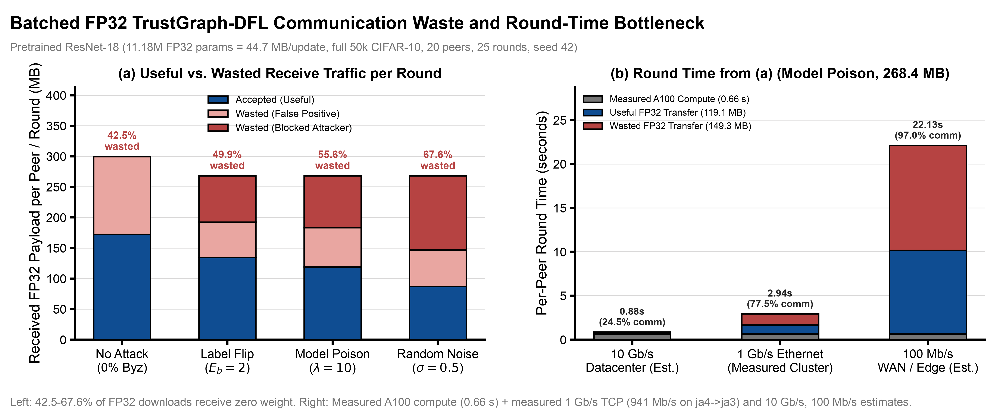

# TrustGraph-DFL system cost and Phase 2 motivation

This report measures the network, time, and memory costs of running TrustGraph-DFL on our Phase 1 CIFAR-10 ResNet-18 setup. Accuracy and defense results are in [reproduce_report.md](reproduce_report.md). Here we measure four practical system bottlenecks so Phase 2 can solve them directly.

---

## Hardware and measurement setup

We measured all 14 CIFAR-10 ResNet-18 runs (50,000 images, 20 peers, 25 rounds, seed 42, 0 `NaN` runs) on `octave` using [src/simulator.py](../../src/simulator.py), and checked multi-process TCP execution across all 8 A100 GPUs in [src/distributed.py](../../src/distributed.py). Each ResNet-18 model has `11,181,642` 32-bit floating-point (FP32) weights, which equals `44.73 MB` (decimal megabytes, used for network speeds) or `42.65 MiB` (binary mebibytes, used for RAM and GPU memory).

| Component | Configuration |
|---|---|
| Training node | `octave` |
| GPUs | 8x NVIDIA A100-PCIE-40GB (`01:00.0` to `E1:00.0`, PCIe Gen4 x16 `SYS`) |
| NVIDIA driver and CUDA | Driver `610.57.04`, CUDA `13.2` |
| Software stack | Python `3.12.13`, PyTorch `2.15.0+cu132`, `torchvision 0.29.2`, `networkx 3.7` |
| Training run wall time (14 runs) | Median `446.0 s` (range `255.5` to `503.7 s`, 14 runs, 0 `NaN` runs) |
| Inter-node TCP benchmark | `ja4` (`172.23.15.14`) to `ja3` (`172.23.15.13`), CPU-only (`0` GPUs) |
| Measured Ethernet NIC | `enp68s0f0`, `1000 Mb/s` (`1 Gb/s`), MTU `1500`, achieved TCP goodput `941.2 Mb/s` |
| Committed dataset | [report/data/phase1_system_metrics_50k.json](../data/phase1_system_metrics_50k.json) |

To measure total round time, we combine three timing sources:

- **Measured GPU compute on `octave`.** Because GPUs run asynchronously from the CPU, we call `torch.cuda.synchronize()` before and after local training, validation gradient computation, and TrustGraph aggregation so the timer captures the real GPU finish time, then take the median across rounds.
- **Measured `1 Gb/s` Ethernet TCP between `ja4` and `ja3`.** Ethernet splits large transfers into `1500`-byte packets (MTU `1500`), adds packet headers, and waits for acknowledgments, so real usable payload speed (goodput) sits slightly below the `1000 Mb/s` hardware rating. We run this transfer test on CPU between `ja4` and `ja3` because those nodes share the same `1 Gb/s` Ethernet speed as `octave` (their older GPU driver cannot run our PyTorch build; see Section 3).
- **Reference estimates for `10 Gb/s` and `100 Mb/s`.** We compute ideal wire time ($\text{bytes} \times 8 / \text{link speed}$) to see how the same traffic behaves on a fast datacenter link (`10 Gb/s`) and a slow edge link (`100 Mb/s`).

---

## Metrics we measure

To measure the network, time, and memory bottlenecks of TrustGraph-DFL, we track five system metrics.

### Wasted bandwidth share

The share of downloaded neighbor bytes that a benign peer throws away after scoring.

$$\text{Wasted share} = \frac{\text{false-positive bytes} + \text{blocked-attacker bytes}}{\text{total received bytes}}$$

In every round, each downloaded model is either kept (positive trust weight) or discarded (zero weight, either a benign false positive or a blocked attacker). Divide all discarded bytes by all received bytes. Lower means less network waste; higher means more bandwidth spent downloading updates that never enter the model.

### Per-peer round time

The total wall-clock time one benign peer spends on GPU work and network transfers in a single round.

$$\text{Round time} = t_{\text{train}} + t_{\text{val}} + t_{\text{agg}} + t_{\text{comm}}$$

Add median per-peer GPU compute times (local SGD training, validation gradient, and TrustGraph aggregation) to network transfer time. Lower means faster rounds; higher means either compute or communication is slowing down training.

### Simultaneous receive buffer

The amount of memory a peer must reserve at once to hold all incoming neighbor models before averaging.

$$\text{Receive buffer} = \text{peer degree} \times \text{single model size}$$

Multiply a peer's number of graph neighbors by the memory size of one FP32 model. Lower means less memory pressure per peer; higher means memory grows linearly as graphs get denser or models get larger.

### Repeat attacker downloads

The number of extra full model downloads a benign peer pulls from a Byzantine neighbor after already blocking that neighbor once.

$$\text{Repeat downloads} = \max(0,\; \text{blocked rounds on directed edge} - 1)$$

Each graph link counts as two directed edges (peer A sending to peer B, and peer B sending to peer A) because each receiver scores its incoming updates independently. For each attacker-to-benign directed edge, count how many rounds it received zero weight and subtract the first block. Lower means the system stops re-downloading from known attackers; higher means chronic attackers repeatedly waste bandwidth.

### Consecutive rejection streak

The longest run of back-to-back rounds in which a directed neighbor edge receives zero trust weight.

$$\text{Max streak} = \max \{ L : \text{directed edge rejected in } L \text{ consecutive rounds} \}$$

Track the accept/reject history for every directed edge and record its longest uninterrupted streak of rejections. Higher streaks mean a neighbor is failing round after round (typical of persistent attackers); lower streaks mean brief, isolated rejections (typical of benign peers drifting on non-IID data).

---

## 1. Bandwidth waste and round time (Figure 5)

Figure 5 links wasted downloads directly to round time. Panel (a) splits the FP32 megabytes each benign peer receives per round into useful traffic (blue), false-positive waste (pink), and blocked-attacker waste (dark red). Panel (b) converts the `Model Poison` bar (`268.4 MB`) into wall-clock seconds across three link speeds.

### 1.1 Wasted bandwidth on rejected updates (Gap 1, Figure 5a)

TrustGraph-DFL checks a neighbor only after downloading its entire `44.73 MB` FP32 model. If the cosine score falls at or below $\tau = 0.003$, ReLU sets the weight to zero and discards the model. Two kinds of downloaded updates get thrown away: malicious updates that the filter catches (blocked-attacker waste), and benign updates whose local non-IID drift pushes their cosine score below $\tau$ (false-positive waste). Because peers pay the full transfer cost before scoring, benign peers on Random ER ($p=0.3$) throw away `42.5%` to `67.6%` of everything they download.

| Regime on Random ER ($p=0.3$) | Mean / max degree | Received (MB/peer/round) | Useful (MB/peer/round) | False-positive waste (MB/peer/round) | Blocked-attacker waste (MB/peer/round) | Wasted share (%) | Total wasted (GB, 25 rounds) |
|---|---:|---:|---:|---:|---:|---:|---:|
| No attack (0% Byzantine) | 6.7 / 11 | 299.7 | 172.5 | 127.2 | 0.0 | 42.45 | 63.60 |
| Label flip (30%, $E_b=2$) | 6.0 / 8 | 268.4 | 134.6 | 57.9 | 75.9 | 49.86 | 46.83 |
| Model poison (30%, $\lambda=10$) | 6.0 / 8 | 268.4 | 119.1 | 64.4 | 84.8 | 55.62 | 52.24 |
| Random noise (30%, $\sigma=0.5$) | 6.0 / 8 | 268.4 | 87.0 | 59.9 | 121.4 | 67.57 | 63.47 |

The same waste appears across topologies (`35.3%` on Ring, `35.7%` on Small-World, `49.9%` on Random) and across attacker shares from `10%` to `50%` (`43.0%` to `49.9%`). In the `euclidean` and `no_relu` ablations, wasted bandwidth drops to `0.0%` only because every attacker update is accepted and hurts accuracy.

| Sweep slice (label flip, $E_b=2$) | Mean / max degree | Received (MB/peer/round) | Useful (MB/peer/round) | False-positive waste (MB/peer/round) | Blocked-attacker waste (MB/peer/round) | Wasted share (%) | Total wasted (GB, 25 rounds) |
|---|---:|---:|---:|---:|---:|---:|---:|
| Ring, 30% Byzantine | 2.0 / 2 | 89.5 | 57.9 | 21.6 | 10.0 | 35.29 | 11.05 |
| Small-World, 30% Byzantine | 3.9 / 7 | 175.7 | 113.0 | 36.0 | 26.7 | 35.71 | 21.96 |
| Random, 10% Byzantine | 6.8 / 11 | 303.1 | 172.8 | 114.9 | 15.4 | 42.98 | 58.64 |
| Random, 20% Byzantine | 6.6 / 11 | 296.3 | 162.1 | 91.5 | 42.7 | 45.28 | 53.67 |
| Random, 40% Byzantine | 6.2 / 11 | 275.8 | 142.2 | 59.5 | 74.1 | 48.43 | 40.08 |
| Random, 50% Byzantine | 6.8 / 11 | 304.1 | 162.1 | 52.8 | 89.3 | 46.71 | 35.51 |

### 1.2 Transfer time vs. GPU compute (Gap 2, Figure 5b)

On `octave` A100 under model poisoning, local compute takes `0.660 s` per peer per round (`0.602 s` training, `0.055 s` validation gradient, `0.0032 s` aggregation; across all 14 runs, median compute stays between `0.647 s` and `0.668 s`).

We then timed real node-to-node TCP transfers across our cluster's `1 Gb/s` Ethernet link (`ja4` to `ja3`, `enp68s0f0`, MTU `1500`). One-way transfers (one node sending to the other) reach `941.2 Mb/s` goodput (`94.1%` of the nominal `1 Gb/s` line rate). Full-duplex transfers (both nodes sending at the same time, as in a real round) reach `935.1 Mb/s`, adding less than `1%` contention overhead.

| Measured TCP workload (`ja4` to `ja3`, `enp68s0f0` 1 Gb/s) | Payload (MB) | Repeats | Median (s) | Min to max (s) | Goodput (Mb/s) |
|---|---:|---:|---:|---:|---:|
| Single ResNet-18 FP32 update (one-way) | 44.73 | 25 | 0.3804 | 0.3803 to 0.3805 | 940.7 |
| Model poison useful share (Panel b blue) | 119.10 | 10 | 1.0123 | 1.0123 to 1.0124 | 941.2 |
| Model poison wasted share (Panel b red) | 149.26 | 10 | 1.2686 | 1.2686 to 1.2728 | 941.2 |
| Full 6-neighbor round burst (one-way) | 268.36 | 10 | 2.2807 | 2.2805 to 2.2807 | 941.3 |
| Simultaneous full-duplex exchange (`ja3` and `ja4`) | 268.36 | 5 | 2.2959 | 2.2940 to 2.2991 | 935.1 |

Pairing measured A100 compute (`0.660 s`) with measured `1 Gb/s` TCP transfers and the two reference link tiers produces Figure 5b.

| Link bandwidth (Model Poison, `268.4 MB` from Fig. 5a) | Source | Measured A100 compute (s) | Useful transfer, `119.1 MB` (s) | Wasted transfer, `149.3 MB` (s) | Total round time (s) | Communication share (%) |
|---|---|---:|---:|---:|---:|---:|
| `10 Gb/s` datacenter | Reference estimate | 0.660 | 0.095 | 0.119 | 0.875 | 24.5 |
| `1 Gb/s` Ethernet (`enp68s0f0`) | Measured (`ja4` to `ja3`) | 0.660 | 1.012 | 1.269 | 2.941 | 77.5 |
| `100 Mb/s` WAN / edge | Reference estimate | 0.660 | 9.528 | 11.941 | 22.129 | 97.0 |

Two clear conclusions follow. First, on cluster `1 Gb/s` Ethernet, network transfer (`2.281 s`) makes up `77.5%` of the round (`3.5x` slower than GPU compute). At the same measured `941.2 Mb/s` goodput, transfers still take more than half the round on Ring (`0.760 s` transfer vs. `0.668 s` compute, `53.2%`) and Small-World (`1.494 s` transfer vs. `0.663 s` compute, `69.3%`). Second, removing wasted traffic alone is not enough, because even the useful FP32 transfer (`1.012 s` at `1 Gb/s`) still takes longer than all A100 compute (`0.660 s`). Accepted updates must also be compressed.

---

## 2. Receive memory and repeated transfers (Figure 6)

Figure 6 shows two structural costs of batched, stateless TrustGraph-DFL: receive buffers that grow with neighbor count (Panel a) and repeated downloads from attackers that were already blocked (Panel b).

### 2.1 Receive memory grows with neighbor count (Gap 3, Figure 6a)

TrustGraph-DFL normalizes each neighbor's trust weight by dividing by the sum of all neighbor scores ($\sum_{k \in \mathcal{N}_i} \tilde{w}_{ik}$). A straightforward batched implementation therefore waits until every neighbor finishes sending and keeps all $d$ full FP32 models in memory at the same time before computing the weighted average. Receive memory scales as $O(d)$ with peer degree $d$.

| Topology and slice | Mean benign degree | Max benign degree | Single update (MiB) | Mean receive buffer (MiB) | Max receive buffer (MiB) | Max / single ratio |
|---|---:|---:|---:|---:|---:|---:|
| Ring (30% label flip) | 2.0 | 2 | 42.7 | 85.3 | 85.3 | 2.0x |
| Small-World (30% label flip) | 3.9 | 7 | 42.7 | 167.6 | 298.6 | 7.0x |
| Random (30% label flip, model poison, noise) | 6.0 | 8 | 42.7 | 255.9 | 341.2 | 8.0x |
| Random (no attack, 10%, 20%, 40%, 50% Byzantine) | 6.2 to 6.8 | 11 | 42.7 | 263.0 to 290.1 | 469.2 | 11.0x |

ResNet-18 fits easily inside a `40 GiB` A100 (`2.05 GiB` actively allocated per peer in our 8-GPU distributed run, and `6.89` to `7.89 GiB` across all 20 peers in our single-GPU simulator). Still, holding `8x` to `11x` a full model grows fast on denser graphs or larger models. A peer does not actually need to store all $d$ models at once: it can unpack one neighbor at a time into a single receive buffer, add $\tilde{w}_{ij} \theta_j$ into a running weighted sum and $\tilde{w}_{ij}$ into a running weight total, and divide by the final weight total once at the end.

### 2.2 Repeated downloads from blocked attackers (Gap 4, Figure 6b)

TrustGraph-DFL stores no per-neighbor history across rounds. Even when a receiver blocks a Byzantine neighbor in round $t$, it downloads another full `44.73 MB` model from that exact same peer in round $t+1$.

| Attack on Random (30% Byzantine, 25 rounds) | Attacker mean blocked rounds | Attacker mean max streak | Attacker edges with >=3 streak (%) | Attacker repeat downloads (GB wasted) | Benign edges with >=1 false positive (%) | Benign isolated single false positives | Benign edges with >=3 streak (%) | Benign edges with >=5 streak (%) |
|---|---:|---:|---:|---:|---:|---:|---:|---:|
| Label flip ($E_b=2$) | 15.6 / 25 | 7.3 | 73.7 | 556 (24.87 GB) | 97.8 | 282 | 34.8 | 17.4 |
| Model poison ($\lambda=10$) | 17.5 / 25 | 8.3 | 94.7 | 626 (28.00 GB) | 100.0 | 210 | 52.2 | 23.9 |
| Random noise ($\sigma=0.5$) | 25.0 / 25 | 25.0 | 100.0 | 912 (40.79 GB) | 100.0 | 282 | 43.5 | 21.7 |
| No attack (0% Byzantine) | 0.0 / 25 | 0.0 | 0.0 | 0 (0.00 GB) | 100.0 | 666 | 50.0 | 27.6 |

Figure 6b sets a clear design rule for Phase 2. Doing nothing lets chronic attackers trigger `556` to `912` repeat downloads (`24.9` to `40.8 GB`). Permanently banning a neighbor after a failure streak does not work either: `97.8%` to `100%` of benign edges hit at least one false positive, `34.8%` to `52.2%` hit a streak of `3` or more consecutive false positives, and `17.4%` to `27.6%` even hit `5` or more. Any permanent ban rule would break the benign graph, so Phase 2 must use temporary probation with recovery instead.

---

## 3. Multi-GPU distributed check and measurement limits

### Why Figure 5 is a conservative lower bound

Figure 5 counts one FP32 model (`44.73 MB`) per neighbor transfer, which matches receiver-anchored scoring (`rxdelta`, where the receiver subtracts its own old weights $\theta_i^t$ locally). Under strict `sender` scoring, the receiver needs both the neighbor's new weights $\theta_j^{t+1/2}$ (for averaging) and its update $\Delta_j^t = \theta_j^{t+1/2} - \theta_j^t$ (for cosine scoring), because receiver $i$ does not know neighbor $j$'s old weights $\theta_j^t$. A real decentralized `sender` transfer therefore sends two vectors (`89.45 MB` per neighbor), doubling wire traffic relative to Figure 5.

### Real 8-GPU distributed check on `octave`

To confirm that our system runs as real separate peers over TCP sockets, we ran `8` independent `PeerNode` processes across all `8x A100` GPUs on `octave` using [src/distributed.py](../../src/distributed.py) (`5` rounds, `25%` model poisoning, `er_p = 0.3`, mean benign degree `3.17`, seed `42`, `0` `NaN` runs). All `8` peers completed in `12.76 s`, reaching `79.39%` per-peer and `84.26%` consensus accuracy after 5 rounds with `40.0%` wasted transfers and `2.05 GiB` peak GPU memory actively used by tensors per peer (`3.35 GiB` reserved by PyTorch's GPU memory cache).

| Per-peer stage (8x A100, 5 rounds, `89.45 MB` per neighbor) | What this step does | Median (s) | Min to max (s) |
|---|---|---:|---:|
| Local training | Run one local SGD epoch on the peer's data shard | 0.621 | 0.513 to 0.838 |
| Validation gradient | Compute $\nabla F_i(\theta_i^t)$ on the balanced validation set | 0.046 | 0.043 to 5.066 |
| GPU-to-CPU copy (D2H) | Copy outgoing FP32 vectors from GPU VRAM into page-locked (pinned) CPU RAM | 0.0051 | 0.0050 to 0.0057 |
| Network exchange (loopback TCP) | Exchange `89.45 MB` neighbor payloads over local TCP sockets (`127.0.0.1`) | 0.339 | 0.332 to 0.344 |
| CPU-to-GPU copy (H2D) | Copy received neighbor vectors from CPU RAM back onto the GPU | 0.0373 | 0.0293 to 0.0441 |
| TrustGraph aggregation | Score neighbors, clip update size, and average accepted models | 0.0023 | 0.0020 to 0.0231 |

Two details explain the numbers in this table. First, the `5.066 s` validation-gradient maximum happens once on round 1 when CUDA warms up kernels for the first backward pass; later rounds stay near `0.046 s`. Second, local TCP (`0.339 s`) is much faster than the `2.281 s` inter-node Ethernet test because all 8 GPUs sit inside `octave`, so `127.0.0.1` transfers stay in host RAM instead of crossing a `1 Gb/s` Ethernet cable.

### Measurement limits

1. **Older GPU driver on `ja3` and `ja4`.** Those two nodes run NVIDIA driver `525.116.04` (CUDA `12.0`), which cannot run our `PyTorch 2.15.0+cu132` runtime (a GPU test fell back to CPU and hit the 5-minute timeout, not OOM). We therefore measure GPU compute on `octave` and real `1 Gb/s` Ethernet TCP on CPU between `ja4` and `ja3`.
2. **One random seed for system-cost sweeps.** All 14 CIFAR-10 ResNet-18 system-cost runs used seed `42`.
3. **Reference link tiers.** The `1 Gb/s` bar in Figure 5b is directly measured on cluster Ethernet, while `10 Gb/s` and `100 Mb/s` are analytical wire-time bounds.

---

## 4. Summary of gaps and how Phase 2 addresses them

| System gap | What Phase 1 TrustGraph-DFL does | Measured cost on 50k ResNet-18 | Phase 2 (PeerSieve) fix |
|---|---|---|---|
| 1. Wasted bandwidth on discarded updates | Downloads every full FP32 model before scoring | `42.5%` to `67.6%` discarded (`46.8` to `63.6 GB` over 25 rounds) | Pre-transfer sketch screening |
| 2. Slow transfer of uncompressed FP32 models | Sends full 32-bit models even for accepted peers | `2.28 s` on `1 Gb/s` TCP (`1.01 s` useful) vs. `0.66 s` GPU compute | 4-bit block compression with error feedback |
| 3. Receive memory grows with degree | Holds all $d$ incoming FP32 models in memory at once | `85.3 MiB` (`2.0x`) on Ring to `469.2 MiB` (`11.0x`) on Random | Audited streaming in one reusable buffer |
| 4. Repeat downloads from blocked attackers | Stores no edge history across rounds | `556` to `912` repeat attacker downloads (`24.9` to `40.8 GB`) | Temporary probation with recovery |

### Pre-transfer sketch screening (fixes Gap 1)

Instead of sending a full `44.73 MB` update first, each peer builds a **CountSketch**: a tiny fixed-size summary (a few hundred kilobytes, more than `100x` smaller than the model) formed by hashing each weight into a small table of buckets and adding or subtracting it using random `+1` / `-1` signs. The receiver hashes its own validation descent vector with the same round seed. Because mismatched weights collide with random signs and cancel out on average while matching weights add up, the dot product of the two small sketches closely approximates the cosine score of the full `11.18M`-weight vectors. Only neighbors that pass this cheap check are asked to send their full update, skipping downloads that would be thrown away.

### 4-bit block compression with error feedback (fixes Gap 2)

Even useful FP32 updates take longer to send over `1 Gb/s` Ethernet than local GPU training. Weights in different ResNet-18 layers have very different magnitudes, so using one scale factor for the whole model would round small weights to zero. Instead, each sender splits its update into small blocks (such as `64` or `128` weights), stores one 16-bit scale factor per block, and rounds each weight in that block to a 4-bit signed integer (`INT4`). This shrinks accepted payloads by roughly `7x` (from `44.73 MB` down to about `6 MB`). To keep rounding noise from hurting accuracy, each sender saves the quantization error (exact update minus compressed update) and adds that leftover error back into its next round's update (**error feedback**) so no training signal is permanently lost.

For exact reproduction and summary export commands, see [experiments/phase1/REPRODUCE.md](../../experiments/phase1/REPRODUCE.md).
