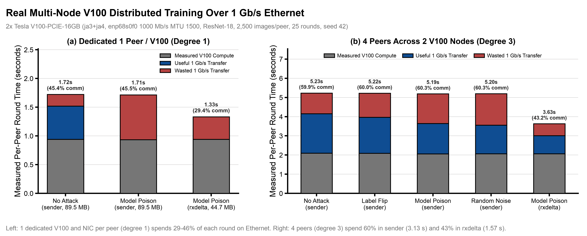

# TrustGraph-DFL system cost and motivation

This report measures the network and round-time costs of running TrustGraph-DFL on CIFAR-10 with ResNet-18. Accuracy and defense results are in [reproduce_report.md](reproduce_report.md). Here we measure two practical communication bottlenecks, both on 20-peer sweeps and on real multi-node V100 training over `1 Gb/s` Ethernet

---

## Hardware and measurement setup

Each ResNet-18 model has `11,181,642` 32-bit floating-point (FP32) weights, which equals `44.73 MB` (decimal megabytes, used for network speeds) or `42.65 MiB` (binary mebibytes, used for RAM and GPU memory). We collect measurements from two cluster setups:

| Component | 20-peer sweep setup (`octave` + TCP benchmark) | Real multi-node V100 setup (`ja3` + `ja4`) |
|---|---|---|
| Nodes | `octave` (compute), `ja4` to `ja3` (CPU TCP link test) | `ja3` (`172.23.15.13`) and `ja4` (`172.23.15.14`) |
| GPUs | 8x NVIDIA A100-PCIE-40GB (`01:00.0` to `E1:00.0`, PCIe Gen4 x16) | 2x NVIDIA Tesla V100-PCIE-16GB (`01:00.0`, PCIe Gen3 x16) |
| Driver and CUDA | Driver `610.57.04`, CUDA `13.2` | Driver `525.116.04`, CUDA `11.8` runtime |
| Software stack | Python `3.12.13`, PyTorch `2.15.0+cu132`, `torchvision 0.29.2` | Python `3.12.13`, PyTorch `2.7.1+cu118`, `torchvision 0.22.1+cu118` |
| Ethernet NIC | `enp68s0f0`, `1000 Mb/s` (`1 Gb/s`), MTU `1500` (`941.2 Mb/s` goodput) | `enp68s0f0`, `1000 Mb/s` (`1 Gb/s`), MTU `1500` |
| Runs measured | 14 single-GPU 20-peer runs (25 rounds, seed 42, 0 `NaN` runs) | 8 real distributed TCP runs (2 and 4 peers, 25 rounds, seed 42, 0 `NaN` runs) |
| Committed dataset | [phase1_system_metrics_50k.json](../data/phase1_system_metrics_50k.json) | [phase1_v100_distributed_2node.json](../data/phase1_v100_distributed_2node.json) |

Three measurement details explain how these timings are collected:

- **Synchronized GPU timers.** Because GPUs run asynchronously from the CPU, we call `torch.cuda.synchronize()` before and after local training, validation gradient computation, GPU-host copies, and aggregation so the clock captures the real GPU finish time, then take the median across rounds.
- **Ethernet goodput and MTU `1500`.** Ethernet splits large transfers into `1500`-byte packets with headers and waits for acknowledgments, so real usable payload speed (goodput) sits slightly below the `1000 Mb/s` line rate (`941.2 Mb/s` one-way and `935.1 Mb/s` full-duplex on our cluster link).
- **Separate V100 CUDA `11.8` runtime.** Nodes `ja3` and `ja4` run driver `525.116.04` (max CUDA `12.0`), which cannot run `PyTorch 2.15.0+cu132`. Running them with `PyTorch 2.7.1+cu118` lets real V100 training and real `1 Gb/s` Ethernet TCP run together in the same job via [src/distributed.py](../../src/distributed.py).

---

## Metrics we measure

To quantify the two network bottlenecks of TrustGraph-DFL, we track three system metrics.

### Wasted bandwidth share

The share of downloaded neighbor bytes that a benign peer throws away after scoring.

$$\text{Wasted share} = \frac{\text{false-positive bytes} + \text{blocked-attacker bytes}}{\text{total received bytes}}$$

In every round, each downloaded update is either kept (positive trust weight) or discarded (zero weight, either a benign false positive or a blocked attacker). Divide all discarded bytes by all received bytes. Lower means less network waste; higher means more bandwidth spent downloading updates that never enter the model.

### Per-peer round time

The total wall-clock time one benign peer spends on GPU compute and neighbor transfers in a single round.

$$\text{Round time} = \underbrace{t_{\text{train}} + t_{\text{val}} + t_{\text{agg}}}_{\text{GPU compute}} + \underbrace{t_{\text{D2H}} + t_{\text{TCP}} + t_{\text{H2D}}}_{\text{transport}}$$

Add median per-peer GPU compute times (local SGD training, validation gradient, and TrustGraph aggregation) to transfer times (GPU-to-CPU copy `D2H`, Ethernet `TCP` exchange, and CPU-to-GPU copy `H2D`). Lower means faster rounds; higher means compute or communication is slowing down training.

### Communication share

The fraction of a peer's round time spent moving model updates instead of training on the GPU.

$$\text{Communication share} = \frac{t_{\text{transport}}}{\text{Round time}}$$

Divide per-peer transport time by total per-peer round time. Lower means the GPU stays busy training; higher means the network link is the main bottleneck holding back training.

---

## 1. Bandwidth waste and round time at 20 peers (Figure 5)

Figure 5 measures the 20-peer ResNet-18 setup from [reproduce_report.md](reproduce_report.md). Panel (a) splits the FP32 megabytes each benign peer receives per round into useful traffic (blue), false-positive waste (pink), and blocked-attacker waste (dark red). Panel (b) converts the `Model Poison` bar (`268.4 MB`) into round seconds across three link speeds.

### 1.1 Wasted bandwidth on discarded updates (Gap 1, Figure 5a)

TrustGraph-DFL scores a neighbor only after downloading its entire `44.73 MB` FP32 model. If the cosine score falls at or below $\tau = 0.003$, ReLU sets the weight to zero and discards the model. Two kinds of downloaded updates get thrown away: malicious updates caught by the filter (blocked-attacker waste), and benign updates whose local non-IID drift pushes their cosine score below $\tau$ (false-positive waste). Because peers pay the full transfer cost before scoring, benign peers on Random ER ($p=0.3$) throw away `42.5%` to `67.6%` of everything they download.

Figure 5a counts one FP32 vector (`44.73 MB`) per neighbor transfer, which matches receiver-anchored scoring (`rxdelta`, where the receiver subtracts its own old weights $\theta_i^t$ locally). Under strict `sender` scoring, a peer must send two vectors (`89.45 MB` per neighbor): its new weights $\theta_j^{t+1/2}$ for averaging and its update $\Delta_j^t = \theta_j^{t+1/2} - \theta_j^t$ for cosine scoring, because receiver $i$ does not know neighbor $j$'s old weights $\theta_j^t$. Figure 5a is therefore a conservative lower bound on strict `sender` traffic.

| Regime on Random ER ($p=0.3$) | Mean / max degree | Received (MB/peer/round) | Useful (MB/peer/round) | False-positive waste (MB/peer/round) | Blocked-attacker waste (MB/peer/round) | Wasted share (%) | Total wasted (GB, 25 rounds) |
|---|---:|---:|---:|---:|---:|---:|---:|
| No attack (0% Byzantine) | 6.7 / 11 | 299.7 | 172.5 | 127.2 | 0.0 | 42.45 | 63.60 |
| Label flip (30%, $E_b=2$) | 6.0 / 8 | 268.4 | 134.6 | 57.9 | 75.9 | 49.86 | 46.83 |
| Model poison (30%, $\lambda=10$) | 6.0 / 8 | 268.4 | 119.1 | 64.4 | 84.8 | 55.62 | 52.24 |
| Random noise (30%, $\sigma=0.5$) | 6.0 / 8 | 268.4 | 87.0 | 59.9 | 121.4 | 67.57 | 63.47 |

The same waste appears across topologies (`35.3%` on Ring, `35.7%` on Small-World, `49.9%` on Random) and across attacker shares from `10%` to `50%` (`43.0%` to `49.9%`). In the `euclidean` and `no_relu` ablations, wasted bandwidth drops to `0.0%` only because every attacker update is accepted and degrades accuracy.

| Sweep slice (label flip, $E_b=2$) | Mean / max degree | Received (MB/peer/round) | Useful (MB/peer/round) | False-positive waste (MB/peer/round) | Blocked-attacker waste (MB/peer/round) | Wasted share (%) | Total wasted (GB, 25 rounds) |
|---|---:|---:|---:|---:|---:|---:|---:|
| Ring, 30% Byzantine | 2.0 / 2 | 89.5 | 57.9 | 21.6 | 10.0 | 35.29 | 11.05 |
| Small-World, 30% Byzantine | 3.9 / 7 | 175.7 | 113.0 | 36.0 | 26.7 | 35.71 | 21.96 |
| Random, 10% Byzantine | 6.8 / 11 | 303.1 | 172.8 | 114.9 | 15.4 | 42.98 | 58.64 |
| Random, 20% Byzantine | 6.6 / 11 | 296.3 | 162.1 | 91.5 | 42.7 | 45.28 | 53.67 |
| Random, 40% Byzantine | 6.2 / 11 | 275.8 | 142.2 | 59.5 | 74.1 | 48.43 | 40.08 |
| Random, 50% Byzantine | 6.8 / 11 | 304.1 | 162.1 | 52.8 | 89.3 | 46.71 | 35.51 |

### 1.2 Transfer time vs. GPU compute on A100 (Gap 2, Figure 5b)

In the 20-peer simulator on `octave` A100 ([src/simulator.py](../../src/simulator.py)), local compute under model poisoning takes `0.660 s` per peer per round (`0.602 s` training, `0.055 s` validation gradient, `0.0032 s` aggregation; across all 14 runs, median compute stays between `0.647 s` and `0.668 s`). Because those 14 runs execute inside one A100 process, we timed the matching payload sizes on our real `1 Gb/s` cluster Ethernet link (`ja4` to `ja3`, `enp68s0f0`, MTU `1500`). One-way transfers reach `941.2 Mb/s` goodput (`94.1%` of line rate), and simultaneous full-duplex transfers (both nodes sending at once) reach `935.1 Mb/s` (less than `1%` contention overhead).

| Measured TCP workload (`ja4` to `ja3`, `enp68s0f0` 1 Gb/s) | Payload (MB) | Repeats | Median (s) | Min to max (s) | Goodput (Mb/s) |
|---|---:|---:|---:|---:|---:|
| Single ResNet-18 FP32 update (one-way) | 44.73 | 25 | 0.3804 | 0.3803 to 0.3805 | 940.7 |
| Model poison useful share (Panel b blue) | 119.10 | 10 | 1.0123 | 1.0123 to 1.0124 | 941.2 |
| Model poison wasted share (Panel b red) | 149.26 | 10 | 1.2686 | 1.2686 to 1.2728 | 941.2 |
| Full 6-neighbor round burst (one-way) | 268.36 | 10 | 2.2807 | 2.2805 to 2.2807 | 941.3 |
| Simultaneous full-duplex exchange (`ja3` and `ja4`) | 268.36 | 5 | 2.2959 | 2.2940 to 2.2991 | 935.1 |

Combining measured `octave` A100 compute (`0.660 s`) with the measured `1 Gb/s` Ethernet TCP times and analytical ideal wire-time bounds ($\text{bytes} \times 8 / \text{link speed}$) for `10 Gb/s` and `100 Mb/s` produces Figure 5b.

| Link bandwidth (Model Poison, `268.4 MB` from Fig. 5a) | Source | Measured A100 compute (s) | Useful transfer, `119.1 MB` (s) | Wasted transfer, `149.3 MB` (s) | Total round time (s) | Communication share (%) |
|---|---|---:|---:|---:|---:|---:|
| `10 Gb/s` datacenter | Reference estimate | 0.660 | 0.095 | 0.119 | 0.875 | 24.5 |
| `1 Gb/s` Ethernet (`enp68s0f0`) | Measured (`ja4` to `ja3`) | 0.660 | 1.012 | 1.269 | 2.941 | 77.5 |
| `100 Mb/s` WAN / edge | Reference estimate | 0.660 | 9.528 | 11.941 | 22.129 | 97.0 |

Two clear conclusions follow. First, on `1 Gb/s` Ethernet, network transfer (`2.281 s`) makes up `77.5%` of the round (`3.5x` slower than A100 compute). At the same `941.2 Mb/s` goodput, transfers still exceed half the round on Ring (`0.760 s` transfer vs. `0.668 s` compute, `53.2%`) and Small-World (`1.494 s` transfer vs. `0.663 s` compute, `69.3%`). Second, dropping wasted traffic alone is not enough, because even the useful FP32 transfer (`1.012 s` at `1 Gb/s`) still takes longer than all A100 compute (`0.660 s`). Accepted updates must also be compressed.

---

## 2. Real multi-node V100 training over 1 Gb/s Ethernet (Figure 6)

Section 1 combined single-GPU simulation compute with a separate TCP link benchmark. To verify the bottleneck directly in live decentralized training, we ran real separate `PeerNode` processes ([src/distributed.py](../../src/distributed.py)) training ResNet-18 (`2,500` CIFAR-10 images per peer, `25` rounds, `val=iid`, seed `42`, `0` `NaN` runs) across two physical V100 servers (`ja3` and `ja4`) while exchanging real model tensors over the `1 Gb/s` Ethernet link (`enp68s0f0`, MTU `1500`).

### 2.1 Dedicated 1 peer per V100 (`2` peers, `ja3` and `ja4`, Figure 6a)

First, we ran `1` peer on `ja3` and `1` peer on `ja4` so each peer owns a dedicated `Tesla V100-PCIE-16GB` GPU (`1.67` to `1.71 GiB` peak allocated VRAM) and a dedicated `1 Gb/s` Ethernet NIC with zero sharing. Every round, the two peers train locally, copy outgoing weights from GPU VRAM to page-locked (pinned) CPU RAM (`D2H`), exchange full payloads simultaneously over `enp68s0f0` (`TCP`), copy received payloads back onto the GPU (`H2D`), and run TrustGraph aggregation.

| Real 2-peer V100 run (`ja3` <-> `ja4`, degree `1`, 25 rounds) | Wire / neighbor (MB) | Per-peer accuracy (%) | Consensus accuracy (%) | Wasted share (%) | V100 compute (s) | D2H + H2D copy (s) | Real 1 Gb/s TCP (s) | Total round time (s) | Communication share (%) |
|---|---:|---:|---:|---:|---:|---:|---:|---:|---:|
| No attack (`0%` Byz, `sender`) | 89.45 | 89.72 | 90.40 | 26.00 | 0.941 | 0.015 | 0.766 | 1.722 | 45.4 |
| Model poison (`50%` Byz, `sender`) | 89.45 | 81.89 | 81.89 | 100.00 | 0.935 | 0.014 | 0.766 | 1.715 | 45.5 |
| Model poison (`50%` Byz, `rxdelta`) | 44.73 | 81.58 | 81.58 | 100.00 | 0.940 | 0.008 | 0.385 | 1.333 | 29.4 |

Even with only **one** neighbor per peer, real `1 Gb/s` Ethernet takes `0.766 s` per round in `sender` mode (`45.4%` to `45.5%` of total round time) and `0.385 s` in `rxdelta` mode (`29.4%`), compared to `0.935` to `0.941 s` for all V100 compute (`0.843` to `0.848 s` training, `0.091 s` validation gradient, `0.001` to `0.002 s` aggregation). GPU-CPU copies (`D2H + H2D`) take just `0.008` to `0.015 s` (under `1%` of the round), proving that the Ethernet wire itself is the bottleneck. Under model poisoning, the benign peer rejects the attacker in all 25 rounds (`0.0%` Byzantine acceptance), so `100%` of its Ethernet transfer time is wasted.

### 2.2 Four-peer Ethernet training (`4` peers across `ja3` and `ja4`, Figure 6b)

Next, we ran `4` peers (`2` peers on `ja3` V100 and `2` peers on `ja4` V100, `1.75` to `1.88 GiB` peak allocated VRAM per peer) on a complete graph (degree `3`, where `2` of each peer's `3` neighbors sit on the remote node across `1 Gb/s` Ethernet and `1` sits on the same node). Under `25%` Byzantine attacks (`1` attacker, `3` benign peers), each benign peer sends and receives `268.36 MB` per round in `sender` mode (`89.45 MB` x `3` neighbors) or `134.18 MB` in `rxdelta` mode (`44.73 MB` x `3`).

| Real 4-peer V100 run (`ja3` + `ja4`, degree `3`, 25 rounds) | Wire / neighbor (MB) | Per-peer accuracy (%) | Consensus accuracy (%) | Wasted share (%) | V100 compute (s) | D2H + H2D copy (s) | Real 1 Gb/s TCP (s) | Total round time (s) | Communication share (%) | Wall time (s) |
|---|---:|---:|---:|---:|---:|---:|---:|---:|---:|---:|
| No attack (`0%` Byz, `sender`) | 89.45 | 91.17 | 92.13 | 34.33 | 2.099 | 0.051 | 3.082 | 5.231 | 59.9 | 148.2 |
| Label flip (`25%` Byz, `sender`) | 89.45 | 90.59 | 91.52 | 40.00 | 2.087 | 0.050 | 3.083 | 5.220 | 60.0 | 164.4 |
| Model poison (`25%` Byz, `sender`) | 89.45 | 90.56 | 90.96 | 49.33 | 2.058 | 0.048 | 3.082 | 5.188 | 60.3 | 147.8 |
| Random noise (`25%` Byz, `sender`) | 89.45 | 90.47 | 91.23 | 52.44 | 2.063 | 0.051 | 3.082 | 5.196 | 60.3 | 148.0 |
| Model poison (`25%` Byz, `rxdelta`) | 44.73 | 90.52 | 90.87 | 39.56 | 2.062 | 0.025 | 1.541 | 3.628 | 43.2 | 108.8 |

Three live-hardware findings confirm our Phase 2 design directly:

1. **Ethernet still dominates even on shared V100 GPUs.** Packing `2` peers onto each V100 doubles per-peer compute from `0.94 s` to `2.06` to `2.10 s`, yet real `1 Gb/s` Ethernet TCP still takes `3.082 s` (`60.0%` to `60.3%` of total round time) because `4` cross-node `89.45 MB` streams (`357.8 MB` total in each direction) cross `enp68s0f0` every round (`929 Mb/s` aggregate goodput).
2. **Roughly half of live Ethernet traffic is discarded.** Benign peers reach `90.47%` to `91.17%` per-peer accuracy (`90.87%` to `92.13%` consensus) while throwing away `34.3%` to `52.4%` of all downloaded bytes (`1.06` to `1.62 s` of pure wasted Ethernet time per round).
3. **Shrinking wire bytes speeds up real wall time linearly.** Switching `model_poison` from `sender` (`89.45 MB`) to `rxdelta` (`44.73 MB`) cuts real Ethernet TCP time cleanly in half (`3.082 s` down to `1.541 s`), lowering round time by `30.1%` (`5.19 s` to `3.63 s`) and total 25-round wall time from `147.8 s` to `108.8 s` at the same `90.5%` accuracy. Even then, `39.6%` of downloads are still discarded and `1.541 s` is still spent moving uncompressed FP32 weights.

---

## 3. Measurement limits

1. **V100 partition access (`2` nodes, `10`-minute cap).** Our Slurm account (`a100`) only has access to `2` V100 nodes (`ja3` and `ja4`) on partition `open` (`10`-minute wall limit); partitions covering all `4` V100 nodes (`ja1` to `ja4`) require `priority`, `public`, or `ci` accounts. The `4`-peer real Ethernet runs therefore place `2` peers per V100 (`2/3` of neighbor edges cross Ethernet and `1/3` stay on the same node), while the `2`-peer runs isolate unshared 1-V100-per-peer timings.
2. **Combined `20`-peer round time in Figure 5b.** Figure 5b pairs single-GPU `octave` A100 compute with separate `ja4`-to-`ja3` `1 Gb/s` TCP timings (plus analytical wire-time bounds for `10 Gb/s` and `100 Mb/s`), because `octave` is a single server without a second A100 node.
3. **One random seed for system-cost runs.** All `14` `octave` sweeps and all `8` real V100 distributed runs used seed `42`.

---

## 4. Summary of gaps and how Phase 2 addresses them

| System gap | What Phase 1 TrustGraph-DFL does | Measured cost on CIFAR-10 ResNet-18 | Phase 2 (PeerSieve) fix |
|---|---|---|---|
| 1. Wasted bandwidth on discarded updates | Downloads every full FP32 model before cosine scoring | `42.5%` to `67.6%` discarded at 20 peers (`46.8` to `63.6 GB`); `34.3%` to `52.4%` discarded on real 4-peer V100 Ethernet | Pre-transfer sketch screening |
| 2. Slow transfer of uncompressed FP32 models | Sends full 32-bit floats even for accepted neighbors | `2.28 s` (`77.5%` of round, `1.01 s` useful) vs. `0.66 s` A100 compute; `3.08 s` (`60.3%` of round) on real 4-peer V100 Ethernet (`1.54 s` in `rxdelta`) | 4-bit block compression with error feedback |

### Pre-transfer sketch screening (fixes Gap 1)

Instead of downloading a full `44.73 MB` (or `89.45 MB`) FP32 payload first, each peer builds a **CountSketch**: a small fixed-size summary (a few hundred kilobytes, over `100x` smaller than the model) created by hashing every weight into a small table of buckets and adding or subtracting it using random `+1` / `-1` signs tied to the round seed. The receiver hashes its own validation descent vector $-\nabla F_i(\theta_i^t)$ with the exact same round seed and buckets. Because mismatched weights collide with random signs and cancel out on average while matching weights add up, the dot product of the two small sketches closely approximates the cosine score of the full `11.18M`-weight vectors. Only neighbors whose sketch score passes the screen are asked to transmit their compressed model update, avoiding full transfers that would end up discarded. After receiving an accepted update, the receiver still checks its exact cosine score and verifies that it matches the sketch sent earlier (blocking attackers that send a fake benign sketch followed by a poisoned model).

### 4-bit block compression with error feedback (fixes Gap 2)

Even after dropping wasted transfers, sending accepted updates in uncompressed 32-bit floats still bottlenecks `1 Gb/s` Ethernet (`1.01 s` useful FP32 vs. `0.66 s` A100 compute at 20 peers, and `1.54 s` to `3.08 s` TCP in real 4-peer V100 runs). Weights in different ResNet-18 layers have very different magnitudes, so using one scale factor for the whole model would round small weights to zero. Instead, each sender splits its update vector into small blocks (such as `64` or `128` weights), stores one 16-bit scale factor per block, and rounds every weight in that block to a 4-bit signed integer (`INT4`). This shrinks accepted transfers by roughly `7x` (from `44.73 MB` down to about `6 MB`, or `0.05 s` per neighbor on `1 Gb/s` Ethernet). To keep rounding noise from hurting accuracy, each sender saves its quantization error (the exact update minus the compressed update) and adds that leftover error back into its next round's update (**error feedback**) so no training signal is permanently lost.

For exact reproduction and summary export commands, see [experiments/phase1/REPRODUCE.md](../../experiments/phase1/REPRODUCE.md).
