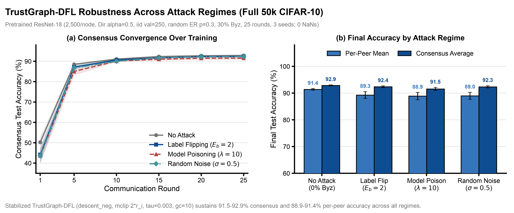
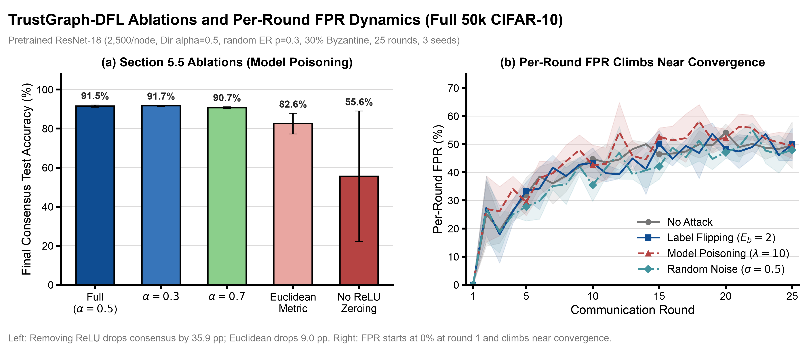

# TrustGraph-DFL reproduction report

This report tests [TrustGraph-DFL.pdf](../../TrustGraph-DFL.pdf) (Xu et al., CIBDA 2026) on CIFAR-10 with 20 decentralized peers. In TrustGraph-DFL, each peer compares incoming neighbor updates against its own validation gradient, drops negative scores with ReLU, and averages the rest.

---

## Hardware and software setup

| Component | Configuration |
|---|---|
| Cluster node | `octave` |
| GPUs | 8x NVIDIA A100-PCIE-40GB (`01:00.0` to `E1:00.0`, PCIe Gen4 x16 `SYS`) |
| NVIDIA driver and CUDA | Driver `610.57.04`, CUDA `13.2` |
| Software stack | Python `3.12.13`, PyTorch `2.15.0+cu132`, `torchvision 0.29.2`, `networkx 3.7` |

---

## Metrics we try to reproduce

Section 5.1 of [TrustGraph-DFL.pdf](../../TrustGraph-DFL.pdf) defines two metrics: test accuracy and false positive rate (FPR). This is because the paper does not state how it combines separate peer models into one test accuracy value and does not report attacker acceptance, we report four metrics.

### Per-peer accuracy

The test accuracy a deployed benign peer gets using its own local model weights $\theta_i^t$.

$$\text{Per-peer accuracy} = \frac{1}{|\mathcal{B}|} \sum_{i \in \mathcal{B}} \text{Acc}(\theta_i^t)$$

Evaluate each benign peer $i \in \mathcal{B}$ on the test set and average the scores. Higher means better accuracy on individual nodes; lower means nodes are hurt by attacks or local non-IID drift.

### Consensus accuracy (added diagnostic)

The test accuracy of one offline model made by averaging the weight vectors of all benign peers.

$$\text{Consensus accuracy} = \text{Acc}\!\left(\frac{1}{|\mathcal{B}|} \sum_{i \in \mathcal{B}} \theta_i^t\right)$$

Average all benign weight vectors $\theta_i^t$ into one model $\bar{\theta}^t$, then test $\bar{\theta}^t$. Higher means the network learned stronger shared weights; lower means the shared model degraded. We add this diagnostic because the paper leaves its single accuracy rule unclear, and comparing it with per-peer accuracy separates learning quality from slow graph mixing.

### False positive rate (FPR, from the paper)

The share of benign neighbor updates that a benign peer rejects with zero weight.

$$\text{FPR} = \frac{\text{rejected benign-to-benign updates}}{\text{total benign-to-benign updates}}$$

Count every benign-to-benign transfer given $w_{ij} = 0$ across all rounds and divide by all benign-to-benign transfers. Lower means the filter keeps more helpful neighbors; higher means peers throw away useful updates.

### Byzantine acceptance (added diagnostic)

The share of malicious neighbor updates that a benign peer accepts with positive weight.

$$\text{Byzantine acceptance} = \frac{\text{accepted Byzantine-to-benign updates}}{\text{total Byzantine-to-benign updates}}$$

Count every Byzantine-to-benign transfer given $w_{ij} > 0$ across all rounds and divide by all Byzantine-to-benign transfers. Lower means stronger defense; higher means bad updates slip through. We add this diagnostic because a broken filter can get low FPR just by accepting every neighbor, including attackers.

---

## 1. No-attack accuracy

The paper reports about 93% accuracy with no attackers. The small 2-conv CNN on 10,000 images stops near 55%, while a pretrained ResNet-18 on all 50,000 images reaches 91.39% per-peer and 92.87% consensus accuracy in 25 rounds.

| Setup | Per-peer accuracy (%) | Consensus accuracy (%) | FPR (%) | `NaN` runs |
|---|---:|---:|---:|---:|
| Literal 10k 2-conv CNN (200 rounds, $-\nabla F_i$) | 46.46 ± 0.85 | 54.84 ± 0.47 | 50.54 ± 2.30 | 0/3 |
| 50k ResNet-18 (25 rounds, 3 seeds) | 91.39 ± 0.30 | 92.87 ± 0.22 | 41.18 ± 3.05 | 0/3 |

---

## 2. Attack resilience at 30% Byzantine peers

The paper reports 89.5% to 93% accuracy under 30% attackers on a Random graph. On the literal 10k setup without clipping, model poisoning and random noise blow up the weights and crash every run. With the fixed gradient sign ($-\nabla F_i$) and clipping on 50k ResNet-18, all three attacks stay stable with zero `NaN` runs, and random noise is blocked completely.

| Attack on 50k Random ER ($p=0.3$) | Per-peer accuracy (%) | Consensus accuracy (%) | FPR (%) | Byzantine acceptance (%) | Cosine (benign / Byzantine) | `NaN` runs |
|---|---:|---:|---:|---:|---:|---:|
| No attack (0% Byzantine) | 91.39 ± 0.30 | 92.87 ± 0.22 | 41.18 ± 3.05 | 0.00 | +0.020 / n/a | 0/3 |
| All-class label flip (30%, 2 attacker epochs) | 89.28 ± 1.26 | 92.38 ± 0.32 | 40.39 ± 2.36 | 41.75 | +0.024 / -0.020 | 0/3 |
| Model poisoning (30%, $\lambda=10$) | 88.88 ± 1.36 | 91.53 ± 0.58 | 43.93 ± 4.27 | 33.07 | +0.016 / -0.030 | 0/3 |
| Random noise (30%, $\sigma=0.5$) | 88.98 ± 1.31 | 92.33 ± 0.42 | 38.83 ± 3.33 | 0.00 | +0.023 / +0.000 | 0/3 |

---

## 3. Network topologies

Table 1 of the paper reports 89.1% on Ring, 91.2% on Random, and 90.4% on Small-World under 30% label flipping. On 50k ResNet-18, Random and Small-World stay near 89.5% per-peer and 92.4% consensus accuracy. Ring has lower per-peer accuracy (84.70%) because each peer connects to only two neighbors, so updates mix more slowly.

| Topology (30% all-class label flip, 50k) | Per-peer accuracy (%) | Consensus accuracy (%) | FPR (%) | Byzantine acceptance (%) | Cosine (benign / Byzantine) | `NaN` runs |
|---|---:|---:|---:|---:|---:|---:|
| Ring (degree 2) | 84.70 ± 1.04 | 91.69 ± 0.07 | 30.80 ± 2.16 | 58.50 | +0.046 / -0.006 | 0/3 |
| Random (ER $p=0.3$) | 89.28 ± 1.26 | 92.38 ± 0.32 | 40.39 ± 2.36 | 41.75 | +0.024 / -0.020 | 0/3 |
| Small-World ($k=4, p=0.3$) | 89.48 ± 0.12 | 92.36 ± 0.27 | 27.76 ± 4.41 | 50.66 | +0.048 / -0.013 | 0/3 |

---

## 4. Scaling to 50% Byzantine peers

Figure 3b of the paper increases attackers up to 50%. On 50k ResNet-18 (Figure 2b), raising label-flipping attackers from 10% to 50% drops consensus accuracy by only 0.60 points, with zero `NaN` runs.

| Byzantine fraction (all-class label flip, Random) | Per-peer accuracy (%) | Consensus accuracy (%) | FPR (%) | Byzantine acceptance (%) | `NaN` runs |
|---:|---:|---:|---:|---:|---:|
| 10% | 90.93 ± 0.16 | 92.63 ± 0.22 | 43.06 ± 2.20 | 47.78 | 0/3 |
| 20% | 90.58 ± 0.43 | 92.75 ± 0.17 | 39.54 ± 3.94 | 41.68 | 0/3 |
| 30% | 89.28 ± 1.26 | 92.38 ± 0.32 | 40.39 ± 2.36 | 41.75 | 0/3 |
| 40% | 89.89 ± 0.54 | 92.23 ± 0.03 | 38.68 ± 4.84 | 42.25 | 0/3 |
| 50% | 89.53 ± 0.38 | 92.03 ± 0.29 | 36.17 ± 3.70 | 44.30 | 0/3 |

---

## 5. Component ablations (Section 5.5)

Section 5.5 tests what happens when we remove ReLU, switch cosine similarity to Euclidean distance, or change self-weight $\alpha$. Dropping ReLU or switching to Euclidean distance lets every attacker through (`100%` Byzantine acceptance) and causes large accuracy drops. Raising $\alpha$ to `0.7` keeps too much weight on the local model and hurts per-peer accuracy, while $\alpha = 0.3$ works slightly better than $\alpha = 0.5$ here.

| Ablation variant (30% model poison, $\lambda=10$) | Per-peer accuracy (%) | Consensus accuracy (%) | FPR (%) | Byzantine acceptance (%) | `NaN` runs |
|---|---:|---:|---:|---:|---:|
| Full TrustGraph-DFL ($\alpha = 0.5$) | 88.88 ± 1.36 | 91.53 ± 0.58 | 43.93 ± 4.27 | 33.07 | 0/3 |
| Lower self-weight ($\alpha = 0.3$) | 89.18 ± 0.96 | 91.67 ± 0.30 | 45.69 ± 1.88 | 21.92 | 0/3 |
| Higher self-weight ($\alpha = 0.7$) | 82.49 ± 2.20 | 90.70 ± 0.44 | 46.92 ± 4.48 | 49.89 | 0/3 |
| Euclidean distance instead of cosine | 80.01 ± 5.58 | 82.57 ± 5.32 | 0.00 ± 0.00 | 100.00 | 0/3 |
| No ReLU zeroing (keep negative scores) | 66.55 ± 16.61 | 55.60 ± 33.40 | 0.00 ± 0.00 | 100.00 | 0/3 |

---

## 6. False positive rate (FPR)

The paper reports 3% to 9% FPR. Under default `sender` scoring ($\theta_j^{t+1/2} - \theta_j^t$), FPR starts at 0% in round 1 when peers share the same weights, then climbs to roughly 40% as peers drift apart on non-IID data (Figure 3b).

To fix this, we tested receiver-anchored scoring (`rxdelta`, $\theta_j^{t+1/2} - \theta_i^t$), which measures where a neighbor moves relative to the receiver's own model. With balanced validation (`val=iid`), `rxdelta` brings FPR into the paper's 3% to 9% target at $\tau = 0.003$, though more attackers pass. Raising the threshold $\tau$ blocks more attackers at the cost of higher FPR (Figure 4).

| Method (`val=iid` unless noted) | No-attack consensus (%) | FPR range (%) | Model poison Byzantine acceptance (%) | Label flip Byzantine acceptance (%) | Random noise Byzantine acceptance (%) |
|---|---:|---:|---:|---:|---:|
| Baseline (`sender`, 3-seed) | 92.87 | 38.8 to 43.9 | 33.07 | 41.75 | 0.00 |
| `rxdelta` ($\tau=0.003$) | 92.63 | 7.4 to 9.5 | 41.26 | 61.58 | 0.00 |
| `rxdelta` ($\tau=0.003$, `val=local`) | 92.50 | 36.9 to 39.2 | Not tested | Not tested | Not tested |
| `rxdelta` ($\tau=0.020$) | 92.71 | 13.7 to 16.7 | 34.63 | 50.84 | 0.00 |
| `rxdelta` ($\tau=0.035$) | 92.45 | 22.3 to 28.6 | 31.68 | 39.16 | 0.00 |

---

## 7. Changes, remaining gaps, and limits

Running the paper's literal 10k 2-conv CNN setup stopped near 55% accuracy and crashed under scaled attacks. We made four changes to reach 91% to 93% accuracy with zero crashes, and those adjustments explain the gaps and limits that remain.

### What we changed

1. **Larger model and full dataset.** Switched from the 2-conv CNN on 10,000 images to a pretrained ResNet-18 on all 50,000 CIFAR-10 images with standard crop and flip augmentation.
2. **Fixed validation gradient sign.** Algorithm 1 in the paper uses $+\nabla F_i$, which points toward higher loss instead of lower loss. Flipping it to $-\nabla F_i$ fixes the direction so benign updates score positive and flipped attacks score negative.
3. **Gradient and update clipping.** Cosine similarity checks angle only, not size. Clipping local gradients at norm `10.0`, capping neighbor moves at twice the peer's own update size, and using a small threshold ($\tau = 0.003$) stopped every `NaN` crash.
4. **Balanced validation and `rxdelta`.** Using a small balanced validation set (`val=iid`, 250 images per peer) and receiver-anchored scoring (`rxdelta`) lowered FPR from about 40% into the 6.5% to 9.5% range. We also flipped all classes for 2 epochs because flipping only classes `0` and `1` barely hurt ResNet-18.

The table below shows the literal 10k CNN results (3 seeds, 200 rounds, Random graph) that revealed these issues.

| Attack (30% Byzantine unless none) | Variant tested | Per-peer accuracy (%) | Consensus accuracy (%) | FPR (%) | Byzantine acceptance (%) | `NaN` runs |
|---|---|---:|---:|---:|---:|---:|
| No attack | Fixed sign ($-\nabla F_i$) | 46.46 ± 0.85 | 54.84 ± 0.47 | 50.54 ± 2.30 | 0.00 | 0/3 |
| No attack | Paper sign ($+\nabla F_i$) | 46.51 ± 1.42 | 54.70 ± 0.62 | 45.18 ± 2.80 | 0.00 | 0/3 |
| Label flip (`0<->1`) | Fixed sign ($-\nabla F_i$) | 42.07 ± 0.23 | 52.83 ± 0.16 | 51.38 ± 2.50 | 43.45 ± 1.64 | 0/3 |
| Label flip (`0<->1`) | Paper sign ($+\nabla F_i$) | 43.41 ± 0.95 | 51.27 ± 1.61 | 46.68 ± 5.55 | 59.16 ± 5.73 | 0/3 |
| Label flip (`0<->1`) | Fixed sign with balanced validation | 45.67 ± 0.62 | 52.76 ± 0.48 | 42.28 ± 0.86 | 53.93 ± 4.55 | 0/3 |
| Model poison ($\lambda=10$) | Fixed sign, unclipped | 12.01 ± 2.85 | 10.00 ± 0.00 | 88.18 ± 2.25 | 2.83 ± 0.87 | 3/3 |
| Model poison ($\lambda=10$) | Fixed sign with norm clip | 26.39 ± 0.33 | 13.97 ± 5.64 | 77.00 ± 0.78 | 79.87 ± 1.12 | 0/3 |
| Random noise ($\sigma=0.5$) | Fixed sign, unclipped | 10.00 ± 0.00 | 10.00 ± 0.00 | 99.40 ± 0.14 | 0.79 ± 0.10 | 3/3 |
| Random noise ($\sigma=0.5$) | Fixed sign with norm clip | 28.76 ± 0.66 | 40.56 ± 0.44 | 62.22 ± 2.57 | 49.69 ± 0.18 | 0/3 |

### Remaining limits

1. **Literal 10k CNN cannot reach 93%.** Matching the paper's accuracy requires 50,000 images and a pretrained ResNet-18.
2. **Low FPR trades off against attacker rejection.** Default `sender` scoring leaves FPR near 40%. Switching to `rxdelta` with `val=iid` brings FPR down to 6.5% to 9.5% at $\tau = 0.003$, but lets more attackers pass; raising $\tau$ to `0.035` reverses that tradeoff.
3. **Ring per-peer accuracy stays 4.4 points below Table 1.** With only two neighbors per peer, individual models stay more specialized (`84.70%`), even though their consensus average reaches `91.69%`.
4. **Unmeasured multi-seed variance on `rxdelta`.** Main 50k runs average 3 seeds (`42, 43, 44`), while the 16 `rxdelta` runs used seed `42` only.

---

## 8. Summary against paper targets

Negative accuracy gaps mean our run is below the paper; positive FPR gaps mean our run rejects more benign peers than the paper.

| Metric | Paper target | Literal 10k CNN | Adjusted 50k ResNet-18 | Measured gap and status |
|---|---|---|---|---|
| No-attack accuracy (Fig. 2, Fig. 3a) | About 93.0% | 46.46% per-peer, 54.84% consensus | 91.39% per-peer, 92.87% consensus | -1.6 per-peer, -0.1 consensus (reproduced on 50k) |
| Label flip, 30% Random (Table 1, Section 5.2) | 91.2% | 42.07% per-peer, 52.83% consensus | 89.28% per-peer, 92.38% consensus | -1.9 per-peer, +1.2 consensus (reproduced) |
| Model poison, 30% Random (Section 5.2) | 89.5% | 3/3 `NaN` crashes | 88.88% per-peer, 91.53% consensus | -0.6 per-peer, +2.0 consensus (reproduced with clipping) |
| Random noise, 30% Random (Section 5.3) | 89% to 93% | 3/3 `NaN` crashes | 88.98% per-peer, 92.33% consensus | Inside 89% to 93% range (reproduced, 0% Byz accept) |
| Ring topology, 30% label flip (Table 1) | 89.1% | 38.8% per-peer, 50.6% consensus | 84.70% per-peer, 91.69% consensus | -4.4 per-peer, +2.6 consensus (per-peer gap remains) |
| Small-World, 30% label flip (Table 1) | 90.4% | 43.2% per-peer, 52.7% consensus | 89.48% per-peer, 92.36% consensus | -0.9 per-peer, +2.0 consensus (reproduced) |
| Resilience at 50% Byzantine (Fig. 3b) | High accuracy at 50% attackers | 52.06% consensus | 89.53% per-peer, 92.03% consensus | Reproduced (-0.60 consensus drop from 10% to 50%) |
| FPR at 50% Byzantine, `sender` (Abstract, Fig. 3b) | About 9.0% | 51.23% | 36.17% | +27.2 points higher FPR (gap in default `sender` mode) |
| FPR at 50% Byzantine, `rxdelta` with `val=iid` | About 9.0% | Not tested | 6.47% to 6.82% | -2.2 to -2.5 points (matches 3% to 9% target) |
| Ablation drop, No ReLU and Euclidean (Section 5.5) | -4.2% and -2.8% | `NaN` crashes | -35.9% and -9.0% | Same ranking, larger drop (0 `NaN` runs) |

For commands to reproduce every run and figure, see [experiments/phase1/REPRODUCE.md](../../experiments/phase1/REPRODUCE.md).
