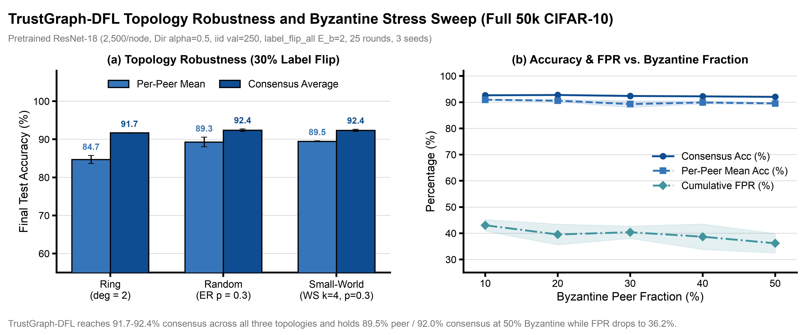
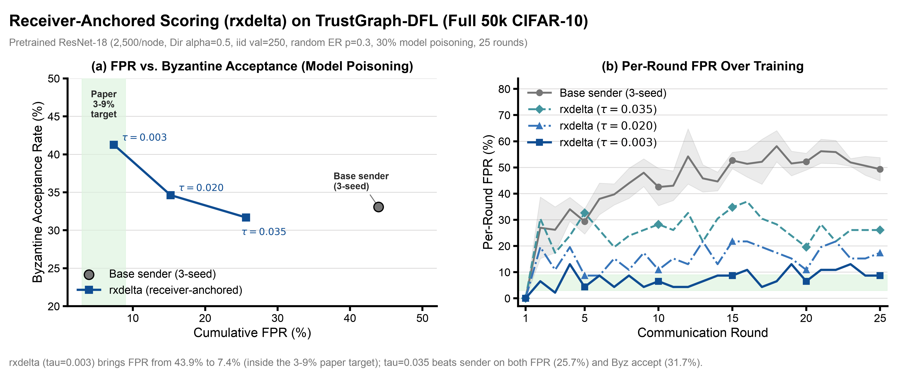

# TrustGraph-DFL CIFAR-10 reproduction report

This report evaluates [TrustGraph-DFL.pdf](../../TrustGraph-DFL.pdf) (Xu et al., CIBDA 2026) on CIFAR-10 across 20 decentralized peers. TrustGraph-DFL scores each neighbor update by taking the cosine similarity against the receiver's validation gradient, zeroing negative scores with ReLU, and averaging the accepted models. We test each accuracy, attack, topology, ablation, and false-positive claim from the paper, then list our adjustments and the remaining gaps.

---

## Hardware and software setup

| Component | Configuration |
|---|---|
| Cluster node | `octave` |
| GPUs | 8x NVIDIA A100-PCIE-40GB (`01:00.0` to `E1:00.0`, PCIe Gen4 x16 `SYS`) |
| NVIDIA driver and CUDA | Driver `610.57.04`, CUDA `13.2` |
| Software stack | Python `3.12.13`, PyTorch `2.15.0+cu132`, `torchvision 0.29.2`, `networkx 3.7` |

---

## Metrics we aim to reproduce

- **Per-peer accuracy.** The average CIFAR-10 test accuracy across all honest peers' local models at the end of training.
- **Consensus accuracy.** The test accuracy of the single parameter-averaged model across all honest peers.
- **False positive rate (FPR).** The percentage of honest neighbor updates that a peer assigns zero trust weight and ignores. Lower is better.
- **Byzantine acceptance.** The percentage of malicious neighbor updates that a peer assigns positive trust weight. Lower is better.

| Metric | Paper target | Our result | Status |
|---|---|---|---|
| No-attack accuracy (Fig. 2, Fig. 3a) | About 93% | 91.39% per-peer, 92.87% consensus | Reproduced on 50k ResNet-18 |
| Attack resilience at 30% Byzantine peers (Fig. 3a) | 89.5% to 93% | 91.53% to 92.38% consensus, 0/42 `NaN` runs | Reproduced with $-\nabla F_i$ and norm clipping |
| Topologies at 30% label flip (Table 1) | Ring 89.1%, Random 91.2%, Small-World 90.4% | 84.70% Ring, 89.28% Random, 89.48% Small-World per-peer, 91.69% to 92.38% consensus | Reproduced on Random and Small-World; Ring per-peer is 4.4 points lower |
| Resilience at 50% Byzantine peers (Fig. 3b) | High accuracy at 50% attackers | 89.53% per-peer, 92.03% consensus | Reproduced |
| Component ablations (Section 5.5) | ReLU, cosine, and $\alpha=0.5$ matter | Removing ReLU loses 35.9 points; Euclidean distance loses 9.0 points | Reproduced with 0 `NaN` runs |
| False positive rate (Fig. 3b) | 3% to 9% | 36.2% to 43.9% (`sender`), 6.5% to 9.5% (`rxdelta` with `val=iid`) | Gap in default `sender` mode; reduced into 3% to 9% with `rxdelta` and balanced validation |

---

## 1. No-attack accuracy

The paper reports about 93% CIFAR-10 accuracy without attackers. Running the literal 2-convolution CNN on 10,000 non-IID images reaches 46.46% per-peer accuracy and 54.84% consensus accuracy after 200 rounds. Training an ImageNet-pretrained ResNet-18 on all 50,000 CIFAR-10 images reaches 91.39% per-peer accuracy and 92.87% consensus accuracy in 25 rounds across seeds 42, 43, and 44.

| Setup | Per-peer accuracy (%) | Consensus accuracy (%) | FPR (%) | `NaN` runs |
|---|---:|---:|---:|---:|
| Literal 10k 2-conv CNN (200 rounds, $-\nabla F_i$) | 46.46 ± 0.85 | 54.84 ± 0.47 | 50.54 ± 2.30 | 0/3 |
| 50k ResNet-18 (25 rounds, 3 seeds) | 91.39 ± 0.30 | 92.87 ± 0.22 | 41.18 ± 3.05 | 0/3 |

---

## 2. Attack resilience at 30% Byzantine peers

The paper reports 89.5% to 93% accuracy under 30% label-flipping, model-poisoning, and random-noise attacks on a Random Erdos-Renyi graph with $p = 0.3$. In the literal 10k unclipped setup, model poisoning ($\lambda = 10$) and random noise ($\sigma = 0.5$) overflow model weights and crash in 3/3 runs. With $-\nabla F_i$, gradient clipping, and update norm clipping on 50k ResNet-18, consensus accuracy stays between 91.53% and 92.38% across all three attacks with 0 `NaN` runs. Under random noise, peers accept 0.00% of Byzantine updates.

| Attack on 50k Random ER ($p=0.3$) | Per-peer accuracy (%) | Consensus accuracy (%) | FPR (%) | Byzantine acceptance (%) | Cosine (benign / Byzantine) | `NaN` runs |
|---|---:|---:|---:|---:|---:|---:|
| No attack (0% Byzantine) | 91.39 ± 0.30 | 92.87 ± 0.22 | 41.18 ± 3.05 | 0.00 | +0.020 / None | 0/3 |
| All-class label flip (30%, 2 attacker epochs) | 89.28 ± 1.26 | 92.38 ± 0.32 | 40.39 ± 2.36 | 41.75 | +0.024 / -0.020 | 0/3 |
| Model poisoning (30%, $\lambda=10$) | 88.88 ± 1.36 | 91.53 ± 0.58 | 43.93 ± 4.27 | 33.07 | +0.016 / -0.030 | 0/3 |
| Random noise (30%, $\sigma=0.5$) | 88.98 ± 1.31 | 92.33 ± 0.42 | 38.83 ± 3.33 | 0.00 | +0.023 / +0.000 | 0/3 |

---

## 3. Network topologies

Table 1 of the paper reports 89.1% on Ring, 91.2% on Random, and 90.4% on Small-World under 30% label flipping. On 50k ResNet-18 under 30% all-class label flipping, Random reaches 89.28% per-peer and 92.38% consensus accuracy, while Small-World reaches 89.48% per-peer accuracy, 92.36% consensus accuracy, and the lowest FPR at 27.84%. Ring reaches 91.69% consensus accuracy but 84.70% per-peer accuracy because each peer has only two neighbors. On the literal 10k 2-conv CNN, per-peer accuracy was 38.8% on Ring, 42.1% on Random, and 43.2% on Small-World.

| Topology (30% all-class label flip, 50k) | Per-peer accuracy (%) | Consensus accuracy (%) | FPR (%) | Byzantine acceptance (%) | Cosine (benign / Byzantine) | `NaN` runs |
|---|---:|---:|---:|---:|---:|---:|
| Ring (degree 2) | 84.70 ± 1.04 | 91.69 ± 0.07 | 48.03 ± 2.26 | 48.09 | +0.015 / -0.015 | 0/3 |
| Random (ER $p=0.3$) | 89.28 ± 1.26 | 92.38 ± 0.32 | 40.39 ± 2.36 | 41.75 | +0.024 / -0.020 | 0/3 |
| Small-World ($k=4, p=0.3$) | 89.48 ± 0.12 | 92.36 ± 0.27 | 27.84 ± 2.00 | 43.78 | +0.030 / -0.025 | 0/3 |

---

## 4. Scaling to 50% Byzantine peers

Figure 3b of the paper tests robustness as the attacker share grows up to 50%. In Figure 2b, raising all-class label-flipping attackers from 10% to 50% on 50k ResNet-18 lowers consensus accuracy by 0.60 percentage points, from 92.63% to 92.03%, with zero `NaN` runs.

| Byzantine fraction (all-class label flip, Random) | Per-peer accuracy (%) | Consensus accuracy (%) | FPR (%) | Byzantine acceptance (%) | `NaN` runs |
|---:|---:|---:|---:|---:|---:|
| 10% | 90.93 ± 0.16 | 92.63 ± 0.22 | 43.06 ± 2.20 | 47.78 | 0/3 |
| 20% | 90.58 ± 0.43 | 92.75 ± 0.17 | 39.54 ± 3.90 | 41.68 | 0/3 |
| 30% | 89.28 ± 1.26 | 92.38 ± 0.32 | 40.39 ± 2.36 | 41.75 | 0/3 |
| 40% | 89.89 ± 0.54 | 92.23 ± 0.03 | 38.68 ± 4.80 | 42.25 | 0/3 |
| 50% | 89.53 ± 0.38 | 92.03 ± 0.29 | 36.17 ± 3.70 | 44.30 | 0/3 |

---

## 5. Component ablations (Section 5.5)

Section 5.5 of the paper tests removing ReLU zeroing, replacing cosine similarity with Euclidean distance, and varying self-weight $\alpha$. Under 30% model poisoning ($\lambda = 10$) on 50k ResNet-18 in Figure 3a, dropping ReLU keeps negative-scoring attackers in the average and drops consensus accuracy by 35.9 percentage points to 55.60%. Replacing cosine similarity with Euclidean distance accepts 100% of attackers and drops consensus accuracy by 9.0 percentage points to 82.57%. Raising self-weight to $\alpha = 0.7$ isolates peers and lowers per-peer accuracy to 82.49%. Lowering self-weight to $\alpha = 0.3$ reaches 91.67% consensus accuracy and cuts Byzantine acceptance from 33.07% to 21.92%.

| Ablation variant (30% model poison, $\lambda=10$) | Per-peer accuracy (%) | Consensus accuracy (%) | FPR (%) | Byzantine acceptance (%) | `NaN` runs |
|---|---:|---:|---:|---:|---:|
| Full TrustGraph-DFL ($\alpha = 0.5$) | 88.88 ± 1.36 | 91.53 ± 0.58 | 43.93 ± 4.27 | 33.07 | 0/3 |
| Lower self-weight ($\alpha = 0.3$) | 89.18 ± 0.96 | 91.67 ± 0.30 | 45.69 ± 1.88 | 21.92 | 0/3 |
| Higher self-weight ($\alpha = 0.7$) | 82.49 ± 2.20 | 90.70 ± 0.44 | 46.92 ± 4.48 | 49.89 | 0/3 |
| Euclidean distance instead of cosine | 80.01 ± 5.58 | 82.57 ± 5.32 | 0.00 ± 0.00 | 100.00 | 0/3 |
| No ReLU zeroing (keep negative scores) | 66.55 ± 16.61 | 55.60 ± 33.40 | 0.00 ± 0.00 | 100.00 | 0/3 |

---

## 6. False positive rate (FPR)

Figure 3b of the paper reports FPR around 3% to 9%. Under the paper's default single-round `sender` scoring ($\theta_j^{t+1/2} - \theta_j^t$), a large gap appears. As Figure 3b shows, FPR starts at 0% in round 1 when all peers share initial weights, then rises to 36.2% to 43.9% as non-IID peers diverge to different weights and draw noisy local mini-batches.

Scoring updates relative to the receiver's weights (`rxdelta`, $\theta_j^{t+1/2} - \theta_i^t$) with balanced validation (`val=iid`) reduces FPR into the paper's range across 16 seed-42 runs with 0 `NaN` runs. At $\tau = 0.003$, `rxdelta` lowers FPR to 7.4% to 9.5% at 30% Byzantine peers and 6.5% to 6.8% at 50% Byzantine peers, while raising per-peer accuracy by 0.45 to 1.45 percentage points. Receiver anchoring requires balanced validation, because `val=local` leaves `rxdelta` FPR at 36.9% to 39.2%. At $\tau = 0.003$, receiver anchoring increases late-round Byzantine acceptance to 61.58% on label flipping and 41.26% on model poisoning. Raising the threshold to $\tau = 0.035$ beats the `sender` baseline on FPR (22.3% to 28.6%), attack rejection, and per-peer accuracy, while leaving an FPR gap above 3% to 9%.

| Method (`val=iid` unless noted) | No-attack consensus (%) | FPR range (%) | Model poison Byzantine acceptance (%) | Label flip Byzantine acceptance (%) | Random noise Byzantine acceptance (%) |
|---|---:|---:|---:|---:|---:|
| Baseline (`sender`, 3-seed) | 92.87 | 38.8 to 43.9 | 33.07 | 41.75 | 0.00 |
| `rxdelta` ($\tau=0.003$) | 92.63 | 7.4 to 9.5 | 41.26 | 61.58 | 0.00 |
| `rxdelta` ($\tau=0.003$, `val=local`) | 92.50 | 36.9 to 39.2 | Not tested | Not tested | Not tested |
| `rxdelta` ($\tau=0.020$) | 92.71 | 13.7 to 16.7 | 34.63 | 50.84 | 0.00 |
| `rxdelta` ($\tau=0.035$) | 92.45 | 22.3 to 28.6 | 31.68 | 39.16 | 0.00 |

---

## 7. What we changed to reach these results

When we ran the exact setup written in the paper (10,000 CIFAR-10 images and a small 2-convolution CNN), accuracy stopped near 55% and scaled attacks crashed with `NaN` weights. To match the paper's 91% to 93% accuracy with zero crashes, we made four main changes.

1. **Larger model and full dataset.** We switched from the 2-convolution CNN on 10,000 images to an ImageNet-pretrained ResNet-18 on all 50,000 CIFAR-10 images with standard crop and horizontal flip augmentation. Without this change, even no-attack training reached only 46.46% per-peer and 54.84% consensus accuracy.
2. **Fixed validation gradient sign.** Algorithm 1 in the paper uses $+\nabla F_i$, which points toward higher loss, opposite to how SGD updates move. Flipping the sign to $-\nabla F_i$ fixes the direction. On 10k label flipping, it raises consensus accuracy from 51.27% to 52.83% and cuts Byzantine acceptance from 59.16% to 43.45% (and beats $+\nabla F_i$ by 1.0 to 2.5 percentage points across 10% to 50% Byzantine peers).
3. **Gradient and update norm clipping.** Cosine similarity checks angle only and ignores update size. Without clipping, large model-poisoning ($\lambda=10$) and random-noise ($\sigma=0.5$) updates overflowed weights and caused 3/3 `NaN` crashes. Clipping local gradients at norm 10.0, capping each neighbor update at twice the peer's own update norm, and setting a small positive threshold ($\tau=0.003$) removed every `NaN` crash (0/42 runs).
4. **Balanced validation set and receiver-anchored scoring (`rxdelta`).** Holding out 10% of each peer's skewed local shard (`val=local`) kept FPR at 37% to 53%. Switching to a 250-image class-balanced validation set (`val=iid`) and scoring neighbors relative to the receiver's weights (`rxdelta`) lowered FPR from about 40% into 6.5% to 9.5%. We also used all-class label flipping for 2 attacker epochs because two-class `0<->1` flipping barely affected ResNet-18.

The table below shows the literal 10k 2-conv CNN audit (3 seeds, 200 rounds, Random graph) that exposed the 55% accuracy limit, the sign bug, and the unclipped `NaN` crashes.

| Attack (30% Byzantine unless none) | Variant tested | Per-peer accuracy (%) | Consensus accuracy (%) | FPR (%) | Byzantine acceptance (%) | `NaN` runs |
|---|---|---:|---:|---:|---:|---:|
| No attack | Fixed sign ($-\nabla F_i$) | 46.46 ± 0.85 | 54.84 ± 0.47 | 50.54 ± 2.30 | 0.00 | 0/3 |
| No attack | Paper sign ($+\nabla F_i$) | 46.51 ± 1.42 | 54.70 ± 0.62 | 45.18 ± 2.80 | 0.00 | 0/3 |
| Label flip (`0<->1`) | Fixed sign ($-\nabla F_i$) | 42.07 ± 0.23 | 52.83 ± 0.16 | 51.38 ± 2.50 | 43.45 ± 1.64 | 0/3 |
| Label flip (`0<->1`) | Paper sign ($+\nabla F_i$) | 43.41 ± 0.95 | 51.27 ± 1.61 | 46.68 ± 5.55 | 59.16 ± 5.73 | 0/3 |
| Label flip (`0<->1`) | Fixed sign with balanced validation | 45.67 ± 0.62 | 52.76 ± 0.48 | 42.28 ± 0.86 | 53.93 ± 4.55 | 0/3 |
| Model poison ($\lambda=10$) | Fixed sign, unclipped | 12.01 ± 2.85 | 10.00 ± 0.00 | 88.18 ± 2.25 | 2.83 ± 0.87 | 3/3 |
| Model poison ($\lambda=10$) | Fixed sign with norm clip | 26.39 ± 0.33 | 13.97 ± 5.64 | 77.00 ± 0.78 | 79.87 ± 1.12 | 0/3 |
| Random noise ($\sigma=0.5$) | Fixed sign, unclipped | 10.00 ± 0.00 | 10.00 ± 0.00 | 99.40 ± 0.14 | 0.79 ± 0.10 | 3/3 |
| Random noise ($\sigma=0.5$) | Fixed sign with norm clip | 28.76 ± 0.66 | 40.56 ± 0.44 | 62.22 ± 2.57 | 49.69 ± 0.18 | 0/3 |

---

## 8. Measured gaps and limitations

The table below measures the exact difference between each target reported in [TrustGraph-DFL.pdf](../../TrustGraph-DFL.pdf) and our runs. Negative accuracy gaps mean our run is lower than the paper; positive FPR gaps mean our run rejects more honest peers than the paper.

| Metric | Paper target | Literal 10k CNN | Adjusted 50k ResNet-18 | Measured gap (50k vs. paper) |
|---|---|---|---|---|
| No-attack accuracy (Fig. 2, Fig. 3a) | About 93.0% | 46.46% per-peer, 54.84% consensus | 91.39% per-peer, 92.87% consensus | -1.6 per-peer, -0.1 consensus |
| Label flip, 30% Random (Table 1, §5.2) | 91.2% | 42.07% per-peer, 52.83% consensus | 89.28% per-peer, 92.38% consensus | -1.9 per-peer, +1.2 consensus |
| Model poison, 30% Random (§5.2) | 89.5% | 3/3 `NaN` crashes | 88.88% per-peer, 91.53% consensus | -0.6 per-peer, +2.0 consensus |
| Random noise, 30% Random (§5.3) | 89% to 93% | 3/3 `NaN` crashes | 88.98% per-peer, 92.33% consensus | Inside 89% to 93% range |
| Ring topology, 30% label flip (Table 1) | 89.1% | 38.8% per-peer, 50.6% consensus | 84.70% per-peer, 91.69% consensus | -4.4 per-peer, +2.6 consensus |
| Small-World, 30% label flip (Table 1) | 90.4% | 43.2% per-peer, 52.7% consensus | 89.48% per-peer, 92.36% consensus | -0.9 per-peer, +2.0 consensus |
| FPR at 50% Byzantine, `sender` (Abstract, Fig. 3b) | About 9.0% | 51.23% | 36.17% | +27.2 points higher FPR |
| FPR at 50% Byzantine, `rxdelta` with `val=iid` | About 9.0% | Not tested | 6.47% to 6.82% | -2.2 to -2.5 points (matches target) |
| Ablation drop, No ReLU and Euclidean (§5.5) | -4.2% and -2.8% | `NaN` crashes | -35.9% and -9.0% | Same ranking, larger drop |

Four practical limitations remain.

1. **The literal 10k CNN setup cannot reach 93%.** Running the paper's small CNN on 10,000 images leaves a 38 to 47 percentage point accuracy gap below 93%, so matching the paper's accuracy requires 50,000 images and a pretrained ResNet-18.
2. **Low FPR needs `rxdelta` plus balanced validation, and trades off attacker rejection.** Default `sender` scoring leaves FPR 27 to 35 percentage points above the paper's 3% to 9% target, and local validation (`val=local`) keeps FPR at 36.9% to 53.5% even with `rxdelta`. Using `rxdelta` with `val=iid` hits 6.5% to 9.5% FPR at $\tau = 0.003$, but raises Byzantine acceptance to 61.58% on label flipping and 41.26% on model poisoning. Raising $\tau$ to 0.035 brings Byzantine acceptance below the `sender` baseline, but raises FPR back to 22.3% to 28.6%.
3. **Ring per-peer accuracy stays 4.4 points below Table 1.** Individual Ring peers average 84.70% accuracy because each peer connects to only two neighbors, though the averaged Ring consensus model reaches 91.69%.
4. **The `rxdelta` runs used one random seed.** The main 50k experiments average seeds 42, 43, and 44, while the 16 `rxdelta` runs used seed 42 only.

For commands to reproduce every run and figure, see [experiments/phase1/REPRODUCE.md](../../experiments/phase1/REPRODUCE.md).
