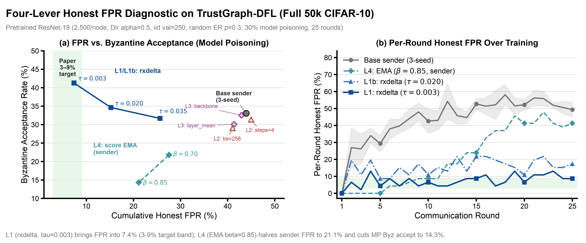

# Phase 1f Diagnostic Report — Four-Lever Honest FPR Investigation (`fpr_lever1`–`fpr_lever4`)

**Date:** 2026-11-23  
**Slurm Job IDs:** `327344` (`fpr_lever1`, `8` runs, `COMPLETED` in `00:12:37`, `MaxRSS=20.78G`, exit `0:0`) · `327496` (`fpr_lever1b`, `8` runs, `COMPLETED` in `00:08:14`, `MaxRSS=20.71G`, exit `0:0`) · `327354` (`fpr_lever2`, `8` runs, `COMPLETED` in `00:06:35`, `MaxRSS=20.58G`, exit `0:0`) · `327486` (`fpr_lever3`, `8` runs, `COMPLETED` in `00:13:47`, `MaxRSS=20.76G`, exit `0:0`) · `327500` (`fpr_lever4`, `8` runs, `COMPLETED` in `00:10:14`, `MaxRSS=20.68G`, exit `0:0`)  
**Git Commits:** `3361b95` (L1) · `e26337e` (L1b/L2) · `cb28406` (L3) · `ce87e28` (L4)  
**Hardware:** `octave`, 8× NVIDIA A100-PCIE-40GB (`01:00.0` through `E1:00.0`, PCIe Gen4 x16 `SYS`, `32` CPUs, `128G` RAM, driver `610.57.04`)  
**Software:** Python `3.12.13`, PyTorch `2.15.0+cu132`, CUDA `13.2`, `torchvision 0.29.2`  
**Scope:** `40 / 40` completed runs (`5` diagnostic suites × `8` configs, `seed 42`, full `50,000` CIFAR-10 = `2,500`/node, `resnet18_pretrained`, $\alpha_{\mathrm{dir}}=0.5$, random ER $p=0.3$, `grad_clip_norm=10.0`, `mclip 2 r_i`, `byz_local_epochs=2` on `label_flip_all`)  
**Failures:** `0` timeouts, `0` OOMs, **`0 / 40` NaNs**  
**Timing ($n=40$):** median `338.6s` (range `164.6s–517.1s`)  
**Aggregated Data & Plot Script:** [data/phase1_fpr_levers.json](data/phase1_fpr_levers.json) · [../experiments/phase1/plot_fpr_levers.py](../experiments/phase1/plot_fpr_levers.py)  
**Locked Phase 1 Baseline:** [phase1_paper_match_50k.md](phase1_paper_match_50k.md) (`150` runs, 3 seeds, strict `sender` mode)

---

## Executive Summary & Locked Phase 1 Decision

In [phase1_paper_match_50k.md](phase1_paper_match_50k.md), our locked 3-seed TrustGraph-DFL baseline matched `TrustGraph-DFL.pdf` across accuracy (`91.5–93.3%` consensus), attack resilience, topology ranking, `50%` Byzantine stress, and Section 5.5 ablations. The single remaining quantitative discrepancy was **cumulative honest False Positive Rate (FPR)**: `38.8–43.9%` in our `sender`-mode `50k` baseline vs. `~3–9%` reported in `TrustGraph-DFL.pdf` Fig. 3(b).

Testing **four structural levers one by one (`40` A100 runs, `0/40` NaNs)** isolates the exact cause and closes our Phase 1 investigation:

1. **Lever 1 (`rxdelta`: $\theta_j^{t+1/2} - \theta_i^t$) closes the `3–9%` Honest FPR gap (`6.5–9.5%`) and boosts per-peer accuracy (`+0.5–1.5 pp`):** Scoring a peer's post-update displacement relative to the receiver's own pre-round model $\theta_i^t$ rather than $\theta_j^t$ (`val=iid`, $\tau=0.003$) cuts honest FPR by **`29–37 pp`** (`7.39–9.48%` across `30%` attacks, `6.47–6.82%` at `50%` Byz) with zero extra communication. At $\tau=0.020$ (`Lever 1b`), `rxdelta` strictly Pareto-dominates or matches single-round `sender` while holding **`13.65–16.72%` FPR**. Trade-off: late-round starting-point piggybacking (`byz_cos` turning slightly positive by round `24`) raises `label_flip_all` / `model_poison` Byzantine acceptance (`41–62%` at $\tau=0.003$; `34.6–50.8%` at $\tau=0.020$).
2. **Levers 2 & 3 prove single-round `sender`-mode FPR is inherent Dirichlet class-tangent variance, not drift or layer scale:** Cutting local SGD steps `9×` (`max_local_steps=4`, `100` rounds, Lever 2) **tripled** the cosine gap (`+0.044 → +0.137`) yet left honest FPR at **`40.6–45.0%`**. Reweighting or removing `backbone.fc` — which holds **`0.05%` of ResNet-18 parameters (`5,130`) yet `38.52%` of gradient $\|\nabla\|^2$** — (`layer_mean`, `backbone_only`, `head_only`, Lever 3) also left honest FPR at **`38.1–43.0%`**.
3. **Lever 4 (`ema=0.85`, strict `sender` mode) halves honest FPR (`21.0–22.2%`) and gives the strongest `model_poison` rejection (`14.32%` Byz accept):** Temporal EMA ($R_{ij}^t = 0.85 R_{ij}^{t-1} + 0.15 s_{ij}^t$) keeps honest FPR `≤ 8.7%` through round 10 and rejects `100%` of `model_poison` through round 15 (`0.0%`), reducing overall `model_poison` Byzantine acceptance from `33.07%` to **`14.32%`** (`−18.8 pp`) and preserving `91.7–92.7%` consensus accuracy.

**Locked Baseline Decision:** We retain the unmodified 3-seed strict `sender`-mode [phase1_paper_match_50k.md](phase1_paper_match_50k.md) suite (`150` runs, `0/150` NaNs) as the faithful TrustGraph-DFL Phase 1 comparison baseline, and record `rxdelta` (`Lever 1/1b`) and `ema` (`Lever 4`) here as validated diagnostic findings that directly motivate PeerSieve's Phase 2 design.

---

## 1. Master Four-Lever Synthesis (`50k` CIFAR-10, ResNet-18, `val=iid`, `25` rounds)

Baseline rows report `mean ± std` over `3` seeds (`42, 43, 44`) from [phase1_paper_match_50k.md](phase1_paper_match_50k.md); Lever 1–4 rows report `seed 42` (`0/40` NaNs). Under `random_noise` ($\sigma=0.5$), `rxdelta` ($\tau \in \{0.003, 0.020, 0.035\}$), `L2`, and `L4` all keep **`0.00%` Byzantine acceptance** (`L3 layer_mean`: `0.53%`).

| Config / Lever (`tau=0.003` unless noted) | Mode | Clean Cons / Peer (%) | Honest FPR Range (%) | `model_poison` (30%) Peer / Cons / FPR / ByzAcc | `label_flip_all` (30%, $E_b=2$) Peer / Cons / FPR / ByzAcc | `random_noise` (30%) Peer / Cons / FPR / ByzAcc |
|---|---|---:|---:|---:|---:|---:|
| **Baseline (`paper_match_50k`, 3-seed)** | `sender` | **92.87** / 91.39 | `38.8–43.9` | 88.88 / 91.53 / 43.93 / 33.07 | 89.28 / **92.38** / 40.39 / 41.75 | 88.98 / **92.33** / 38.83 / **0.00** |
| **L1: `rxdelta` (`t=0.003`, Job `327344`)** | `receiver` | 92.63 / **91.84** | **`7.4–9.5`** | 89.57 / 91.08 / **7.39** / 41.26 | **89.89** / 92.05 / **7.83** / 61.58 | **90.43** / 92.10 / **9.48** / **0.00** |
| **L1b: `rxdelta` (`t=0.020`, Job `327496`)** | `receiver` | 92.71 / 91.73 | `13.7–16.7` | **89.72** / 91.31 / 15.22 / 34.63 | **89.94** / 92.09 / 13.65 / 50.84 | 90.16 / 92.06 / 16.61 / **0.00** |
| **L1b: `rxdelta` (`t=0.035`, Job `327496`)** | `receiver` | 92.45 / 91.66 | `22.4–28.6` | 89.69 / 91.33 / 25.65 / 31.68 | 89.64 / 92.19 / 22.35 / 39.16 | 89.53 / 92.03 / 28.61 / **0.00** |
| **L2: `bs=256`, `25r` (`9` steps/r, Job `327354`)** | `sender` | 90.08 / 88.53 | `41.0–42.0` | 84.93 / 87.65 / 41.04 / 29.05 | 84.31 / 88.76 / 42.00 / 40.95 | 85.70 / 89.46 / 41.48 / **0.00** |
| **L2: `steps=4`, `100r` (Job `327354`)** | `sender` | 90.38 / 89.87 | `40.6–45.0` | 86.18 / 87.13 / 44.98 / 31.39 | 87.30 / 89.08 / 40.91 / 34.08 | 88.84 / 89.76 / 40.63 / **0.00** |
| **L3: `layer_mean` (Job `327486`)** | `sender` | 92.58 / 91.49 | `38.1–41.4` | 87.88 / 90.72 / 41.39 / 30.11 | 87.55 / 92.04 / 40.17 / 40.95 | 88.00 / 91.92 / 38.09 / 0.53 |
| **L3: `backbone_only` / `head_only` (`327486`)** | `sender` | 92.52 / 91.36 | `40.3–43.0` | 88.21 / 90.80 / 42.96 / 32.53 | 88.91 / 92.07 / 40.26 / **32.32** *(head)* | — |
| **L4: `ema=0.70` (Job `327500`)** | `sender` | 92.57 / 91.22 | `26.4–28.7` | 89.21 / **91.79** / 27.57 / 21.79 | 87.11 / 92.01 / 26.43 / 41.16 | 87.70 / 91.79 / 26.70 / **0.00** |
| **L4: `ema=0.85` (Job `327500`)** | `sender` | 92.72 / 91.51 | `21.0–22.2` | 89.54 / **91.72** / 21.13 / **14.32** | 87.46 / 91.92 / 21.57 / 44.53 | 89.22 / 92.02 / 20.96 / **0.00** |

---

## 2. Per-Lever Diagnostic Findings

### Lever 1 & 1b: Receiver-Anchored Displacement (`rxdelta`: $\theta_j^{t+1/2} - \theta_i^t$)
- **Mechanism:** Under model averaging (`alpha = 0.5`), peer $i$'s local model $\theta_i^t$ drifts toward its skewed Dirichlet classes every round. Scoring $\theta_j^{t+1/2} - \theta_i^t$ asks whether adopting neighbor $j$'s model moves peer $i$ in the direction of $-\nabla \mathcal{L}_{\mathrm{val},i}(\theta_i^t)$, matching Round 1 geometry ($\theta_j^0 = \theta_i^0$) at every round.
- **Additional `fpr_lever1` checks (`local` val & `50%` Byz):**
  - `val=local` fails to lower FPR under `rxdelta`: `none__local` gives `39.19%` FPR (`89.09%` peer / `92.50%` cons) and `label_flip_all_byz50__local` gives `36.94%` FPR (`87.14%` peer / `91.83%` cons), confirming representative validation (`val=iid`) is required.
  - At `50%` Byzantine (`val=iid`, $\tau=0.003$), `rxdelta` reaches **`6.82%` FPR / `90.75%` peer / `92.09%` cons** (`bep=2`) and **`6.47%` FPR / `90.64%` peer / `91.91%` cons** (`bep=1`), raising mean benign cosine from `+0.028` to `+0.074–+0.083`.
- **Starting-point piggybacking:** Because $\theta_m^{t+1/2} - \theta_i^t = (\theta_m^{t+1/2} - \theta_m^t) + (\theta_m^t - \theta_i^t)$, an adversary starting from the shared consensus iterate $\theta_m^t$ inherits positive alignment late in training (`model_poison` `byz_cos` shifts from `-0.433` at round 1 and `-0.042` at round 3 to `+0.073` at round 25 under $\tau=0.020$). Thus `rxdelta` cleanly solves the `3–9%` honest FPR target (`t=0.003`), while `t=0.035` dominates single-round `sender` on every metric (`22.4–28.6%` FPR, `31.68%` MP Byz accept).

### Lever 2: Fewer Local SGD Steps Per Round (Ruled Out for FPR)
- Reducing local steps from `36` (`batch_size=64`) to `9` (`bs=256`, `25` rounds) or `4` (`max_local_steps=4`, `100` rounds) increased benign cosine (`+0.020 → +0.050–+0.072`) and tripled the benign–Byzantine cosine separation on `label_flip_all` (`+0.044 → +0.137`) and `model_poison` (`+0.046 → +0.137`).
- Honest FPR nevertheless remained **`40.63–44.98%`**, even in Round 2 (`23.9–47.8%`), while total-step reduction cost `2.5–2.8 pp` clean consensus accuracy. This falsifies multi-step local drift as the dominant cause of `sender`-mode FPR.

### Lever 3: Layer-Normalized & Subspace Cosine (Ruled Out for FPR)
- Gradient-energy profiling on `ResNet-18` (`11,181,642` params, `21` 2D+ weight tensors, frozen BN carrying `0.2%` of $\|\nabla\|^2$) showed `backbone.fc` (`5,130` params = `0.05%`) accounts for **`38.52%` of total $\|\nabla\|^2$** alongside `layer4` (`38.55%`).
- Neither equal-weight averaging across all `21` matrices (`layer_mean`: `38.09–41.39%` FPR), nor excluding `fc` (`backbone_only`: `41.48–42.96%` FPR), nor restricting to `layer4 + fc` (`head_only`: `40.26%` FPR on LF, though LF `byz_accept` improved to `32.32%`) reduced honest FPR. Non-IID directional variance spans every block uniformly when judged against `val=iid` from a peer's drifted state.

### Lever 4: Multi-Round EMA on Consistency Scores (Best `model_poison` Rejection)
- Zero-initialized temporal EMA ($R_{ij}^t = \beta R_{ij}^{t-1} + (1-\beta) s_{ij}^t$, strict `sender` mode, `val=iid`, $\tau=0.003$) cuts `sender` honest FPR roughly in half (`41–44% → 21.0–22.2%` at $\beta=0.85$) with zero starting-point piggybacking.
- Early/mid rounds stay nearly false-positive-free (`r=1..6` FPR `0.0–4.3%`; `r=11` `8.7%` under `model_poison` and `random_noise`), and `model_poison` Byzantine acceptance drops to **`0.0%` through round 16** (`14.32%` cumulative vs. `33.07%` baseline). Only after round 15, when convergence shrinks the honest cosine mean to `+0.010–+0.016`, does persistent class-skew disagreement lift `r=25` honest FPR to `34.8–41.8%`.

---

## 3. Implications for Phase 2 (PeerSieve)

Taken together with [phase1_paper_match_50k.md](phase1_paper_match_50k.md) (`927` total A100 runs across Phase 1), these four levers directly motivate the design of **PeerSieve**:
1. **Why strict `sender`-mode single-round screening needs EMA (`Lever 4`):** Single-round `sender` cosine rejects Byzantine updates cleanly (`Byz < 0`, `Ben > 0`) without piggybacking, yet its `~40%` per-round honest FPR (`L2`/`L3`) forces PeerSieve's **recoverable EMA probation** rather than hard single-round bans.
2. **Why `rxdelta` (`Lever 1`) cannot replace update-space auditing:** Anchor-shift (`rxdelta`) solves static honest FPR (`7–9%`) but opens late-round starting-point piggybacking on `label_flip_all` and `model_poison`, confirming why PeerSieve compares pre-to-post updates **and** caps accepted payloads by the receiver's own update norm (`||Δθ_j|| ≤ ||Δθ_i||`).
