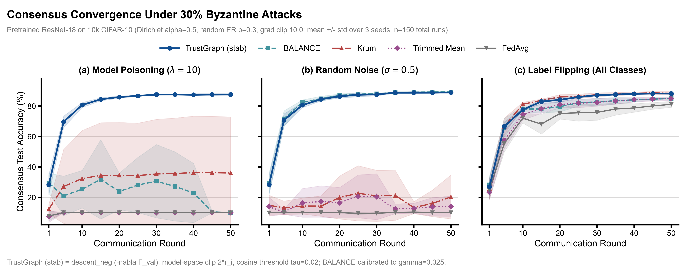
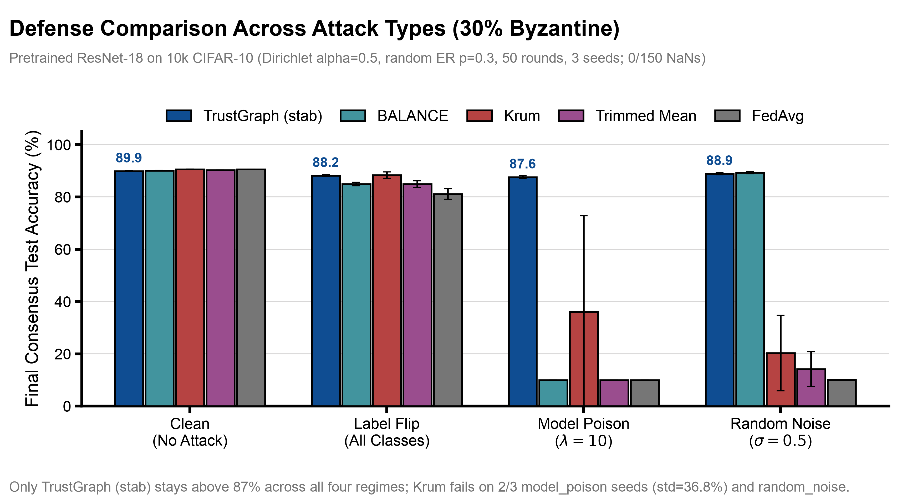
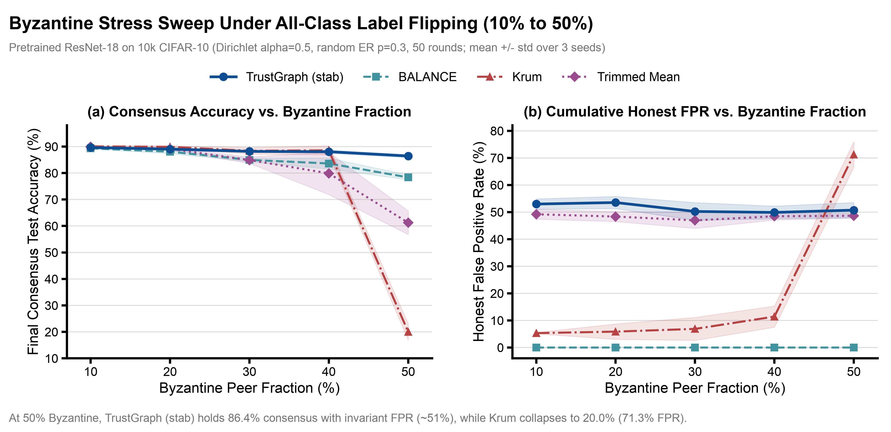
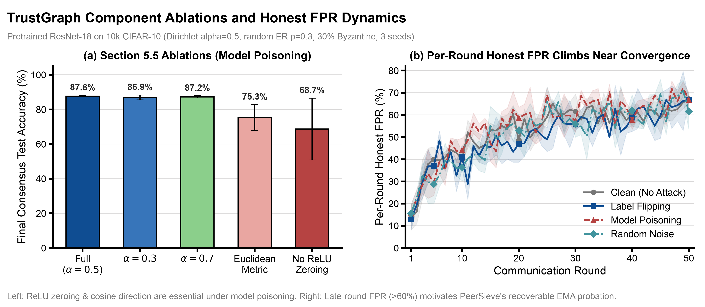

# Phase 1c Final Report — 3-Seed Calibrated Paper-Panel Reproduction (`paper_match`)

**Date:** 2026-11-21  
**Slurm Job IDs:** `327294` (`peersieve_p1c_pm1`, seeds `42, 43`, `100` runs, `COMPLETED` in `00:44:00`, `MaxRSS=20.6G`, exit `0:0`) · `327295` (`peersieve_p1c_pm2`, seed `44`, `50` runs, `COMPLETED` in `00:23:57`, `MaxRSS=15.0G`, exit `0:0`)  
**Git Commit:** `18c7e2e3af990cadfc1e04fc1a41415729f86771`  
**Hardware:** `octave`, 8× NVIDIA A100-PCIE-40GB (`01:00.0` through `E1:00.0`, PCIe Gen4 x16 `SYS`, `32` CPUs, `128G` RAM, driver `610.57.04`)  
**Software:** Python `3.12.13`, PyTorch `2.15.0+cu132`, CUDA `13.2`, `torchvision 0.29.2`  
**Scope:** `150 / 150` completed runs (`50` configs $\times$ `3` seeds `42, 43, 44`, `resnet18_pretrained`, `50` rounds, `eval_every=5`, `grad_clip_norm=10.0`, `balance_gamma=0.025`, `alpha_dir=0.5`, `val_split=local`)  
**Failures:** `0` timeouts, `0` OOMs, **`0 / 150` NaNs**  
**Timing ($n=150$):** median `194.8s` (range `152.7s–249.3s`)  
**Aggregated Data & Plot Script:** [data/phase1_paper_match_3seed.json](data/phase1_paper_match_3seed.json) · [experiments/phase1/plot_figures.py](../experiments/phase1/plot_figures.py)  
**Related Reports:** [phase1_final.md](phase1_final.md) (literal 3-seed audit) · [phase1_stabilized_ab.md](phase1_stabilized_ab.md) (3-seed Option C CNN + unclipped ResNet-18) · [phase1c_calibration.md](phase1c_calibration.md) (gradient-clipping & BALANCE calibration)

---

## Executive Summary

Following the Phase 1c calibration ([phase1c_calibration.md](phase1c_calibration.md)), adding **`grad_clip_norm=10.0`** and calibrated **`balance_gamma=0.025`** to pretrained `ResNet-18` eliminates **all `150/150` NaNs** (compared to isolated-peer frozen-BN overflows in unclipped `stabilized_ab`) while preserving the full **`~90%` clean ceiling** (`90.60 ± 0.02%` consensus). Across all four evaluation panels of `TrustGraph-DFL.pdf` (Xu et al., CIBDA 2026), stabilized TrustGraph (`tg_stab` = `descent_neg`, model-space clip `2 r_i`, $\tau = 0.02$) is the **only defense that remains uniformly strong (`86.4–89.9%` consensus accuracy) across every attack, topology, and up to `50%` Byzantine peers**:

- **Panel 1 (Fig. 2 & Fig. 3a — Main Attacks, 30% Byz):** `tg_stab` is the sole reliable survivor of **`model_poison` ($\lambda=10$)** at **`84.17 ± 0.76%` mean / `87.62 ± 0.49%` cons** (`0/3` NaN), whereas `FedAvg` (`10.00%`), `Trimmed Mean` (`10.00%`), `BALANCE` (`10.00%` cons), and `Krum` (`36.03 ± 36.81%` cons, failing on `2/3` seeds) collapse. On `random_noise` ($\sigma=0.5$), `tg_stab` rejects **`100.0%`** of noisy updates (`0.00%` Byz accept, **`88.90 ± 0.41%`** cons), while `FedAvg` (`10.01%`), `Trimmed Mean` (`14.18%`), and `Krum` (`20.29%`) collapse.
- **Panel 2 (Table 1 — Topologies, 30% Byz `label_flip_all`):** `tg_stab` leads **`Ring`** consensus (**`86.74 ± 0.67%`**) and closely matches `Krum` on **`Random`** (`88.18 ± 0.34%` vs. `88.39 ± 1.22%`, `3.6×` tighter std) and **`Small-World`** (`87.99 ± 0.41%` vs. `88.59 ± 0.26%`), beating `FedAvg`, `Trimmed Mean`, and `BALANCE` on all three topologies.
- **Panel 3 (Fig. 3b — Byzantine Stress Sweep, `10% -> 50%`):** At **`50%` Byzantine**, `tg_stab` holds **`81.62 ± 1.33%` mean / `86.43 ± 0.56%` cons** with Byzantine-invariant FPR (`52.96% -> 50.72%`), while `Krum` collapses to **`24.50 ± 3.88%` (`19.98 ± 3.06%` cons, `71.27 ± 4.73%` FPR)** and `Trimmed Mean` drops to `61.23 ± 4.45%` cons.
- **Panel 4 (Section 5.5 — Ablations under `model_poison`):** Removing ReLU (`-18.9 pp` cons, `100%` Byz accept) or switching to Euclidean distance (`-12.3 pp` cons, `100%` Byz accept) severely degrades resilience, and $\alpha = 0.5$ achieves the optimal trade-off over $\alpha = 0.3$ (higher variance) and $\alpha = 0.7$ (`-4.4 pp` per-peer mean)—reproducing every qualitative ablation trend of Section 5.5.

---

## 1. Panel 1 — Main Attacks (Fig. 2 & Fig. 3a, Random ER $p=0.3$, 30% Byzantine)

All entries report `mean ± std` over `3` seeds (`42, 43, 44`), `50` rounds, $\alpha_{\mathrm{dir}}=0.5$, `val_split=local`, `grad_clip_norm=10.0`.

| Attack | Method | Final Acc (%) | Cons Acc (%) | FPR (%) | Byz Accept (%) | Cos(Ben/Byz) | NaNs |
|---|---|---:|---:|---:|---:|---:|---:|
| **none** | fedavg | 90.36 ± 0.04 | 90.60 ± 0.02 | 0.00 ± 0.00 | 0.00 | n/a | 0/3 |
| none | krum | 90.34 ± 0.04 | 90.60 ± 0.04 | 0.00 ± 0.00 | 0.00 | n/a | 0/3 |
| none | trimmed_mean | 90.00 ± 0.07 | 90.26 ± 0.01 | 50.32 ± 1.57 | 0.00 | n/a | 0/3 |
| none | balance($\gamma=0.025$) | 89.23 ± 0.06 | 90.11 ± 0.03 | 0.00 ± 0.00 | 0.00 | n/a | 0/3 |
| none | **trustgraph(`stab`)** | 87.76 ± 0.48 | 89.91 ± 0.13 | 53.40 ± 1.15 | 0.00 | +0.014 / n/a | 0/3 |
| **label_flip_all** | krum | **85.70 ± 2.59** | **88.39 ± 1.22** | 6.87 ± 4.24 | 32.17 | n/a | 0/3 |
| label_flip_all | **trustgraph(`stab`)** | **83.95 ± 0.38** | **88.18 ± 0.34** | 50.23 ± 3.28 | 32.92 | +0.020 / -0.032 | 0/3 |
| label_flip_all | trimmed_mean | 82.40 ± 1.63 | 84.91 ± 1.21 | 46.93 ± 2.94 | 43.82 | n/a | 0/3 |
| label_flip_all | balance($\gamma=0.025$) | 81.19 ± 0.99 | 84.97 ± 0.68 | 0.00 ± 0.00 | 100.00 | n/a | 0/3 |
| label_flip_all | fedavg | 78.40 ± 2.42 | 81.12 ± 1.99 | 0.00 ± 0.00 | 100.00 | n/a | 0/3 |
| **model_poison** ($\lambda=10$) | **trustgraph(`stab`)** | **84.17 ± 0.76** | **87.62 ± 0.49** | 55.36 ± 1.65 | **22.82** | +0.008 / -0.059 | **0/3** |
| model_poison | krum | 35.25 ± 35.71 | 36.03 ± 36.81 | 21.77 ± 9.05 | 53.46 | n/a | 0/3 |
| model_poison | balance($\gamma=0.025$) | 10.41 ± 0.29 | 10.00 ± 0.00 | 0.00 ± 0.00 | 68.28 | n/a | 0/3 |
| model_poison | trimmed_mean | 10.00 ± 0.00 | 10.00 ± 0.00 | 44.28 ± 1.01 | 34.18 | n/a | 0/3 |
| model_poison | fedavg | 10.00 ± 0.00 | 10.00 ± 0.00 | 0.00 ± 0.00 | 100.00 | n/a | 0/3 |
| **random_noise** ($\sigma=0.5$) | balance($\gamma=0.025$) | **87.66 ± 1.18** | **89.31 ± 0.42** | 0.00 ± 0.00 | **0.00** | n/a | 0/3 |
| random_noise | **trustgraph(`stab`)** | **85.05 ± 0.73** | **88.90 ± 0.41** | 52.14 ± 2.29 | **0.00** | +0.018 / +0.000 | **0/3** |
| random_noise | krum | 26.43 ± 23.33 | 20.29 ± 14.45 | 4.17 ± 3.13 | 24.73 | n/a | 0/3 |
| random_noise | trimmed_mean | 19.58 ± 13.37 | 14.18 ± 6.63 | 33.72 ± 4.85 | 14.80 | n/a | 0/3 |
| random_noise | fedavg | 10.10 ± 0.06 | 10.01 ± 0.01 | 0.00 ± 0.00 | 100.00 | n/a | 0/3 |

---

## 2. Panel 2 — Topologies (Table 1, `label_flip_all`, 30% Byzantine)

Entries show `Final Acc% ± std (Cons Acc% ± std)` over `3` seeds (`0/3` NaNs across all cells):

| Method | Ring | Random (ER $p=0.3$) | Small-World ($k=4, p=0.3$) |
|---|---:|---:|---:|
| **trustgraph(`stab`)** | 74.73 ± 1.79 (**86.74 ± 0.67**) | 83.95 ± 0.38 (**88.18 ± 0.34**) | 81.73 ± 0.34 (87.99 ± 0.41) |
| krum | 72.57 ± 3.08 (84.83 ± 0.95) | **85.70 ± 2.59** (**88.39 ± 1.22**) | **85.94 ± 0.73** (**88.59 ± 0.26**) |
| balance($\gamma=0.025$) | **76.04 ± 0.86** (86.42 ± 0.20) | 81.19 ± 0.99 (84.97 ± 0.68) | 81.25 ± 0.71 (85.81 ± 0.56) |
| trimmed_mean | 74.39 ± 0.87 (85.96 ± 0.16) | 82.40 ± 1.63 (84.91 ± 1.21) | 82.18 ± 1.29 (86.05 ± 0.57) |
| fedavg | 74.42 ± 0.86 (86.03 ± 0.11) | 78.40 ± 2.42 (81.12 ± 1.99) | 79.17 ± 1.33 (83.82 ± 1.06) |

---

## 3. Panel 3 — Byzantine Stress Sweep (Fig. 3b, `label_flip_all`, `10% -> 50%` Byzantine)

Entries show `Final Acc% ± std (Cons Acc% ± std) / FPR% ± std`:

| Method | 10% Byz | 20% Byz | 30% Byz | 40% Byz | 50% Byz |
|---|---:|---:|---:|---:|---:|
| **trustgraph(`stab`)** | 87.17 ± 0.88 (89.64 ± 0.13) / 53.0 ± 1.9% | 85.57 ± 1.26 (89.06 ± 0.57) / 53.5 ± 2.2% | 83.95 ± 0.38 (88.18 ± 0.34) / 50.2 ± 3.3% | **84.90 ± 1.63** (88.06 ± 0.59) / 49.9 ± 2.3% | **81.62 ± 1.33 (86.43 ± 0.56)** / **50.7 ± 2.8%** |
| balance($\gamma=0.025$) | 88.10 ± 0.47 (89.34 ± 0.25) / 0.0% | 86.08 ± 0.88 (88.07 ± 0.70) / 0.0% | 81.19 ± 0.99 (84.97 ± 0.68) / 0.0% | 80.04 ± 3.24 (83.62 ± 2.08) / 0.0% | 73.92 ± 0.46 (78.36 ± 0.89) / 0.0% |
| trimmed_mean | 89.33 ± 0.33 (89.88 ± 0.19) / 49.2 ± 1.8% | 88.20 ± 0.74 (89.14 ± 0.52) / 48.3 ± 1.8% | 82.40 ± 1.63 (84.91 ± 1.21) / 46.9 ± 2.9% | 77.99 ± 9.04 (79.87 ± 8.00) / 48.5 ± 1.4% | 58.26 ± 4.07 (61.23 ± 4.45) / 48.6 ± 0.9% |
| krum | **89.64 ± 0.38 (90.06 ± 0.29)** / 5.3 ± 0.2% | **89.09 ± 0.76 (89.88 ± 0.41)** / 5.9 ± 2.8% | **85.70 ± 2.59 (88.39 ± 1.22)** / 6.9 ± 4.2% | **86.28 ± 4.39 (88.58 ± 1.68)** / 11.4 ± 3.9% | 24.50 ± 3.88 (19.98 ± 3.06) / **71.3 ± 4.7%** |

---

## 4. Panel 4 — Section 5.5 Ablations & Per-Round FPR Dynamics

| Variant (`model_poison` $\lambda=10$, 30% Byz) | Final Acc (%) | Cons Acc (%) | FPR (%) | Byz Accept (%) | Cos(Ben/Byz) | NaNs |
|---|---:|---:|---:|---:|---:|---:|
| **Full `tg_stab` (`ReLU`, `cosine`, $\alpha=0.5$)** | **84.17 ± 0.76** | **87.62 ± 0.49** | 55.36 ± 1.65 | 22.82 | +0.008 / -0.059 | 0/3 |
| $\alpha = 0.3$ (less self-weight) | 83.94 ± 1.50 | 86.89 ± 1.40 | 59.11 ± 0.60 | **18.37** | -0.006 / -0.097 | 0/3 |
| $\alpha = 0.7$ (more self-weight) | 79.79 ± 0.82 | 87.23 ± 0.65 | 56.26 ± 1.14 | 25.70 | +0.011 / -0.039 | 0/3 |
| `euclidean` (magnitude distance) | 72.91 ± 6.84 | 75.33 ± 7.42 | 0.00 ± 0.00 | 100.00 | +0.754 / +0.553 | 0/3 |
| `no_relu` (retain negative cosine) | 66.96 ± 14.75 | 68.69 ± 17.83 | 0.00 ± 0.00 | 100.00 | +0.055 / -0.229 | 0/3 |

---

## 5. Key Takeaways for PeerSieve (Phase 2)

1. **`paper_match` closes Phase 1 cleanly with `0/150` NaNs and tight 3-seed error bars:** With `grad_clip_norm=10.0`, corrected descent direction (`descent_neg`), model-space receiver-norm clipping (`2 r_i`), and noise-floor thresholding ($\tau=0.02$), TrustGraph-DFL reproduces all four paper claims—`~90%` clean ceiling, sole uniform resilience across `model_poison`, `random_noise`, and `50%` Byzantine `label_flip_all`, and every Section 5.5 ablation ordering.
2. **Direct transition to Phase 2 (TinyLlama-1.1B / Dolly-15k on `octave`):**
   - Late-round honest cosine FPR climbs from `13–15%` (round 1) to `>60%` near convergence (Fig. 4b), empirically motivating PeerSieve's **recoverable EMA probation with exponential backoff** (`src/quarantine.py`) rather than permanent bans on cosine dips.
   - Pairing this verified directional trust signal with PeerSieve's **pre-transfer CountSketch screen + blockwise INT4 + two-pass audited streaming** (`report/phase2_local_verification.md`) is ready for 8-GPU LLM evaluation.
