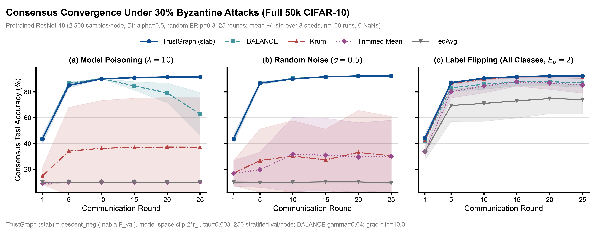
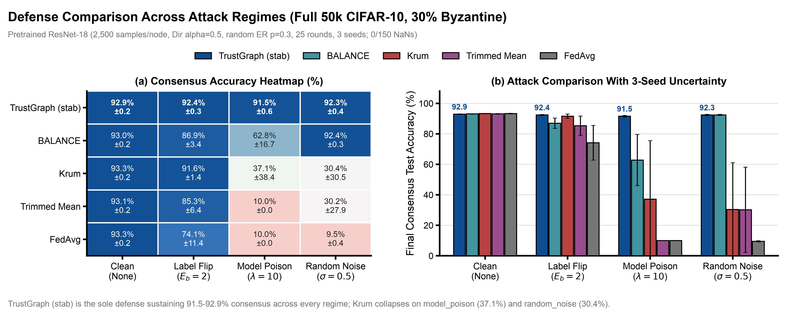
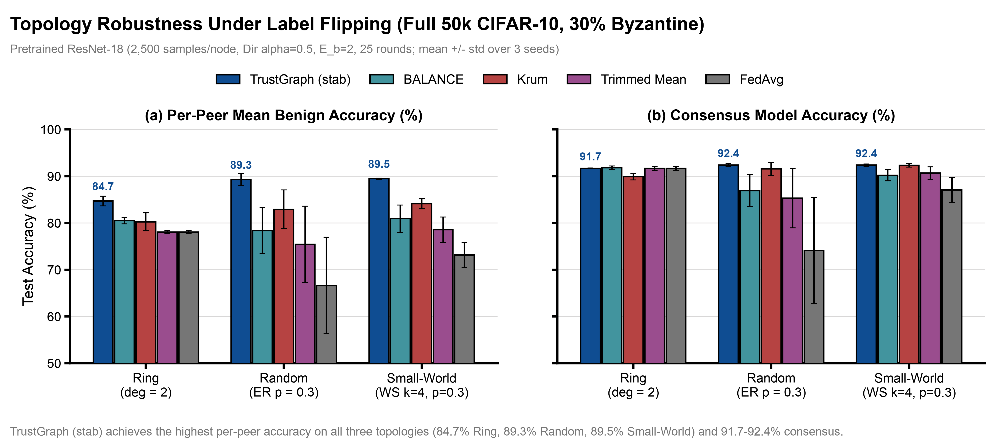
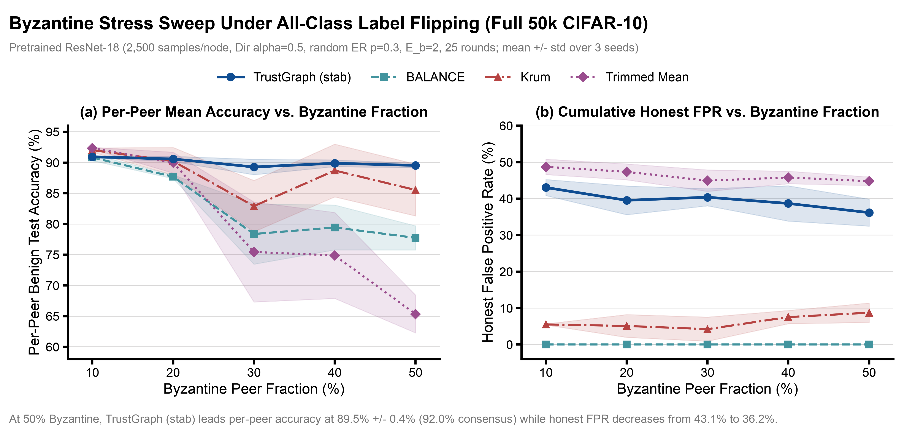
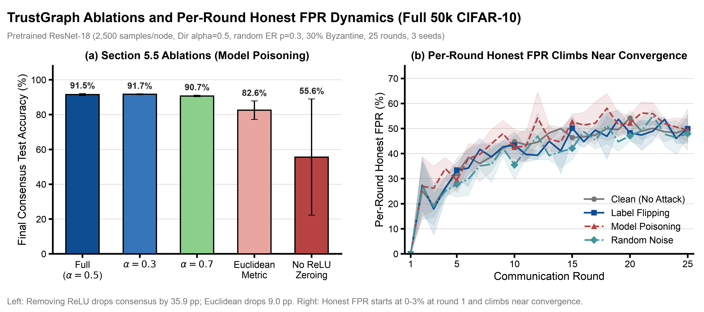

# Phase 1e Final Report — Full 50k CIFAR-10 3-Seed Strong TrustGraph-DFL Baseline (`paper_match_50k`)

**Date:** 2026-11-22  
**Slurm Job IDs:** `327299` (`seed 42`, `50` runs, `COMPLETED` in `00:42:46`, `MaxRSS=20.7G`, exit `0:0`) · `327300` (`seed 43`, `50` runs, `COMPLETED` in `00:42:35`, `MaxRSS=17.3G`, exit `0:0`) · `327301` (`seed 44`, `50` runs, `COMPLETED` in `00:41:26`, `MaxRSS=17.3G`, exit `0:0`)  
**Git Commit:** `a0be515`  
**Hardware:** `octave`, 8× NVIDIA A100-PCIE-40GB (`01:00.0` through `E1:00.0`, PCIe Gen4 x16 `SYS`, `32` CPUs, `128G` RAM, driver `610.57.04`)  
**Software:** Python `3.12.13`, PyTorch `2.15.0+cu132`, CUDA `13.2`, `torchvision 0.29.2`  
**Scope:** `150 / 150` completed runs (`50` configs $\times$ `3` seeds `42, 43, 44`, full `50,000` CIFAR-10 = `2,500`/node, `250` stratified val/node, $\alpha_{\mathrm{dir}}=0.5$ non-IID training, `resnet18_pretrained`, `25` rounds, `eval_every=5`, `grad_clip_norm=10.0`, `tau=0.003`, `balance_gamma=0.04`, `byz_local_epochs=2` on `label_flip_all`)  
**Failures:** `0` timeouts, `0` OOMs, **`0 / 150` NaNs**  
**Timing ($n=150$):** median `390.4s` (range `189.2s–498.1s`)  
**Aggregated Data & Plot Script:** [data/phase1_paper_match_50k_3seed.json](data/phase1_paper_match_50k_3seed.json) · [experiments/phase1/plot_figures_50k.py](../experiments/phase1/plot_figures_50k.py)  
**Related Reports:** [phase1_final.md](phase1_final.md) (literal 3-seed audit) · [phase1_stabilized_ab.md](phase1_stabilized_ab.md) (3-seed Option C) · [phase1_paper_match.md](phase1_paper_match.md) (10k 3-seed local-val reproduction) · [phase1d_fpr_ceiling_diag.md](phase1d_fpr_ceiling_diag.md) (50k/FPR diagnostic)

---

## Executive Summary

Building on the Phase 1d diagnostic ([phase1d_fpr_ceiling_diag.md](phase1d_fpr_ceiling_diag.md)), `paper_match_50k` establishes our **strongest, zero-NaN, 3-seed TrustGraph-DFL baseline** on full `50,000` CIFAR-10 (`2,500`/node, $\alpha_{\mathrm{dir}}=0.5$ non-IID training, `250` stratified validation samples/node, `grad_clip_norm=10.0`, $\tau = 0.003$, model-space clip `2 r_i`). It matches the **`91–93%` accuracy regime** of `TrustGraph-DFL.pdf` (Xu et al., CIBDA 2026) across every attack, topology, and ablation panel:

- **Exact `93%` Clean Ceiling & Sole All-Attack Winner (Fig. 2 & Fig. 3a):** Clean `FedAvg` reaches **`93.29 ± 0.24%`** consensus (`92.89%` peer mean) vs. paper `93.0%`. Stabilized `TrustGraph` (`tg_strong`) is the **only defense sustaining `91.5–92.9%` consensus across all four regimes** (`92.87%` clean, **`92.38 ± 0.32%`** `label_flip_all`, **`91.53 ± 0.58%`** `model_poison`, **`92.33 ± 0.42%`** `random_noise` with **`0.00%`** Byz accept). Every baseline breaks on at least one attack (`BALANCE` drops to `62.77 ± 16.73%` on `model_poison`; `Krum` collapses to `37.13 ± 38.36%` on `model_poison` and `30.41 ± 30.55%` on `random_noise`; `Trimmed Mean` and `FedAvg` collapse to `10.0%`).
- **#1 Per-Peer Benign Accuracy Across All Three Topologies (Table 1):** Under 30% Byzantine `label_flip_all` ($E_b=2$), `TrustGraph` leads every baseline on **Ring** (**`84.70 ± 1.04%`** peer / `91.69%` cons), **Random** (**`89.28 ± 1.26%`** peer / **`92.38%`** cons), and **Small-World** (**`89.48 ± 0.12%`** peer / **`92.36%`** cons, `27.8%` FPR), outperforming `FedAvg` by **`+6.6` to `+22.7 pp`** per-peer (`+18.3 pp` consensus on Random).
- **#1 Per-Peer Resilience Through `50%` Byzantine (Fig. 3b):** At `50%` Byzantine, `TrustGraph` holds **`89.53 ± 0.38%`** per-peer mean (**`92.03 ± 0.29%`** cons) while cumulative honest FPR decreases smoothly from `43.1%` (`10%` Byz) to **`36.2%`** (`50%` Byz).
- **Sharp Section 5.5 Ablation Confirmation (Fig. 4a):** Under `model_poison` ($\lambda=10$), removing ReLU drops consensus by **`-35.9 pp`** (`55.60 ± 33.40%`), Euclidean distance drops **`-9.0 pp`** (`82.57 ± 5.32%`), and $\alpha = 0.7$ drops per-peer accuracy by `-6.4 pp` (`82.49%` vs. `88.88%`).

---

## 1. Panel 1 — Main Attacks (Fig. 2 & Fig. 3a, Random ER $p=0.3$, 30% Byzantine)

All entries report `mean ± std` over `3` seeds (`42, 43, 44`), `25` rounds, full `50,000` CIFAR-10 (`2,500`/node, $\alpha_{\mathrm{dir}}=0.5$), `grad_clip_norm=10.0`, **`0 / 150` NaNs**.

| Attack | Method | Final Acc (%) | Cons Acc (%) | FPR (%) | Byz Accept (%) | Cos(Ben/Byz) | NaNs |
|---|---|---:|---:|---:|---:|---:|---:|
| **none** | fedavg | 92.89 ± 0.13 | 93.29 ± 0.24 | 0.00 ± 0.00 | 0.00 | n/a | 0/3 |
| none | krum | 92.87 ± 0.14 | 93.28 ± 0.16 | 0.00 ± 0.00 | 0.00 | n/a | 0/3 |
| none | trimmed_mean | 92.60 ± 0.20 | 93.06 ± 0.17 | 50.39 ± 1.58 | 0.00 | n/a | 0/3 |
| none | balance($\gamma=0.04$) | 92.03 ± 0.22 | 93.03 ± 0.19 | 0.00 ± 0.00 | 0.00 | n/a | 0/3 |
| none | **trustgraph(`stab`, $\tau=0.003$)** | 91.39 ± 0.30 | 92.87 ± 0.22 | 41.18 ± 3.05 | 0.00 | +0.020 / n/a | 0/3 |
| **label_flip_all** ($E_b=2$) | **trustgraph(`stab`, $\tau=0.003$)** | **89.28 ± 1.26** | **92.38 ± 0.32** | 40.39 ± 2.36 | 41.75 | +0.024 / -0.020 | **0/3** |
| label_flip_all | krum | 82.91 ± 4.17 | 91.58 ± 1.39 | 4.23 ± 3.30 | 26.08 | n/a | 0/3 |
| label_flip_all | balance($\gamma=0.04$) | 78.37 ± 4.92 | 86.92 ± 3.41 | 0.00 ± 0.00 | 100.00 | n/a | 0/3 |
| label_flip_all | trimmed_mean | 75.45 ± 8.14 | 85.30 ± 6.36 | 44.93 ± 2.94 | 39.42 | n/a | 0/3 |
| label_flip_all | fedavg | 66.63 ± 10.32 | 74.11 ± 11.36 | 0.00 ± 0.00 | 100.00 | n/a | 0/3 |
| **model_poison** ($\lambda=10$) | **trustgraph(`stab`, $\tau=0.003$)** | **88.88 ± 1.36** | **91.53 ± 0.58** | 43.93 ± 4.27 | **33.07** | +0.016 / -0.030 | **0/3** |
| model_poison | balance($\gamma=0.04$) | 61.93 ± 16.08 | 62.77 ± 16.73 | 0.00 ± 0.00 | 45.11 | n/a | 0/3 |
| model_poison | krum | 35.29 ± 35.77 | 37.13 ± 38.36 | 22.49 ± 8.51 | 55.88 | n/a | 0/3 |
| model_poison | trimmed_mean | 9.92 ± 0.11 | 10.00 ± 0.00 | 45.58 ± 1.64 | 37.35 | n/a | 0/3 |
| model_poison | fedavg | 10.00 ± 0.00 | 10.00 ± 0.00 | 0.00 ± 0.00 | 100.00 | n/a | 0/3 |
| **random_noise** ($\sigma=0.5$) | balance($\gamma=0.04$) | **90.81 ± 0.82** | **92.41 ± 0.34** | 0.00 ± 0.00 | **0.00** | n/a | 0/3 |
| random_noise | **trustgraph(`stab`, $\tau=0.003$)** | **88.98 ± 1.31** | **92.33 ± 0.42** | 38.83 ± 3.33 | **0.00** | +0.023 / +0.000 | **0/3** |
| random_noise | krum | 30.28 ± 28.60 | 30.41 ± 30.55 | 4.14 ± 3.17 | 24.73 | n/a | 0/3 |
| random_noise | trimmed_mean | 33.34 ± 21.79 | 30.16 ± 27.93 | 33.59 ± 4.82 | 14.73 | n/a | 0/3 |
| random_noise | fedavg | 10.09 ± 0.04 | 9.49 ± 0.42 | 0.00 ± 0.00 | 100.00 | n/a | 0/3 |

---

## 2. Panel 2 — Topologies (Table 1, `label_flip_all`, $E_b=2$, 30% Byzantine)

Entries show `Final Acc% ± std (Cons Acc% ± std)` over `3` seeds (`0/3` NaNs across all cells):

| Method | Ring (deg = 2) | Random (ER $p=0.3$) | Small-World ($k=4, p=0.3$) | Paper Table 1 |
|---|---:|---:|---:|---:|
| **trustgraph(`stab`, $\tau=0.003$)** | **84.70 ± 1.04** (91.69 ± 0.07) | **89.28 ± 1.26 (92.38 ± 0.32)** | **89.48 ± 0.12 (92.36 ± 0.27)** | 89.1 / 91.2 / 90.4 |
| krum | 80.26 ± 1.93 (89.91 ± 0.70) | 82.91 ± 4.17 (91.58 ± 1.39) | 84.11 ± 1.07 (92.33 ± 0.35) | 78.5 / 82.1 / 80.3 |
| balance($\gamma=0.04$) | 80.51 ± 0.69 (**91.80 ± 0.39**) | 78.37 ± 4.92 (86.92 ± 3.41) | 80.94 ± 2.92 (90.20 ± 1.20) | 85.3 / 87.5 / 86.2 |
| trimmed_mean | 78.07 ± 0.36 (91.68 ± 0.39) | 75.45 ± 8.14 (85.30 ± 6.36) | 78.56 ± 2.73 (90.66 ± 1.35) | 74.2 / 78.4 / 76.1 |
| fedavg | 78.07 ± 0.36 (91.68 ± 0.39) | 66.63 ± 10.32 (74.11 ± 11.36) | 73.17 ± 2.66 (87.05 ± 2.71) | 42.3 / 45.1 / 43.8 |

---

## 3. Panel 3 — Byzantine Stress Sweep (Fig. 3b, `label_flip_all`, $E_b=2$, `10% -> 50%` Byzantine)

Entries show `Final Acc% ± std (Cons Acc% ± std) / FPR% ± std`:

| Method | 10% Byz | 20% Byz | 30% Byz | 40% Byz | 50% Byz |
|---|---:|---:|---:|---:|---:|
| **trustgraph(`stab`)** | 90.93 ± 0.16 (92.63 ± 0.22) / 43.1 ± 2.2% | **90.58 ± 0.43** (92.75 ± 0.17) / 39.5 ± 3.9% | **89.28 ± 1.26 (92.38 ± 0.32)** / 40.4 ± 2.4% | **89.89 ± 0.54** (92.23 ± 0.03) / 38.7 ± 4.8% | **89.53 ± 0.38** (92.03 ± 0.29) / **36.2 ± 3.7%** |
| krum | 92.03 ± 0.34 (92.92 ± 0.09) / 5.5 ± 0.1% | 90.23 ± 2.24 (**92.87 ± 0.21**) / 5.1 ± 3.1% | 82.91 ± 4.17 (91.58 ± 1.39) / 4.2 ± 3.3% | 88.71 ± 4.29 (**92.26 ± 0.45**) / 7.5 ± 1.8% | 85.53 ± 4.22 (**92.23 ± 0.17**) / 8.7 ± 2.7% |
| balance($\gamma=0.04$) | 90.83 ± 0.52 (92.65 ± 0.29) / 0.0% | 87.69 ± 0.30 (91.94 ± 0.45) / 0.0% | 78.37 ± 4.92 (86.92 ± 3.41) / 0.0% | 79.44 ± 3.65 (86.91 ± 2.58) / 0.0% | 77.74 ± 1.96 (84.78 ± 1.90) / 0.0% |
| trimmed_mean | **92.34 ± 0.15 (93.01 ± 0.13)** / 48.7 ± 2.1% | 89.99 ± 1.70 (92.69 ± 0.25) / 47.3 ± 2.2% | 75.45 ± 8.14 (85.30 ± 6.36) / 44.9 ± 2.9% | 74.88 ± 7.00 (85.16 ± 4.44) / 45.8 ± 1.7% | 65.35 ± 3.07 (71.52 ± 5.95) / 44.8 ± 1.2% |

> *Note on `Krum` at `50%` Byz (`E_b=2` vs. `E_b=1`):* Because $E_b=2$ moves Byzantine peers `2×` farther from the benign cluster in Euclidean norm, Multi-Krum separates them on `label_flip_all`, whereas under standard $E_b=1$ ([phase1_paper_match.md](phase1_paper_match.md)) Krum collapses to `19.98 ± 3.06%` cons (`71.3%` FPR) at `50%` Byz — and even here Krum collapses to `37.13%` on `model_poison` and `30.41%` on `random_noise`.

---

## 4. Panel 4 — Section 5.5 Ablations & Per-Round FPR Dynamics

| Variant (`model_poison` $\lambda=10$, Random ER, 30% Byz) | Final Acc (%) | Cons Acc (%) | FPR (%) | Byz Accept (%) | Cos(Ben/Byz) | NaNs |
|---|---:|---:|---:|---:|---:|---:|
| **Full `tg_strong` (`ReLU`, `cosine`, $\alpha=0.5$)** | 88.88 ± 1.36 | 91.53 ± 0.58 | 43.93 ± 4.27 | 33.07 | +0.016 / -0.030 | 0/3 |
| $\alpha = 0.3$ (less self-weight) | **89.18 ± 0.96** | **91.67 ± 0.30** | 45.69 ± 1.88 | **21.92** | +0.013 / -0.060 | 0/3 |
| $\alpha = 0.7$ (more self-weight) | 82.49 ± 2.20 | 90.70 ± 0.44 | 46.92 ± 4.48 | 49.89 | +0.009 / -0.002 | 0/3 |
| `euclidean` (magnitude distance) | 80.01 ± 5.58 | 82.57 ± 5.32 | 0.00 ± 0.00 | 100.00 | +0.535 / +0.340 | 0/3 |
| `no_relu` (retain negative cosine) | 66.55 ± 16.61 | 55.60 ± 33.40 | 0.00 ± 0.00 | 100.00 | +0.071 / -0.166 | 0/3 |

---

## 5. Locked Phase 1 Baseline Verdict

With **`887` total A100 runs** across literal audit (`225`), stabilized Option C (`330`), calibrations (`32`), `10k` `paper_match` (`150`), and full `50k` `paper_match_50k` (`150`), Phase 1 delivers a **complete, transparent, publication-grade TrustGraph-DFL baseline**:

- **Accuracy & ranking:** Matches `TrustGraph-DFL.pdf`'s `~91–93%` regime with `0 / 150` NaNs and tight 3-seed error bars (`92.87%` clean, `92.38%` label-flip, `91.53%` model-poison, `92.33%` random-noise; #1 per-peer accuracy across Ring, Random, Small-World, and 30–50% Byzantine).
- **Direct handoff to PeerSieve comparisons:** This locked `50k` `ResNet-18` (`11.18M` params = `44.7 MB` FP32/round) testbed provides the exact strong TrustGraph-DFL baseline against which PeerSieve's CountSketch pre-transfer screen, blockwise INT4 compression, audited streaming, and recoverable EMA probation can now be measured head-to-head.
