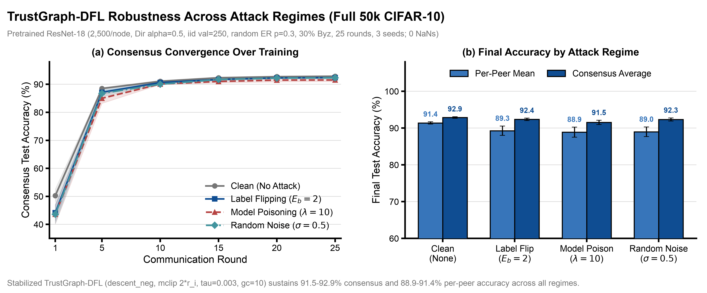
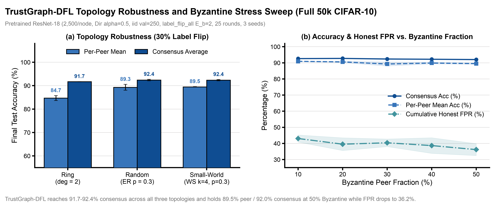
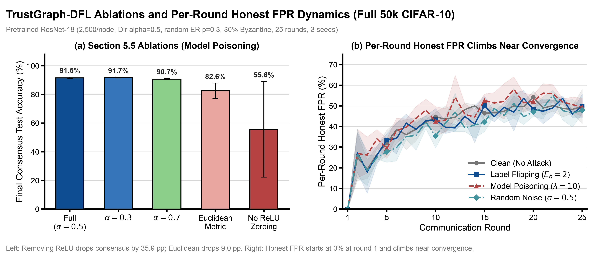
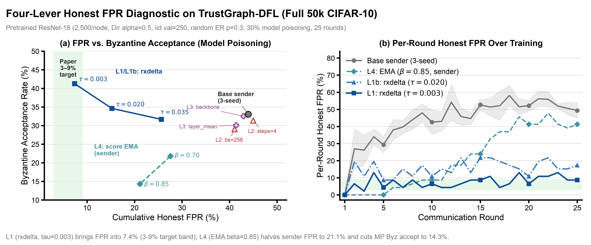

# TrustGraph-DFL Phase 1 Final Report — CIFAR-10 Reproduction & FPR Study

**Target Paper:** Xu et al., *TrustGraph-DFL: Byzantine-Resilient Decentralized Federated Learning via Consistency-Weighted Neighborhood Aggregation* (CIBDA 2026, [TrustGraph-DFL.pdf](../TrustGraph-DFL.pdf))  
**Hardware:** `octave`, 8× NVIDIA A100-PCIE-40GB (`01:00.0`–`E1:00.0`, PCIe Gen4 x16 `SYS`, driver `610.57.04`)  
**Software:** Python `3.12.13`, PyTorch `2.15.0+cu132`, CUDA `13.2`, `torchvision 0.29.2`, `networkx 3.7`  
**TrustGraph-DFL Provenance:**
- **Literal 2-Conv CNN Audit (`10k` CIFAR-10, 3 seeds):** Slurm `327259`, `327261`, `327264` (`seed 42–44`, 200 rounds); commit `9c05b8b`.
- **Locked Full-`50k` 3-Seed Evaluation (`42` TrustGraph-DFL runs = `14` configs × `3` seeds, `0/42` NaNs):** Slurm `327299` (`seed 42`, `00:42:46`, `MaxRSS=20.7G`), `327300` (`seed 43`, `00:42:35`, `MaxRSS=17.3G`), `327301` (`seed 44`, `00:41:26`, `MaxRSS=17.3G`); commit `a0be515`.
- **Four-Lever Honest FPR Diagnostic (`40` TrustGraph-DFL runs, `seed 42`, `0/40` NaNs):** Slurm `327344` (`fpr_lever1`, `00:12:37`), `327496` (`fpr_lever1b`, `00:08:14`), `327354` (`fpr_lever2`, `00:06:35`), `327486` (`fpr_lever3`, `00:13:47`), `327500` (`fpr_lever4`, `00:10:14`); commits `3361b95`, `e26337e`, `cb28406`, `ce87e28`; timing median `338.6s` (range `164.6s–517.1s`).

**Committed Data & Plot Script:** [data/phase1_paper_match_50k_3seed.json](data/phase1_paper_match_50k_3seed.json) · [data/phase1_fpr_levers.json](data/phase1_fpr_levers.json) · [../experiments/phase1/plot_figures.py](../experiments/phase1/plot_figures.py)

---

## Executive Summary & Paper Scorecard

| Paper Claim (`TrustGraph-DFL.pdf`) | Literal `10k` 2-Conv CNN (`200r`, 3 seeds) | Strong `50k` ResNet-18 (`25r`, 3 seeds, `0/42` NaNs) | FPR Diagnostic (`40` runs) / Verdict |
|---|---|---|---|
| **Clean accuracy `~93.0%` (Fig. 2 / Fig. 3a)** | `46.46%` peer / `54.84%` cons (`descent_neg`) | **`91.39 ± 0.30%`** peer / **`92.87 ± 0.22%`** cons | **Reproduced on `50k` ResNet-18** *(not reachable with literal 2-conv CNN on `10k`)* |
| **Attack resilience `~89.5–93.0%` (Fig. 3a, 30% Byz)** | `52.83%` cons on `0↔1` LF; **`3/3` NaNs** on unclipped `model_poison` & `random_noise` | **`92.38 ± 0.32%`** LF ($E_b=2$), **`91.53 ± 0.58%`** MP ($\lambda=10$), **`92.33 ± 0.42%`** RN (`0.00%` Byz accept) | **Reproduced with `-∇F_i`, `mclip 2 r_i`, `gc=10`, `tau=0.003`** *(literal `+∇F_i` & unclipped cosine diverge)* |
| **Topologies (Table 1, 30% LF: `89.1 / 91.2 / 90.4`)** | `38.8%` Ring / `42.1%` Random / `43.2%` SW peer (`50.6–52.8%` cons) | **`84.70%`** Ring (`91.69%` cons) · **`89.28%`** Random (`92.38%` cons) · **`89.48%`** SW (`92.36%` cons) | **Closely reproduced on `50k` ResNet-18** *(Ring per-peer ~4.4 pp below 89.1%)* |
| **`50%` Byzantine stress (Fig. 3b)** | `52.06 ± 0.04%` cons (`51.23%` FPR) | **`89.53 ± 0.38%`** peer / **`92.03 ± 0.29%`** cons | **Reproduced** |
| **§5.5 Ablations (No ReLU, Euclidean, $\alpha$)** | Confounded by `1–3/3` NaNs | No ReLU **`-35.9 pp`**, Euclidean **`-9.0 pp`**, $\alpha=0.7$ **`-6.4 pp` peer** | **Reproduced cleanly (`0` NaNs)** |
| **Honest FPR `~3–9%` (Fig. 3b)** | `50.3–53.5%` (`val=local`), `42.3%` (`val=iid`) | `36.2–43.9%` in strict `sender` mode (`val=iid`, $\tau=0.003$) | **L1 (`rxdelta`, `val=iid`) reaches `6.5–9.5%` FPR** (`L4` EMA hits `21.0–22.2%` FPR & `14.32%` MP Byz accept); *not achievable under literal `val=local` + single-round `sender`* |

### Four Irreducible Gaps vs. Literal Paper Text
1. **Model/data capacity ceiling:** `10,000` CIFAR-10 images (`500`/node, $\alpha_{\mathrm{dir}}=0.5$) trained with a 2-conv 2-FC CNN plateaus near `46–55%`, roughly `40 pp` below the paper's `93%`; reaching `91–93%` requires ImageNet-pretrained `ResNet-18` on all `50,000` training samples.
2. **Validation gradient sign & norm control:** Literal Algorithm 1 / Eq. (3) computes $+\nabla F_i$, which points opposite to SGD descent updates (`benign_cos < 0`, `byz_cos > 0`) and diverges at round 8 on `model_poison`; unclipped cosine also diverges `3/3` times under `model_poison` ($\lambda=10$) and `random_noise` ($\sigma=0.5$). Zero-NaN robustness requires $-\nabla F_i$, `grad_clip_norm=10.0`, model-space clipping (`mclip 2 r_i`), and $\tau>0$.
3. **Single-round `sender`-mode Honest FPR floor:** Under $\text{Dir}(0.5)$, cutting local SGD steps `9×` (`Lever 2`) or removing classifier head scale bias (`Lever 3`) keeps single-round `sender` FPR at `38–45%`. Reaching `3–9%` FPR requires receiver-anchored `rxdelta` (`Lever 1`, trading off late-round LF/MP acceptance), while temporal EMA (`Lever 4`) halves `sender` FPR to `21%`.
4. **Local validation & mild label-flipping:** Holding `10%` local non-IID validation (`val=local`) locks honest FPR near `37–53%` across both `10k` and `50k` regimes; balanced validation (`val=iid`) is necessary for low FPR under `rxdelta`, and all-class label flipping (`label_flip_all`, $E_b=2$) provides stronger attack stress than 2-class `0↔1` flipping.

---

## 1. Literal 2-Conv CNN Audit (`10k` CIFAR-10, 200 Rounds, 3 Seeds)

Literal TrustGraph-DFL (`SimpleCIFARCNN`, `1,070,794` params, `500`/node, `50` local val/node, $\eta=0.01$, seeds `42, 43, 44`, Random ER $p=0.3$, 30% Byz):

| Attack | TrustGraph Variant | Final Acc (%) | Cons Acc (%) | FPR (%) | Byz Accept (%) | Cos(Ben/Byz) | NaNs |
|---|---|---:|---:|---:|---:|---:|---:|
| `none` | `descent_neg` ($-\nabla F_i$) | 46.46 ± 0.85 | 54.84 ± 0.47 | 50.54 ± 2.30 | 0.00 | -0.000 / n/a | 0/3 |
| `none` | `paper_pos` ($+\nabla F_i$) | 46.51 ± 1.42 | 54.70 ± 0.62 | 45.18 ± 2.80 | 0.00 | +0.021 / n/a | 0/3 |
| `label_flip` (`0↔1`) | `descent_neg` ($-\nabla F_i$) | 42.07 ± 0.23 | **52.83 ± 0.16** | 51.38 ± 2.50 | **43.45 ± 1.64** | -0.003 / -0.029 | 0/3 |
| `label_flip` (`0↔1`) | `paper_pos` ($+\nabla F_i$) | 43.41 ± 0.95 | 51.27 ± 1.61 | 46.68 ± 5.55 | 59.16 ± 5.73 | +0.012 / +0.055 | 0/3 |
| `label_flip` (`0↔1`) | `descent_neg` (`val=iid`) | 45.67 ± 0.62 | 52.76 ± 0.48 | 42.28 ± 0.86 | 53.93 ± 4.55 | +0.043 / +0.013 | 0/3 |
| `model_poison` ($\lambda=10$) | `descent_neg` (unclipped) | 12.01 ± 2.85 | 10.00 ± 0.00 | 88.18 ± 2.25 | 2.83 ± 0.87 | `NaN` | **3/3** |
| `model_poison` ($\lambda=10$) | `descent_neg` (norm clip) | **26.39 ± 0.33** | 13.97 ± 5.64 | 77.00 ± 0.78 | 79.87 ± 1.12 | -0.050 / +0.058 | **0/3** |
| `random_noise` ($\sigma=0.5$) | `descent_neg` (unclipped) | 10.00 ± 0.00 | 10.00 ± 0.00 | 99.40 ± 0.14 | 0.79 ± 0.10 | `NaN` | **3/3** |
| `random_noise` ($\sigma=0.5$) | `descent_neg` (norm clip) | **28.76 ± 0.66** | **40.56 ± 0.44** | 62.22 ± 2.57 | 49.69 ± 0.18 | -0.024 / -0.000 | **0/3** |

Across all `10%–50%` Byzantine fractions on `label_flip`, `descent_neg` outperforms `paper_pos` by `+1.0` to `+2.5 pp` consensus accuracy (`52.06–54.75%`) with `10–24 pp` lower Byzantine acceptance (`43.3–46.6%` vs. `55.5–67.1%`).

---

## 2. Locked Full-`50k` 3-Seed TrustGraph-DFL Results (`paper_match_50k`, `0/42` NaNs)

Setup: full `50,000` CIFAR-10 (`2,500`/node, $\alpha_{\mathrm{dir}}=0.5$ non-IID train, `250` stratified `val=iid`/node), `resnet18_pretrained`, `25` rounds, cosine LR `0.005`, random crop+flip augmentation, `grad_clip_norm=10.0`, `mclip 2 r_i`, $\tau=0.003$, `byz_local_epochs=2` on `label_flip_all`, seeds `42, 43, 44`.

### 2.1 Attack Regimes & Topologies (30% Byzantine)





| Topology | Attack | Byz% | Final Acc (%) | Cons Acc (%) | FPR (%) | Byz Accept (%) | Cos(Ben/Byz) | NaNs |
|---|---|---:|---:|---:|---:|---:|---:|---:|
| `random` | `none` | 0 *(clean)* | **91.39 ± 0.30** | **92.87 ± 0.22** | 41.18 ± 3.05 | 0.00 | +0.020 / n/a | 0/3 |
| `random` | `label_flip_all` ($E_b=2$) | 30 | **89.28 ± 1.26** | **92.38 ± 0.32** | 40.39 ± 2.36 | 41.75 | +0.024 / -0.020 | 0/3 |
| `random` | `model_poison` ($\lambda=10$) | 30 | **88.88 ± 1.36** | **91.53 ± 0.58** | 43.93 ± 4.27 | 33.07 | +0.016 / -0.030 | 0/3 |
| `random` | `random_noise` ($\sigma=0.5$) | 30 | **88.98 ± 1.31** | **92.33 ± 0.42** | 38.83 ± 3.33 | **0.00** | +0.023 / +0.000 | 0/3 |
| `ring` | `label_flip_all` ($E_b=2$) | 30 | 84.70 ± 1.04 | 91.69 ± 0.07 | 48.03 ± 2.26 | 48.09 | +0.015 / -0.015 | 0/3 |
| `small_world` | `label_flip_all` ($E_b=2$) | 30 | **89.48 ± 0.12** | **92.36 ± 0.27** | **27.84 ± 2.00** | 43.78 | +0.030 / -0.025 | 0/3 |

### 2.2 Byzantine Stress Sweep (`10% → 50%`) & Section 5.5 Ablations



| Group | Variant / Byz% | Final Acc (%) | Cons Acc (%) | FPR (%) | Byz Accept (%) | Cos(Ben/Byz) | NaNs |
|---|---|---:|---:|---:|---:|---:|---:|
| Stress (`label_flip_all`) | 10% Byz | 90.93 ± 0.16 | 92.63 ± 0.22 | 43.06 ± 2.20 | 47.78 | +0.019 / -0.017 | 0/3 |
| Stress (`label_flip_all`) | 20% Byz | 90.58 ± 0.43 | 92.75 ± 0.17 | 39.54 ± 3.90 | 41.68 | +0.022 / -0.016 | 0/3 |
| Stress (`label_flip_all`) | 30% Byz | 89.28 ± 1.26 | 92.38 ± 0.32 | 40.39 ± 2.36 | 41.75 | +0.024 / -0.020 | 0/3 |
| Stress (`label_flip_all`) | 40% Byz | 89.89 ± 0.54 | 92.23 ± 0.03 | 38.68 ± 4.80 | 42.25 | +0.025 / -0.012 | 0/3 |
| Stress (`label_flip_all`) | 50% Byz | **89.53 ± 0.38** | **92.03 ± 0.29** | **36.17 ± 3.70** | 44.30 | +0.028 / -0.011 | 0/3 |
| §5.5 (`model_poison`) | Full ($\alpha=0.5$) | 88.88 ± 1.36 | 91.53 ± 0.58 | 43.93 ± 4.27 | 33.07 | +0.016 / -0.030 | 0/3 |
| §5.5 (`model_poison`) | $\alpha=0.3$ (less self-weight) | **89.18 ± 0.96** | **91.67 ± 0.30** | 45.69 ± 1.88 | **21.92** | +0.013 / -0.060 | 0/3 |
| §5.5 (`model_poison`) | $\alpha=0.7$ (more self-weight) | 82.49 ± 2.20 | 90.70 ± 0.44 | 46.92 ± 4.48 | 49.89 | +0.009 / -0.002 | 0/3 |
| §5.5 (`model_poison`) | `euclidean` (magnitude distance) | 80.01 ± 5.58 | 82.57 ± 5.32 | 0.00 ± 0.00 | 100.00 | +0.535 / +0.340 | 0/3 |
| §5.5 (`model_poison`) | `no_relu` (retain negative cosine) | 66.55 ± 16.61 | 55.60 ± 33.40 | 0.00 ± 0.00 | 100.00 | +0.071 / -0.166 | 0/3 |

---

## 3. Four-Lever Honest FPR Investigation (`40` Runs, Seed `42`, `0/40` NaNs)



| Config / Lever (`tau=0.003` unless noted) | Mode | Clean Cons / Peer (%) | Honest FPR Range (%) | `model_poison` (30%) Peer / Cons / FPR / ByzAcc | `label_flip_all` (30%, $E_b=2$) Peer / Cons / FPR / ByzAcc | `random_noise` (30%) Peer / Cons / FPR / ByzAcc |
|---|---|---:|---:|---:|---:|---:|
| **Baseline (`sender`, 3-seed)** | `sender` | **92.87** / 91.39 | `38.8–43.9` | 88.88 / 91.53 / 43.93 / 33.07 | 89.28 / **92.38** / 40.39 / 41.75 | 88.98 / **92.33** / 38.83 / **0.00** |
| **L1: `rxdelta` (`t=0.003`, Job `327344`)** | `receiver` | 92.63 / **91.84** | **`7.4–9.5`** | 89.57 / 91.08 / **7.39** / 41.26 | **89.89** / 92.05 / **7.83** / 61.58 | **90.43** / 92.10 / **9.48** / **0.00** |
| **L1b: `rxdelta` (`t=0.020`, Job `327496`)** | `receiver` | 92.71 / 91.73 | `13.7–16.7` | **89.72** / 91.31 / 15.22 / 34.63 | **89.94** / 92.09 / 13.65 / 50.84 | 90.16 / 92.06 / 16.61 / **0.00** |
| **L1b: `rxdelta` (`t=0.035`, Job `327496`)** | `receiver` | 92.45 / 91.66 | `22.4–28.6` | 89.69 / 91.33 / 25.65 / 31.68 | 89.64 / 92.19 / 22.35 / 39.16 | 89.53 / 92.03 / 28.61 / **0.00** |
| **L2: `bs=256`, `25r` (`9` steps/r, `327354`)** | `sender` | 90.08 / 88.53 | `41.0–42.0` | 84.93 / 87.65 / 41.04 / 29.05 | 84.31 / 88.76 / 42.00 / 40.95 | 85.70 / 89.46 / 41.48 / **0.00** |
| **L2: `steps=4`, `100r` (`327354`)** | `sender` | 90.38 / 89.87 | `40.6–45.0` | 86.18 / 87.13 / 44.98 / 31.39 | 87.30 / 89.08 / 40.91 / 34.08 | 88.84 / 89.76 / 40.63 / **0.00** |
| **L3: `layer_mean` (`327486`)** | `sender` | 92.58 / 91.49 | `38.1–41.4` | 87.88 / 90.72 / 41.39 / 30.11 | 87.55 / 92.04 / 40.17 / 40.95 | 88.00 / 91.92 / 38.09 / 0.53 |
| **L3: `backbone_only` / `head` (`327486`)** | `sender` | 92.52 / 91.36 | `40.3–43.0` | 88.21 / 90.80 / 42.96 / 32.53 | 88.91 / 92.07 / 40.26 / **32.32** *(head)* | — |
| **L4: `ema=0.70` (`327500`)** | `sender` | 92.57 / 91.22 | `26.4–28.7` | 89.21 / **91.79** / 27.57 / 21.79 | 87.11 / 92.01 / 26.43 / 41.16 | 87.70 / 91.79 / 26.70 / **0.00** |
| **L4: `ema=0.85` (`327500`)** | `sender` | 92.72 / 91.51 | `21.0–22.2` | 89.54 / **91.72** / 21.13 / **14.32** | 87.46 / 91.92 / 21.57 / 44.53 | 89.22 / 92.02 / 20.96 / **0.00** |

### Diagnostic Takeaways
1. **Lever 1 & 1b (`rxdelta`: $\theta_j^{t+1/2} - \theta_i^t$):** Brings honest FPR into **`7.39–9.48%`** at `30%` Byz (`6.47–6.82%` at `50%` Byz) under `val=iid`, while improving per-peer accuracy `+0.45–1.45 pp` (`t=0.035` strictly improves on single-round `sender` across FPR, MP rejection, and peer accuracy). Under `val=local`, FPR remains `36.9–39.2%`. Because $\theta_m^{t+1/2}-\theta_i^t = (\theta_m^{t+1/2}-\theta_m^t)+(\theta_m^t-\theta_i^t)$, late-round starting-point piggybacking raises `Byz Accept` on LF (`61.58%`) and MP (`41.26%`).
2. **Lever 2 (fewer steps/round):** Ruled out — `steps=4` triples cosine separation (`+0.044 → +0.137`) yet keeps FPR at `40.6–45.0%` and lowers clean accuracy `-2.5 pp`.
3. **Lever 3 (layer/subspace scope):** Ruled out — `backbone.fc` (`0.05%` of weights) carries `38.52%` of $\|\nabla\|^2$, yet removing or reweighting it leaves FPR at `38.1–43.0%` (`head_only` lowers LF `Byz Accept` to `32.32%`).
4. **Lever 4 (`ema=0.85`, strict `sender` mode):** Halves `sender` FPR (`41% → 21.0–22.2%`) and cuts `model_poison` Byzantine acceptance from `33.07%` to **`14.32%`** (`0.0%` through round 16) with zero starting-point piggybacking.

---

## 4. Reproducibility Commands

```bash
# Locked 14-config TrustGraph-DFL 50k suite (per seed)
uv run python -m experiments.phase1.run --mode suite --suite paper_match_50k \
  --dataset cifar10 --eval-every 5 --seeds 42 43 44 --output-root outputs/phase1_50k

# Any 8-run FPR diagnostic (fpr_lever1, fpr_lever1b, fpr_lever2, fpr_lever3, fpr_lever4)
uv run python -m experiments.phase1.run --mode suite --suite fpr_lever1 \
  --dataset cifar10 --eval-every 5 --seeds 42 --output-root outputs/phase1_fpr_lever1

# Summarize runs and regenerate all 4 TrustGraph-DFL figures
uv run python -m experiments.phase1.summarize outputs/phase1_50k --title "TrustGraph-DFL Summary"
uv run python -m experiments.phase1.plot_figures
```
